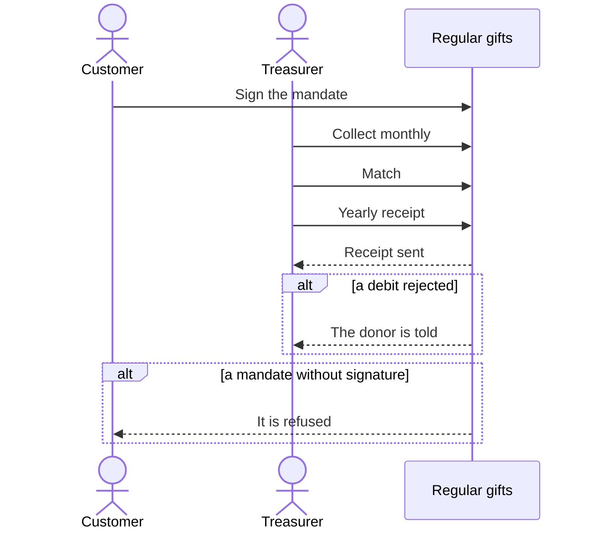

🏠 [Specs](../../../../README.md) › 🏷️ [Sectors](../../../README.md) › 🤲 [SC08 Non-profit association](../../README.md) ›
📝 [Use cases](../README.md) › 📝 [Use cases: FL-SC08-02 Donations and receipts](README.md) ›
📝 UC-SC08-07 Manage regular donors

# 📝 UC-SC08-07 Manage regular donors

**Status:** ✅ specified

## Summary

A donor signs a direct debit mandate; the treasurer collects the gift monthly and sends one receipt a year.

## Personas

- [U31 Treasurer](../../../../01-users/personas/u31-treasurer.md)
- [U09 Customer](../../../../01-users/personas/u09-customer.md)

## Goal

Regular income from loyal donors.

## Trigger

A donor chooses a regular gift.

## Frequency

Monthly collection.

## Preconditions

- The SC08 sector pack is installed for the company,
  [UC-F14-02](../../../../02-functional/f14-plugin-store/use-cases/01-find-and-install/uc-f14-02-install-a-plugin-or-sector-pack.md),
  and its users have their roles,
  [UC-F1-06](../../../../02-functional/f01-administration/use-cases/04-edit-a-role/uc-f01-06-edit-a-role-and-its-record-rules.md).

## Postconditions

- **Success:** gifts are collected monthly.
- **Failed:** the mandate is suspended.

## Main flow

1. The donor signs the mandate on
   [S-SC08-07 Regular gifts](../../screens/02-donations-and-receipts/s-sc08-07-regular-gifts.md)
   ([BR-SC08-12](../../business-rules/br-sc08-12-regular-gifts-by-mandate.md)).
2. The treasurer sends the monthly debits,
   [UC-F8-05](../../../../02-functional/f08-accounting/use-cases/03-bank-and-collect/uc-f08-05-collect-customer-payments.md).
3. Debits are matched to gifts.
4. One receipt covers the year ([UC-SC08-06](uc-sc08-06-issue-tax-receipts-for-gifts.md)).

## Alternative flows

- 2a. A change of amount: the next debit uses the new amount.

## Error flows

- 2e. A debit rejected: the donor is told.
- 1e. A mandate without signature: it is refused.
- Any step: a call to a service or an outside system fails: it is retried first
  ([BR-F3-32](../../../../02-functional/f03-assistant/business-rules/br-f03-32-retry-before-an-error.md)), then the
  error message pattern ([D122](../../../../06-decisions/ux/d122-error-message-standard.md)) says what failed; what was
  typed is kept.

## Business rules

- [BR-SC08-12 Regular gifts by mandate](../../business-rules/br-sc08-12-regular-gifts-by-mandate.md)

## Entities

- [E-SC08-04 Gift](../../data/e-sc08-04-gift.md)
- [E-SC08-07 Debit mandate](../../data/e-sc08-07-debit-mandate.md)

## Permissions

The treasurer and customer roles; the record rules of their role and site apply,
[UC-F1-06](../../../../02-functional/f01-administration/use-cases/04-edit-a-role/uc-f01-06-edit-a-role-and-its-record-rules.md).

## Notifications

None beyond the in-app updates of the records concerned.

## Audit events

Every creation, change and state change of gift, debit mandate records, with who, when and the values before and after
(T3).

## AI involvement

The AI assistant answers questions on the gift, debit mandate records of this use case, with links, and prepares them as
drafts the user confirms. It works within the user's rights,
[BR-F3-34](../../../../02-functional/f03-assistant/business-rules/br-f03-34-every-capability-is-reachable-from-the-assistant.md),
and never deletes or does anything irreversible without the user's confirmation,
[BR-F3-07](../../../../02-functional/f03-assistant/business-rules/br-f03-07-no-deletes-no-irreversible-acts.md).

## API, MCP and A2A exposure

Through the API and webhooks (T5) and the MCP and A2A gateway (T6), with the caller's rights,
[BR-F3-34](../../../../02-functional/f03-assistant/business-rules/br-f03-34-every-capability-is-reachable-from-the-assistant.md),
reading, creating and changing the records of this use case; nothing irreversible without a person's confirmation.

## Screens

- [S-SC08-07 Regular gifts](../../screens/02-donations-and-receipts/s-sc08-07-regular-gifts.md)

## Flowchart

See [FL-SC08-02 Donations and receipts](../../flows/fl-sc08-02-donations-and-receipts.md#flowchart).

## Sequence diagram

## Acceptance criteria

1. **Given** the example association's mandate M-77 at 15 EUR a month **when** 12 debits pass in 2026 **then** the
   yearly receipt is 180 EUR.
2. **Given** J. Martin's 15 EUR debit rejected **when** the bank returns it **then** the donor is told.

## Non-functional notes

[D408](../../../../06-decisions/technical/d408-performance-and-profiles.md)'s targets
([performance](../../../../05-non-functional/performance.md)): 95 % of screens within 1 second; lists paged on the
server, the first page within 1 second; reports within 5 seconds or in the background. WCAG 2.2 AA and RGAA
([D46](../../../../06-decisions/ux/d46-accessibility-standard.md)).

## Regulatory references

Legal values from the France country pack:
[CR-FR-023 SEPA payment formats](../../../../10-country-packs/france/payments/cr-fr-023-sepa-formats.md).

## Related use cases

- [UC-SC08-06 Issue tax receipts for gifts](uc-sc08-06-issue-tax-receipts-for-gifts.md)

## Open questions

None.

---

⬅️ [UC-SC08-06 Issue tax receipts for gifts](uc-sc08-06-issue-tax-receipts-for-gifts.md) · ⬆️ [Up](README.md) ·
➡️ [UC-SC08-08](../03-grants/uc-sc08-08-apply-for-grants-and-follow-their-conditions.md)
