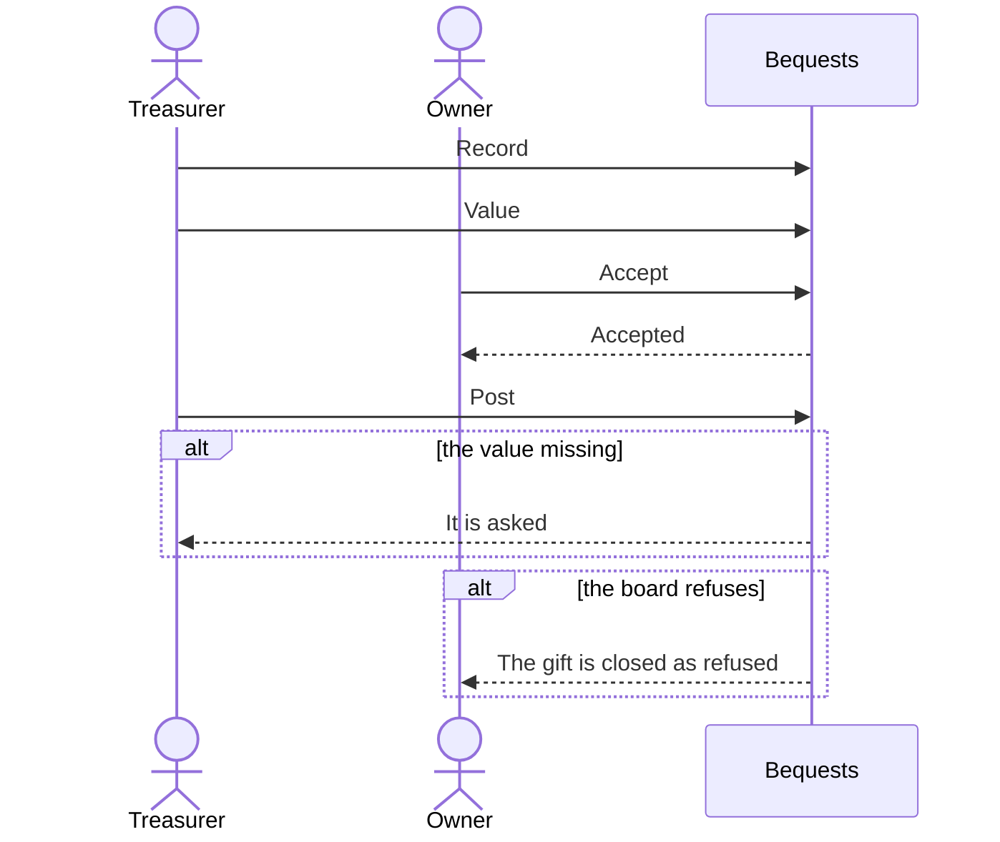

🏠 [Specs](../../../../README.md) › 🏷️ [Sectors](../../../README.md) › 🤲 [SC08 Non-profit association](../../README.md) ›
📝 [Use cases](../README.md) › 📝 [Use cases: FL-SC08-02 Donations and receipts](README.md) ›
📝 UC-SC08-16 Manage bequests and gifts in kind

# 📝 UC-SC08-16 Manage bequests and gifts in kind

**Status:** ✅ specified

## Summary

The treasurer records bequests and gifts in kind with their value; the board accepts them when the statutes require.

## Personas

- [U31 Treasurer](../../../../01-users/personas/u31-treasurer.md)
- [U13 Owner](../../../../01-users/personas/u13-owner.md)

## Goal

Bequests and gifts in kind valued and accepted.

## Trigger

A bequest or a gift in kind.

## Frequency

A few a year.

## Preconditions

- The SC08 sector pack is installed for the company,
  [UC-F14-02](../../../../02-functional/f14-plugin-store/use-cases/01-find-and-install/uc-f14-02-install-a-plugin-or-sector-pack.md),
  and its users have their roles,
  [UC-F1-06](../../../../02-functional/f01-administration/use-cases/04-edit-a-role/uc-f01-06-edit-a-role-and-its-record-rules.md).

## Postconditions

- **Success:** the gift is accepted and recorded.
- **Failed:** the gift is refused.

## Main flow

1. The treasurer records the gift on
   [S-SC08-16 Bequests](../../screens/02-donations-and-receipts/s-sc08-16-bequests.md).
2. The treasurer records its value with a valuation.
3. The board accepts it, [UC-SC08-03](../01-members-and-governance/uc-sc08-03-run-the-board-and-its-decisions.md),
   [BR-SC08-15](../../business-rules/br-sc08-15-gifts-in-kind-valued.md).
4. It is posted,
   [UC-F8-23](../../../../02-functional/f08-accounting/use-cases/07-client-money-grants-and-non-profits/uc-f08-23-keep-non-profit-accounts.md).

## Alternative flows

- 3a. A bequest with conditions: the conditions are recorded and followed as a dedicated fund.

## Error flows

- 2e. The value missing: it is asked.
- 3e. The board refuses: the gift is closed as refused.
- Any step: a call to a service or an outside system fails: it is retried first
  ([BR-F3-32](../../../../02-functional/f03-assistant/business-rules/br-f03-32-retry-before-an-error.md)), then the
  error message pattern ([D122](../../../../06-decisions/ux/d122-error-message-standard.md)) says what failed; what was
  typed is kept.

## Business rules

- [BR-SC08-15 Gifts in kind valued](../../business-rules/br-sc08-15-gifts-in-kind-valued.md)

## Entities

- [E-SC08-15 Gift in kind](../../data/e-sc08-15-gift-in-kind.md)

## Permissions

The treasurer and owner roles; the record rules of their role and site apply,
[UC-F1-06](../../../../02-functional/f01-administration/use-cases/04-edit-a-role/uc-f01-06-edit-a-role-and-its-record-rules.md).

## Notifications

None beyond the in-app updates of the records concerned.

## Audit events

Every creation, change and state change of gift in kind records, with who, when and the values before and after (T3).

## AI involvement

The AI assistant answers questions on the gift in kind records of this use case, with links, and prepares them as drafts
the user confirms. It works within the user's rights,
[BR-F3-34](../../../../02-functional/f03-assistant/business-rules/br-f03-34-every-capability-is-reachable-from-the-assistant.md),
and never deletes or does anything irreversible without the user's confirmation,
[BR-F3-07](../../../../02-functional/f03-assistant/business-rules/br-f03-07-no-deletes-no-irreversible-acts.md).

## API, MCP and A2A exposure

Through the API and webhooks (T5) and the MCP and A2A gateway (T6), with the caller's rights,
[BR-F3-34](../../../../02-functional/f03-assistant/business-rules/br-f03-34-every-capability-is-reachable-from-the-assistant.md),
reading, creating and changing the records of this use case; nothing irreversible without a person's confirmation.

## Screens

- [S-SC08-16 Bequests](../../screens/02-donations-and-receipts/s-sc08-16-bequests.md)

## Flowchart

See [FL-SC08-02 Donations and receipts](../../flows/fl-sc08-02-donations-and-receipts.md#flowchart).

## Sequence diagram

## Acceptance criteria

1. **Given** the example association's flat from estate X valued 180,000 EUR **when** the board accepts it on 3 November
   **then** it is recorded as accepted.
2. **Given** a flat left by estate X with no valuation **when** the board meets **then** it is asked.

## Non-functional notes

[D408](../../../../06-decisions/technical/d408-performance-and-profiles.md)'s targets
([performance](../../../../05-non-functional/performance.md)): 95 % of screens within 1 second; lists paged on the
server, the first page within 1 second; reports within 5 seconds or in the background. WCAG 2.2 AA and RGAA
([D46](../../../../06-decisions/ux/d46-accessibility-standard.md)).

## Regulatory references

None specific to this use case; the sector's legal rules are listed in [SC08 regulatory](../../regulatory.md).

## Related use cases

- [UC-SC08-03 Run the board and its decisions](../01-members-and-governance/uc-sc08-03-run-the-board-and-its-decisions.md)

## Open questions

None.

---

⬅️ [UC-SC08-15](../06-accounts-and-data/uc-sc08-15-publish-the-yearly-accounts-above-the-thresholds.md) ·
⬆️ [Up](README.md) ·
➡️ [UC-SC08-17 Communicate with members](../06-accounts-and-data/uc-sc08-17-communicate-with-members.md)
