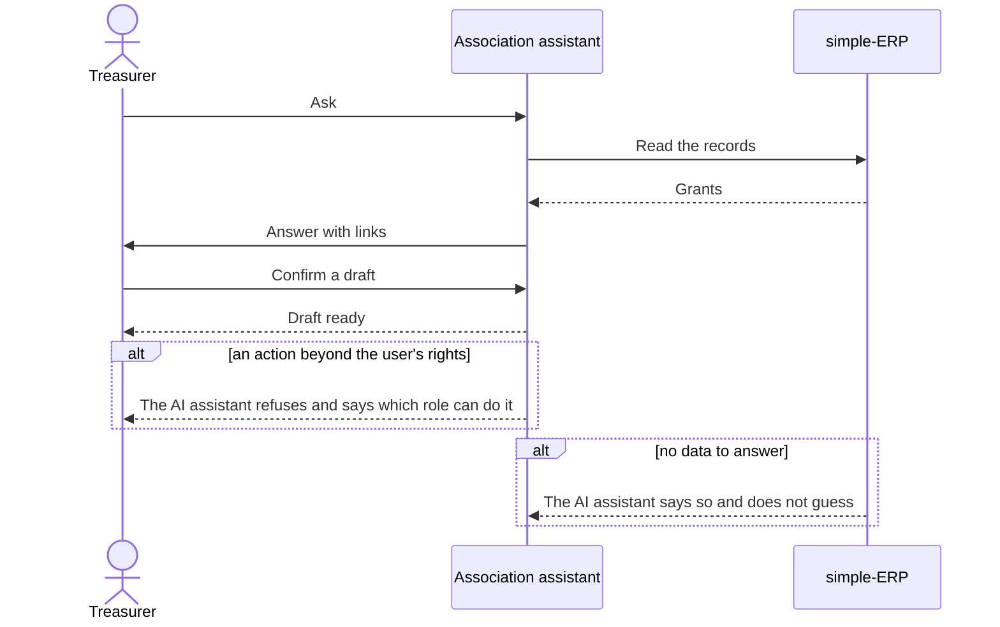

🏠 [Specs](../../../../README.md) › 🏷️ [Sectors](../../../README.md) › 🤲 [SC08 Non-profit association](../../README.md) ›
📝 [Use cases](../README.md) › 📝 [Use cases: FL-SC08-02 Donations and receipts](README.md) ›
📝 UC-SC08-20 Ask the AI assistant about the association

# 📝 UC-SC08-20 Ask the AI assistant about the association

**Status:** ✅ specified

## Summary

The treasurer or the president asks the AI assistant about gifts, reports due or members to renew, within their role's
rights.

## Personas

- [U31 Treasurer](../../../../01-users/personas/u31-treasurer.md)
- [U13 Owner](../../../../01-users/personas/u13-owner.md)

## Goal

Answers without hunting through screens.

## Trigger

A question to the AI assistant.

## Frequency

Weekly.

## Preconditions

- The SC08 sector pack is installed for the company,
  [UC-F14-02](../../../../02-functional/f14-plugin-store/use-cases/01-find-and-install/uc-f14-02-install-a-plugin-or-sector-pack.md),
  and its users have their roles,
  [UC-F1-06](../../../../02-functional/f01-administration/use-cases/04-edit-a-role/uc-f01-06-edit-a-role-and-its-record-rules.md).

## Postconditions

- **Success:** the answer cites the records, or the draft is confirmed.
- **Failed:** the AI assistant says it cannot answer or act, and why.

## Main flow

1. The treasurer asks on
   [S-SC08-20 Association assistant](../../screens/02-donations-and-receipts/s-sc08-20-association-assistant.md): "Which
   grant reports are due this quarter?".
2. The AI assistant reads grants within the user's rights.
3. The AI assistant lists them with due dates.
4. The treasurer asks for a thank-you letter; the AI assistant drafts it,
   [UC-F3-04](../../../../02-functional/f03-assistant/use-cases/04-summarise-or-draft/uc-f03-04-summarise-and-draft.md).

## Alternative flows

- 1a. The president asks for members to renew: the AI assistant lists them.

## Error flows

- 4e. An action beyond the user's rights: the AI assistant refuses and says which role can do it.
- 2e. No data to answer: the AI assistant says so and does not guess.
- Any step: a call to a service or an outside system fails: it is retried first
  ([BR-F3-32](../../../../02-functional/f03-assistant/business-rules/br-f03-32-retry-before-an-error.md)), then the
  error message pattern ([D122](../../../../06-decisions/ux/d122-error-message-standard.md)) says what failed; what was
  typed is kept.

## Business rules

- [BR-SC08-01 Associations follow the country pack](../../business-rules/br-sc08-01-associations-follow-the-country-pack.md)
- [BR-F3-34 All capabilities via the AI assistant](../../../../02-functional/f03-assistant/business-rules/br-f03-34-every-capability-is-reachable-from-the-assistant.md)
- [BR-F3-07 No deletes, no irreversible acts](../../../../02-functional/f03-assistant/business-rules/br-f03-07-no-deletes-no-irreversible-acts.md)

## Entities

- [E-SC08-04 Gift](../../data/e-sc08-04-gift.md)
- [E-F8-18 Grant](../../../../02-functional/f08-accounting/data/e-f08-18-grant.md)

## Permissions

The treasurer and owner roles; the record rules of their role and site apply,
[UC-F1-06](../../../../02-functional/f01-administration/use-cases/04-edit-a-role/uc-f01-06-edit-a-role-and-its-record-rules.md).

## Notifications

None beyond the in-app updates of the records concerned.

## Audit events

Every creation, change and state change of gift, grant records, with who, when and the values before and after (T3).

## AI involvement

The AI assistant answers questions on the gift, grant records of this use case, with links, and prepares them as drafts
the user confirms. It works within the user's rights,
[BR-F3-34](../../../../02-functional/f03-assistant/business-rules/br-f03-34-every-capability-is-reachable-from-the-assistant.md),
and never deletes or does anything irreversible without the user's confirmation,
[BR-F3-07](../../../../02-functional/f03-assistant/business-rules/br-f03-07-no-deletes-no-irreversible-acts.md).

## API, MCP and A2A exposure

Through the API and webhooks (T5) and the MCP and A2A gateway (T6), with the caller's rights,
[BR-F3-34](../../../../02-functional/f03-assistant/business-rules/br-f03-34-every-capability-is-reachable-from-the-assistant.md),
reading, creating and changing the records of this use case; nothing irreversible without a person's confirmation.

## Screens

- [S-SC08-20 Association assistant](../../screens/02-donations-and-receipts/s-sc08-20-association-assistant.md)

## Flowchart

See [FL-SC08-02 Donations and receipts](../../flows/fl-sc08-02-donations-and-receipts.md#flowchart).

## Sequence diagram

## Acceptance criteria

1. **Given** the example association's Town grant with its report due 2027-06-30 **when** the treasurer asks in April
   2027 **then** the AI assistant lists it.
2. **Given** a volunteer asking for donors' amounts **when** she asks **then** the AI assistant refuses and says which
   role can do it.

## Non-functional notes

[D408](../../../../06-decisions/technical/d408-performance-and-profiles.md)'s targets
([performance](../../../../05-non-functional/performance.md)): 95 % of screens within 1 second; lists paged on the
server, the first page within 1 second; reports within 5 seconds or in the background. WCAG 2.2 AA and RGAA
([D46](../../../../06-decisions/ux/d46-accessibility-standard.md)).

## Regulatory references

None specific to this use case; the sector's legal rules are listed in [SC08 regulatory](../../regulatory.md).

## Related use cases

- [UC-SC08-09 Report to funders on grants](../03-grants/uc-sc08-09-report-to-funders-on-grants.md)

## Open questions

None.

---

⬅️ [UC-SC08-19](../06-accounts-and-data/uc-sc08-19-follow-the-association-s-dashboard.md) · ⬆️ [Up](README.md) ·
➡️ [UC-SC08-21](../07-foundations-integration-and-federations/uc-sc08-21-give-grants-as-a-foundation.md)
