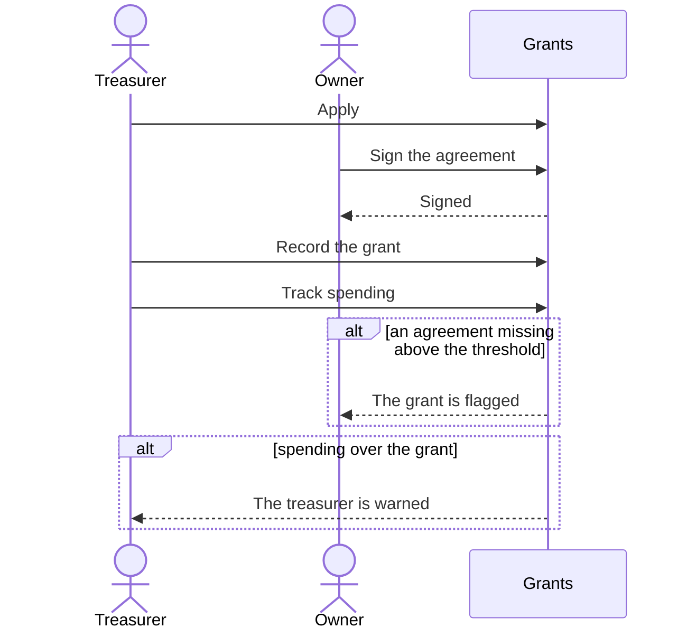

🏠 [Specs](../../../../README.md) › 🏷️ [Sectors](../../../README.md) › 🤲 [SC08 Non-profit association](../../README.md) ›
📝 [Use cases](../README.md) › 📝 [Use cases: FL-SC08-03 Grants](README.md) ›
📝 UC-SC08-08 Apply for grants and follow their conditions

# 📝 UC-SC08-08 Apply for grants and follow their conditions

**Status:** ✅ specified

## Summary

The treasurer applies for grants, records the signed agreement and its conditions with the shared grant accounting, and
tracks spending to the purpose.

## Personas

- [U31 Treasurer](../../../../01-users/personas/u31-treasurer.md)
- [U13 Owner](../../../../01-users/personas/u13-owner.md)

## Goal

Grants obtained and used for their purpose.

## Trigger

A funding opportunity.

## Frequency

A few a year.

## Preconditions

- The SC08 sector pack is installed for the company,
  [UC-F14-02](../../../../02-functional/f14-plugin-store/use-cases/01-find-and-install/uc-f14-02-install-a-plugin-or-sector-pack.md),
  and its users have their roles,
  [UC-F1-06](../../../../02-functional/f01-administration/use-cases/04-edit-a-role/uc-f01-06-edit-a-role-and-its-record-rules.md).

## Postconditions

- **Success:** the grant is recorded and its spending tracked.
- **Failed:** the application is refused.

## Main flow

1. The treasurer records the application on [S-SC08-08 Grants](../../screens/03-grants/s-sc08-08-grants.md).
2. The president signs,
   [UC-F2-14](../../../../02-functional/f02-no-code-configuration/use-cases/07-benchmark-additions/uc-f02-14-send-documents-for-e-signature.md).
3. The grant is recorded with conditions,
   [UC-F8-22](../../../../02-functional/f08-accounting/use-cases/07-client-money-grants-and-non-profits/uc-f08-22-account-for-a-grant.md).
4. Spending is tagged to the purpose ([BR-SC08-06](../../business-rules/br-sc08-06-grants-tracked-to-their-purpose.md)).

## Alternative flows

- 3a. A multi-year grant: each year's share is recognised as its conditions are met,
  [BR-F8-14](../../../../02-functional/f08-accounting/business-rules/br-f08-14-a-grant-is-earned-as-its-conditions-are-met.md).
- 4a. A project co-funded by several funders: each funder's share is billed or reported through the multi-payer
  capability,
  [UC-F6-20](../../../../02-functional/f06-customers-and-sales/use-cases/07-special-invoicing/uc-f06-20-invoice-several-payers-with-funders-and-caps.md).

## Error flows

- 2e. An agreement missing above the threshold: the grant is flagged.
- 4e. Spending over the grant: the treasurer is warned.
- Any step: a call to a service or an outside system fails: it is retried first
  ([BR-F3-32](../../../../02-functional/f03-assistant/business-rules/br-f03-32-retry-before-an-error.md)), then the
  error message pattern ([D122](../../../../06-decisions/ux/d122-error-message-standard.md)) says what failed; what was
  typed is kept.

## Business rules

- [BR-SC08-06 Grants tracked to their purpose](../../business-rules/br-sc08-06-grants-tracked-to-their-purpose.md)
- [BR-SC08-07 Dedicated funds kept apart](../../business-rules/br-sc08-07-dedicated-funds-kept-apart.md)
- [BR-F8-14 A grant is earned as its conditions are met](../../../../02-functional/f08-accounting/business-rules/br-f08-14-a-grant-is-earned-as-its-conditions-are-met.md)

## Entities

- [E-F8-18 Grant](../../../../02-functional/f08-accounting/data/e-f08-18-grant.md)

## Permissions

The treasurer and owner roles; the record rules of their role and site apply,
[UC-F1-06](../../../../02-functional/f01-administration/use-cases/04-edit-a-role/uc-f01-06-edit-a-role-and-its-record-rules.md).

## Notifications

None beyond the in-app updates of the records concerned.

## Audit events

Every creation, change and state change of grant, grant records, with who, when and the values before and after (T3).

## AI involvement

The AI assistant answers questions on the grant, grant records of this use case, with links, and prepares them as drafts
the user confirms. It works within the user's rights,
[BR-F3-34](../../../../02-functional/f03-assistant/business-rules/br-f03-34-every-capability-is-reachable-from-the-assistant.md),
and never deletes or does anything irreversible without the user's confirmation,
[BR-F3-07](../../../../02-functional/f03-assistant/business-rules/br-f03-07-no-deletes-no-irreversible-acts.md).

## API, MCP and A2A exposure

Through the API and webhooks (T5) and the MCP and A2A gateway (T6), with the caller's rights,
[BR-F3-34](../../../../02-functional/f03-assistant/business-rules/br-f03-34-every-capability-is-reachable-from-the-assistant.md),
reading, creating and changing the records of this use case; nothing irreversible without a person's confirmation.

## Screens

- [S-SC08-08 Grants](../../screens/03-grants/s-sc08-08-grants.md)

## Flowchart

See [FL-SC08-03 Grants](../../flows/fl-sc08-03-grants.md#flowchart).

## Sequence diagram

## Acceptance criteria

1. **Given** the example association's Town grant of 24,000 EUR for the school with its agreement **when** it is
   recorded **then** its report is due 2027-06-30.
2. **Given** a 24,000 EUR grant from the Town without agreement **when** it is recorded **then** the grant is flagged.

## Non-functional notes

[D408](../../../../06-decisions/technical/d408-performance-and-profiles.md)'s targets
([performance](../../../../05-non-functional/performance.md)): 95 % of screens within 1 second; lists paged on the
server, the first page within 1 second; reports within 5 seconds or in the background. WCAG 2.2 AA and RGAA
([D46](../../../../06-decisions/ux/d46-accessibility-standard.md)).

## Regulatory references

Legal values from the France country pack:
[CR-FR-127 Grant agreement and financial report](../../../../10-country-packs/france/non-profit/cr-fr-127-grant-agreement-and-report.md).

## Related use cases

- [UC-SC08-09 Report to funders on grants](uc-sc08-09-report-to-funders-on-grants.md)

## Open questions

None.

---

⬅️ [UC-SC08-07 Manage regular donors](../02-donations-and-receipts/uc-sc08-07-manage-regular-donors.md) ·
⬆️ [Up](README.md) · ➡️ [UC-SC08-09 Report to funders on grants](uc-sc08-09-report-to-funders-on-grants.md)
