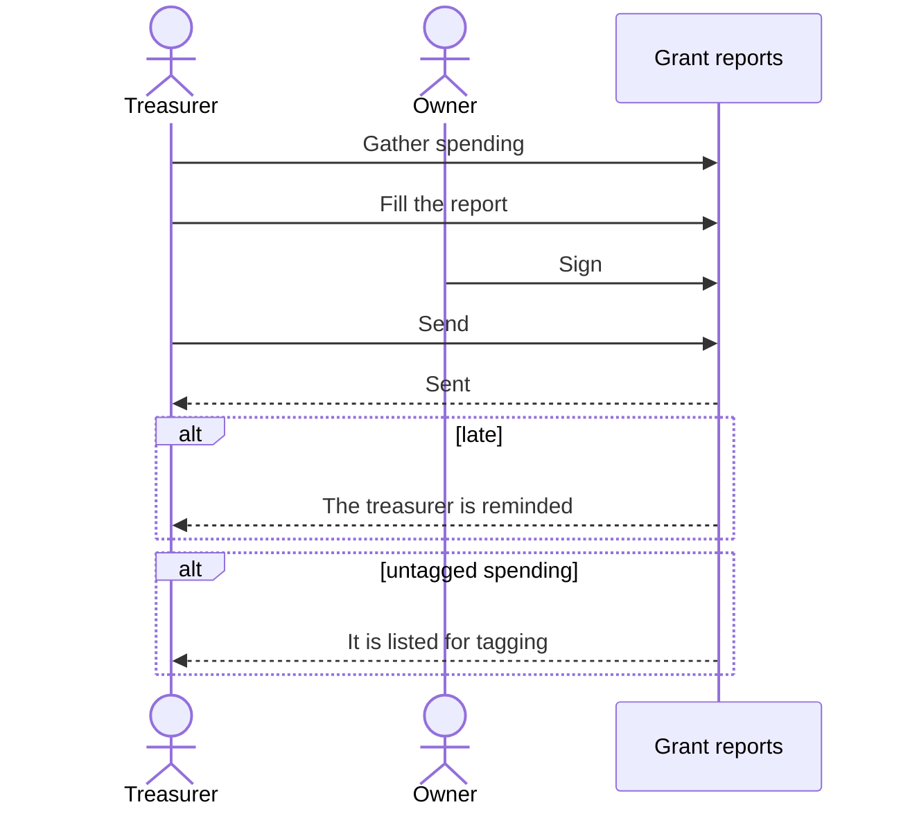

🏠 [Specs](../../../../README.md) › 🏷️ [Sectors](../../../README.md) › 🤲 [SC08 Non-profit association](../../README.md) ›
📝 [Use cases](../README.md) › 📝 [Use cases: FL-SC08-03 Grants](README.md) › 📝 UC-SC08-09 Report to funders on grants

# 📝 UC-SC08-09 Report to funders on grants

**Status:** 🔄 waiting for the owner

## Summary

The treasurer gathers spending per grant, fills the financial report and sends it to the funder on time.

## Personas

- [U31 Treasurer](../../../../01-users/personas/u31-treasurer.md)
- [U13 Owner](../../../../01-users/personas/u13-owner.md)

## Goal

Every grant reported on time.

## Trigger

The report's due date.

## Frequency

Yearly per grant.

## Preconditions

- The SC08 sector pack is installed for the company,
  [UC-F14-02](../../../../02-functional/f14-plugin-store/use-cases/01-find-and-install/uc-f14-02-install-a-plugin-or-sector-pack.md),
  and its users have their roles,
  [UC-F1-06](../../../../02-functional/f01-administration/use-cases/04-edit-a-role/uc-f01-06-edit-a-role-and-its-record-rules.md).

## Postconditions

- **Success:** the report is sent.
- **Failed:** the report is late and reminded.

## Main flow

1. The treasurer gathers spending on [S-SC08-09 Grant reports](../../screens/03-grants/s-sc08-09-grant-reports.md).
2. The report is filled from the books.
3. The president signs.
4. The report is sent.

## Alternative flows

- 2a. The funder's own format: the report is exported in that format.

## Error flows

- 4e. Late: the treasurer is reminded ((Proposed) 30 days before the date).
- 1e. Untagged spending: it is listed for tagging.
- Any step: a call to a service or an outside system fails: it is retried first
  ([BR-F3-32](../../../../02-functional/f03-assistant/business-rules/br-f03-32-retry-before-an-error.md)), then the
  error message pattern ([D122](../../../../06-decisions/ux/d122-error-message-standard.md)) says what failed; what was
  typed is kept.

## Business rules

- [BR-SC08-06 Grants tracked to their purpose](../../business-rules/br-sc08-06-grants-tracked-to-their-purpose.md)

## Entities

- [E-F8-18 Grant](../../../../02-functional/f08-accounting/data/e-f08-18-grant.md)
- [E-SC08-09 Grant report](../../data/e-sc08-09-grant-report.md)

## Permissions

The treasurer and owner roles; the record rules of their role and site apply,
[UC-F1-06](../../../../02-functional/f01-administration/use-cases/04-edit-a-role/uc-f01-06-edit-a-role-and-its-record-rules.md).

## Notifications

None beyond the in-app updates of the records concerned.

## Audit events

Every creation, change and state change of grant, grant report records, with who, when and the values before and after
(T3).

## AI involvement

The AI assistant answers questions on the grant, grant report records of this use case, with links, and prepares them as
drafts the user confirms. It works within the user's rights,
[BR-F3-34](../../../../02-functional/f03-assistant/business-rules/br-f03-34-every-capability-is-reachable-from-the-assistant.md),
and never deletes or does anything irreversible without the user's confirmation,
[BR-F3-07](../../../../02-functional/f03-assistant/business-rules/br-f03-07-no-deletes-no-irreversible-acts.md).

## API, MCP and A2A exposure

Through the API and webhooks (T5) and the MCP and A2A gateway (T6), with the caller's rights,
[BR-F3-34](../../../../02-functional/f03-assistant/business-rules/br-f03-34-every-capability-is-reachable-from-the-assistant.md),
reading, creating and changing the records of this use case; nothing irreversible without a person's confirmation.

## Screens

- [S-SC08-09 Grant reports](../../screens/03-grants/s-sc08-09-grant-reports.md)

## Flowchart

See [FL-SC08-03 Grants](../../flows/fl-sc08-03-grants.md#flowchart).

## Sequence diagram

## Acceptance criteria

1. **Given** the example association's Town grant with 23,100 EUR spent in 2026 **when** the report is sent **then** it
   shows 23,100 EUR of 24,000 EUR.
2. **Given** the Town report due 2027-06-30 not sent **when** it is 2027-06-01 **then** the treasurer is reminded
   ((Proposed) 30 days before the date).

## Non-functional notes

[D408](../../../../06-decisions/technical/d408-performance-and-profiles.md)'s targets
([performance](../../../../05-non-functional/performance.md)): 95 % of screens within 1 second; lists paged on the
server, the first page within 1 second; reports within 5 seconds or in the background. WCAG 2.2 AA and RGAA
([D46](../../../../06-decisions/ux/d46-accessibility-standard.md)).

## Regulatory references

Legal values from the France country pack:
[CR-FR-127 Grant agreement and financial report](../../../../10-country-packs/france/non-profit/cr-fr-127-grant-agreement-and-report.md).

## Related use cases

- [UC-SC08-08 Apply for grants and follow their conditions](uc-sc08-08-apply-for-grants-and-follow-their-conditions.md)

## Open questions

None open; the items marked (Proposed) wait for the owner in the [waiting list](../../../../09-waiting/README.md).

---

⬅️ [UC-SC08-08](uc-sc08-08-apply-for-grants-and-follow-their-conditions.md) · ⬆️ [Up](README.md) ·
➡️ [UC-SC08-10](../04-volunteers/uc-sc08-10-recruit-and-register-volunteers-for-missions.md)
