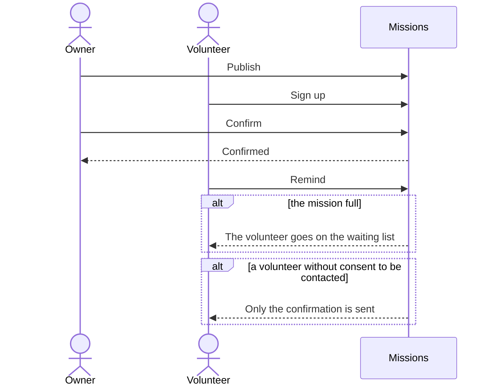

🏠 [Specs](../../../../README.md) › 🏷️ [Sectors](../../../README.md) › 🤲 [SC08 Non-profit association](../../README.md) ›
📝 [Use cases](../README.md) › 📝 [Use cases: FL-SC08-04 Volunteers](README.md) ›
📝 UC-SC08-10 Recruit and register volunteers for missions

# 📝 UC-SC08-10 Recruit and register volunteers for missions

**Status:** ✅ specified

## Summary

The president publishes missions; volunteers sign up on the portal and are confirmed.

## Personas

- [U32 Volunteer](../../../../01-users/personas/u32-volunteer.md)
- [U13 Owner](../../../../01-users/personas/u13-owner.md)

## Goal

Every mission staffed with volunteers.

## Trigger

A mission needs people.

## Frequency

Weekly.

## Preconditions

- The SC08 sector pack is installed for the company,
  [UC-F14-02](../../../../02-functional/f14-plugin-store/use-cases/01-find-and-install/uc-f14-02-install-a-plugin-or-sector-pack.md),
  and its users have their roles,
  [UC-F1-06](../../../../02-functional/f01-administration/use-cases/04-edit-a-role/uc-f01-06-edit-a-role-and-its-record-rules.md).

## Postconditions

- **Success:** volunteers are confirmed.
- **Failed:** the mission stays open.

## Main flow

1. The president publishes the mission on [S-SC08-10 Missions](../../screens/04-volunteers/s-sc08-10-missions.md).
2. Volunteers sign up on the portal,
   [UC-F2-20](../../../../02-functional/f02-no-code-configuration/use-cases/09-portals-and-offline-forms/uc-f02-20-expose-a-record-type-on-a-portal.md).
3. The president confirms.
4. Volunteers get a reminder before the mission.

## Alternative flows

- 2a. A waiting list: late sign-ups wait and move up if someone cancels.

## Error flows

- 2e. The mission full: the volunteer goes on the waiting list.
- 2f. A volunteer without consent to be contacted: only the confirmation is sent.
- Any step: a call to a service or an outside system fails: it is retried first
  ([BR-F3-32](../../../../02-functional/f03-assistant/business-rules/br-f03-32-retry-before-an-error.md)), then the
  error message pattern ([D122](../../../../06-decisions/ux/d122-error-message-standard.md)) says what failed; what was
  typed is kept.

## Business rules

- [BR-SC08-13 Communication with consent](../../business-rules/br-sc08-13-communication-with-consent.md)
- [BR-F2-20 A portal shows only the chosen fields of the person's own records](../../../../02-functional/f02-no-code-configuration/business-rules/br-f02-20-a-portal-shows-only-the-chosen-fields-of-the-persons-own-records.md)

## Entities

- [E-SC08-10 Mission](../../data/e-sc08-10-mission.md)

## Permissions

The volunteer and owner roles; the record rules of their role and site apply,
[UC-F1-06](../../../../02-functional/f01-administration/use-cases/04-edit-a-role/uc-f01-06-edit-a-role-and-its-record-rules.md).

## Notifications

None beyond the in-app updates of the records concerned.

## Audit events

Every creation, change and state change of mission records, with who, when and the values before and after (T3).

## AI involvement

The AI assistant answers questions on the mission records of this use case, with links, and prepares them as drafts the
user confirms. It works within the user's rights,
[BR-F3-34](../../../../02-functional/f03-assistant/business-rules/br-f03-34-every-capability-is-reachable-from-the-assistant.md),
and never deletes or does anything irreversible without the user's confirmation,
[BR-F3-07](../../../../02-functional/f03-assistant/business-rules/br-f03-07-no-deletes-no-irreversible-acts.md).

## API, MCP and A2A exposure

Through the API and webhooks (T5) and the MCP and A2A gateway (T6), with the caller's rights,
[BR-F3-34](../../../../02-functional/f03-assistant/business-rules/br-f03-34-every-capability-is-reachable-from-the-assistant.md),
reading, creating and changing the records of this use case; nothing irreversible without a person's confirmation.

## Screens

- [S-SC08-10 Missions](../../screens/04-volunteers/s-sc08-10-missions.md)

## Flowchart

See [FL-SC08-04 Volunteers](../../flows/fl-sc08-04-volunteers.md#flowchart).

## Sequence diagram

## Acceptance criteria

1. **Given** the example association's food drive with 12 places and 9 volunteers **when** a volunteer signs up **then**
   10 places are taken.
2. **Given** the food drive on 5 December with 12 places **when** a 13th volunteer signs up **then** the volunteer goes
   on the waiting list.

## Non-functional notes

[D408](../../../../06-decisions/technical/d408-performance-and-profiles.md)'s targets
([performance](../../../../05-non-functional/performance.md)): 95 % of screens within 1 second; lists paged on the
server, the first page within 1 second; reports within 5 seconds or in the background. WCAG 2.2 AA and RGAA
([D46](../../../../06-decisions/ux/d46-accessibility-standard.md)).

## Regulatory references

None specific to this use case; the sector's legal rules are listed in [SC08 regulatory](../../regulatory.md).

## Related use cases

- [UC-SC08-11 Record and value volunteer time](uc-sc08-11-record-and-value-volunteer-time.md)

## Open questions

None.

---

⬅️ [UC-SC08-09 Report to funders on grants](../03-grants/uc-sc08-09-report-to-funders-on-grants.md) ·
⬆️ [Up](README.md) · ➡️ [UC-SC08-11 Record and value volunteer time](uc-sc08-11-record-and-value-volunteer-time.md)
