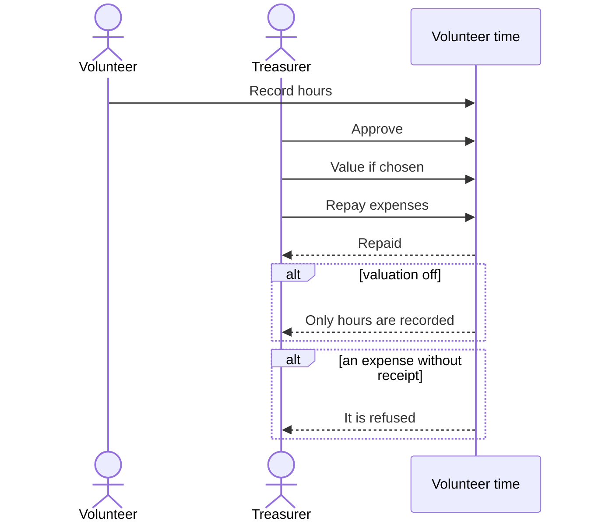

🏠 [Specs](../../../../README.md) › 🏷️ [Sectors](../../../README.md) › 🤲 [SC08 Non-profit association](../../README.md) ›
📝 [Use cases](../README.md) › 📝 [Use cases: FL-SC08-04 Volunteers](README.md) ›
📝 UC-SC08-11 Record and value volunteer time

# 📝 UC-SC08-11 Record and value volunteer time

**Status:** ✅ specified

## Summary

Volunteers record their hours; the treasurer approves them and values them in the accounts' notes if the association
chooses to; expenses are repaid on proof.

## Personas

- [U32 Volunteer](../../../../01-users/personas/u32-volunteer.md)
- [U31 Treasurer](../../../../01-users/personas/u31-treasurer.md)

## Goal

Volunteer work known, and valued when chosen.

## Trigger

A mission ends.

## Frequency

After each mission.

## Preconditions

- The SC08 sector pack is installed for the company,
  [UC-F14-02](../../../../02-functional/f14-plugin-store/use-cases/01-find-and-install/uc-f14-02-install-a-plugin-or-sector-pack.md),
  and its users have their roles,
  [UC-F1-06](../../../../02-functional/f01-administration/use-cases/04-edit-a-role/uc-f01-06-edit-a-role-and-its-record-rules.md).

## Postconditions

- **Success:** hours are approved and, if chosen, valued.
- **Failed:** hours wait for approval.

## Main flow

1. The volunteer records hours on [S-SC08-11 Volunteer time](../../screens/04-volunteers/s-sc08-11-volunteer-time.md).
2. The treasurer approves.
3. Hours are valued, [BR-SC08-10](../../business-rules/br-sc08-10-volunteer-time-valued-if-chosen.md),
   [UC-F8-23](../../../../02-functional/f08-accounting/use-cases/07-client-money-grants-and-non-profits/uc-f08-23-keep-non-profit-accounts.md).
4. Expenses are repaid on receipts ([BR-SC08-09](../../business-rules/br-sc08-09-volunteers-repaid-on-proof.md)).

## Alternative flows

- 1a. Hours from an event list: the list's hours are imported.

## Error flows

- 3e. Valuation off: only hours are recorded.
- 4e. An expense without receipt: it is refused.
- Any step: a call to a service or an outside system fails: it is retried first
  ([BR-F3-32](../../../../02-functional/f03-assistant/business-rules/br-f03-32-retry-before-an-error.md)), then the
  error message pattern ([D122](../../../../06-decisions/ux/d122-error-message-standard.md)) says what failed; what was
  typed is kept.

## Business rules

- [BR-SC08-10 Volunteer time valued if chosen](../../business-rules/br-sc08-10-volunteer-time-valued-if-chosen.md)
- [BR-SC08-09 Volunteers repaid on proof](../../business-rules/br-sc08-09-volunteers-repaid-on-proof.md)

## Entities

- [E-SC08-11 Volunteer hours](../../data/e-sc08-11-volunteer-hours.md)
- [E-F8-20 Volunteer contribution](../../../../02-functional/f08-accounting/data/e-f08-20-volunteer-contribution.md)

## Permissions

The volunteer and treasurer roles; the record rules of their role and site apply,
[UC-F1-06](../../../../02-functional/f01-administration/use-cases/04-edit-a-role/uc-f01-06-edit-a-role-and-its-record-rules.md).

## Notifications

None beyond the in-app updates of the records concerned.

## Audit events

Every creation, change and state change of volunteer hours, volunteer contribution records, with who, when and the
values before and after (T3).

## AI involvement

The AI assistant answers questions on the volunteer hours, volunteer contribution records of this use case, with links,
and prepares them as drafts the user confirms. It works within the user's rights,
[BR-F3-34](../../../../02-functional/f03-assistant/business-rules/br-f03-34-every-capability-is-reachable-from-the-assistant.md),
and never deletes or does anything irreversible without the user's confirmation,
[BR-F3-07](../../../../02-functional/f03-assistant/business-rules/br-f03-07-no-deletes-no-irreversible-acts.md).

## API, MCP and A2A exposure

Through the API and webhooks (T5) and the MCP and A2A gateway (T6), with the caller's rights,
[BR-F3-34](../../../../02-functional/f03-assistant/business-rules/br-f03-34-every-capability-is-reachable-from-the-assistant.md),
reading, creating and changing the records of this use case; nothing irreversible without a person's confirmation.

## Screens

- [S-SC08-11 Volunteer time](../../screens/04-volunteers/s-sc08-11-volunteer-time.md)

## Flowchart

See [FL-SC08-04 Volunteers](../../flows/fl-sc08-04-volunteers.md#flowchart).

## Sequence diagram

## Acceptance criteria

1. **Given** the example association's P. L. with 4 hours at the food drive, valuation at 12 EUR an hour **when** they
   are approved **then** 48 EUR is valued.
2. **Given** an association not valuing time **when** P. L.'s 4 hours are approved **then** only hours are recorded.

## Non-functional notes

[D408](../../../../06-decisions/technical/d408-performance-and-profiles.md)'s targets
([performance](../../../../05-non-functional/performance.md)): 95 % of screens within 1 second; lists paged on the
server, the first page within 1 second; reports within 5 seconds or in the background. WCAG 2.2 AA and RGAA
([D46](../../../../06-decisions/ux/d46-accessibility-standard.md)).

## Regulatory references

Legal values from the France country pack:
[CR-FR-129 Volunteers' expenses](../../../../10-country-packs/france/non-profit/cr-fr-129-volunteer-expenses.md).

## Related use cases

- [UC-SC08-14 Keep association accounts](../06-accounts-and-data/uc-sc08-14-keep-association-accounts.md)

## Open questions

None.

---

⬅️ [UC-SC08-10](uc-sc08-10-recruit-and-register-volunteers-for-missions.md) · ⬆️ [Up](README.md) ·
➡️ [UC-SC08-12 Run events and ticketing](../05-events/uc-sc08-12-run-events-and-ticketing.md)
