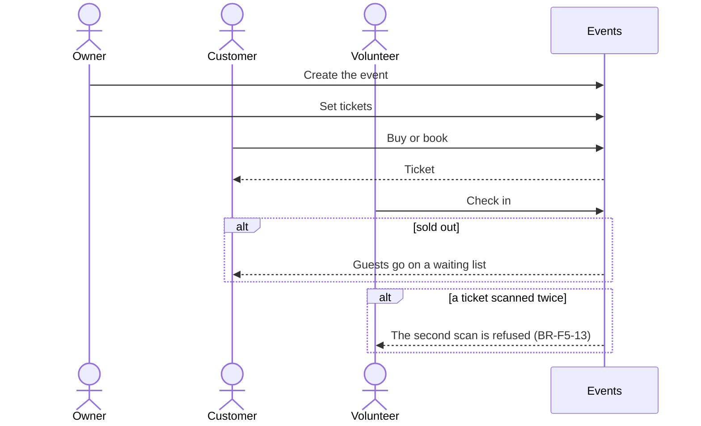

🏠 [Specs](../../../../README.md) › 🏷️ [Sectors](../../../README.md) › 🤲 [SC08 Non-profit association](../../README.md) ›
📝 [Use cases](../README.md) › 📝 [Use cases: FL-SC08-05 Events](README.md) › 📝 UC-SC08-12 Run events and ticketing

# 📝 UC-SC08-12 Run events and ticketing

**Status:** ✅ specified

## Summary

The president creates an event on the shared ticketing model, sells or gives tickets, and checks attendees in at the
door.

## Personas

- [U13 Owner](../../../../01-users/personas/u13-owner.md)
- [U09 Customer](../../../../01-users/personas/u09-customer.md)
- [U32 Volunteer](../../../../01-users/personas/u32-volunteer.md)

## Goal

Events filled and attendance known.

## Trigger

An event is planned.

## Frequency

A few a year.

## Preconditions

- The SC08 sector pack is installed for the company,
  [UC-F14-02](../../../../02-functional/f14-plugin-store/use-cases/01-find-and-install/uc-f14-02-install-a-plugin-or-sector-pack.md),
  and its users have their roles,
  [UC-F1-06](../../../../02-functional/f01-administration/use-cases/04-edit-a-role/uc-f01-06-edit-a-role-and-its-record-rules.md).

## Postconditions

- **Success:** tickets are sold and checked in.
- **Failed:** the event is cancelled and tickets refunded.

## Main flow

1. The president creates the event on [S-SC08-12 Events](../../screens/05-events/s-sc08-12-events.md),
   [UC-F5-11](../../../../02-functional/f05-social-media/use-cases/07-events-and-ticketing/uc-f05-11-organise-events-and-sell-tickets.md).
2. Ticket types and places are set,
   [UC-F5-17](../../../../02-functional/f05-social-media/use-cases/07-events-and-ticketing/uc-f05-17-set-up-ticketing-for-an-event.md).
3. Guests buy or book tickets,
   [BR-F5-12](../../../../02-functional/f05-social-media/business-rules/br-f05-12-one-seat-one-ticket-across-every-channel.md).
4. Volunteers scan tickets at the door,
   [UC-F5-18](../../../../02-functional/f05-social-media/use-cases/07-events-and-ticketing/uc-f05-18-sell-at-the-box-office-and-scan-tickets.md).

## Alternative flows

- 2a. A free event: tickets are free and still counted.

## Error flows

- 3e. Sold out: guests go on a waiting list.
- 4e. A ticket scanned twice: the second scan is refused,
  [BR-F5-13](../../../../02-functional/f05-social-media/business-rules/br-f05-13-a-ticket-opens-the-door-once.md).
- Any step: a call to a service or an outside system fails: it is retried first
  ([BR-F3-32](../../../../02-functional/f03-assistant/business-rules/br-f03-32-retry-before-an-error.md)), then the
  error message pattern ([D122](../../../../06-decisions/ux/d122-error-message-standard.md)) says what failed; what was
  typed is kept.

## Business rules

- [BR-SC08-01 Associations follow the country pack](../../business-rules/br-sc08-01-associations-follow-the-country-pack.md)
- [BR-F5-12 One seat, one ticket, across every channel](../../../../02-functional/f05-social-media/business-rules/br-f05-12-one-seat-one-ticket-across-every-channel.md)
- [BR-F5-13 A ticket opens the door once](../../../../02-functional/f05-social-media/business-rules/br-f05-13-a-ticket-opens-the-door-once.md)

## Entities

- [E-SC08-12 Association event](../../data/e-sc08-12-association-event.md)
- [E-F5-07 Registration event](../../../../02-functional/f05-social-media/data/e-f05-07-registration-event.md)
- [E-F5-12 Event ticket](../../../../02-functional/f05-social-media/data/e-f05-12-event-ticket.md)

## Permissions

The owner, customer and volunteer roles; the record rules of their role and site apply,
[UC-F1-06](../../../../02-functional/f01-administration/use-cases/04-edit-a-role/uc-f01-06-edit-a-role-and-its-record-rules.md).

## Notifications

None beyond the in-app updates of the records concerned.

## Audit events

Every creation, change and state change of event, event, ticket records, with who, when and the values before and after
(T3).

## AI involvement

The AI assistant answers questions on the event, event, ticket records of this use case, with links, and prepares them
as drafts the user confirms. It works within the user's rights,
[BR-F3-34](../../../../02-functional/f03-assistant/business-rules/br-f03-34-every-capability-is-reachable-from-the-assistant.md),
and never deletes or does anything irreversible without the user's confirmation,
[BR-F3-07](../../../../02-functional/f03-assistant/business-rules/br-f03-07-no-deletes-no-irreversible-acts.md).

## API, MCP and A2A exposure

Through the API and webhooks (T5) and the MCP and A2A gateway (T6), with the caller's rights,
[BR-F3-34](../../../../02-functional/f03-assistant/business-rules/br-f03-34-every-capability-is-reachable-from-the-assistant.md),
reading, creating and changing the records of this use case; nothing irreversible without a person's confirmation.

## Screens

- [S-SC08-12 Events](../../screens/05-events/s-sc08-12-events.md)

## Flowchart

See [FL-SC08-05 Events](../../flows/fl-sc08-05-events.md#flowchart).

## Sequence diagram

## Acceptance criteria

1. **Given** the example association's gala on 12 December with 200 places and 164 tickets **when** a guest books
   **then** 165 tickets are taken.
2. **Given** the gala with 200 places sold **when** a guest books **then** guests go on a waiting list.

## Non-functional notes

[D408](../../../../06-decisions/technical/d408-performance-and-profiles.md)'s targets
([performance](../../../../05-non-functional/performance.md)): 95 % of screens within 1 second; lists paged on the
server, the first page within 1 second; reports within 5 seconds or in the background. WCAG 2.2 AA and RGAA
([D46](../../../../06-decisions/ux/d46-accessibility-standard.md)).

## Regulatory references

None specific to this use case; the sector's legal rules are listed in [SC08 regulatory](../../regulatory.md).

## Related use cases

- [UC-SC08-13 Run a temporary bar at events](uc-sc08-13-run-a-temporary-bar-at-events.md)

## Open questions

None.

---

⬅️ [UC-SC08-11 Record and value volunteer time](../04-volunteers/uc-sc08-11-record-and-value-volunteer-time.md) ·
⬆️ [Up](README.md) · ➡️ [UC-SC08-13 Run a temporary bar at events](uc-sc08-13-run-a-temporary-bar-at-events.md)
