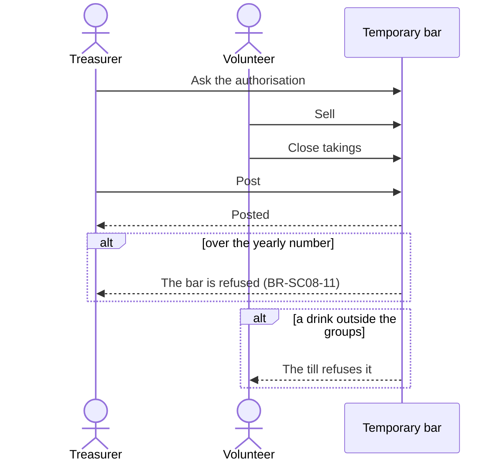

🏠 [Specs](../../../../README.md) › 🏷️ [Sectors](../../../README.md) › 🤲 [SC08 Non-profit association](../../README.md) ›
📝 [Use cases](../README.md) › 📝 [Use cases: FL-SC08-05 Events](README.md) › 📝 UC-SC08-13 Run a temporary bar at events

# 📝 UC-SC08-13 Run a temporary bar at events

**Status:** ✅ specified

## Summary

The treasurer asks the authorisation for a temporary bar; volunteers sell within the drink groups; takings are closed.

## Personas

- [U32 Volunteer](../../../../01-users/personas/u32-volunteer.md)
- [U31 Treasurer](../../../../01-users/personas/u31-treasurer.md)

## Goal

A bar within the yearly limit and the authorisation.

## Trigger

An event with a bar.

## Frequency

A few a year.

## Preconditions

- The SC08 sector pack is installed for the company,
  [UC-F14-02](../../../../02-functional/f14-plugin-store/use-cases/01-find-and-install/uc-f14-02-install-a-plugin-or-sector-pack.md),
  and its users have their roles,
  [UC-F1-06](../../../../02-functional/f01-administration/use-cases/04-edit-a-role/uc-f01-06-edit-a-role-and-its-record-rules.md).

## Postconditions

- **Success:** takings are closed and posted.
- **Failed:** the bar is refused.

## Main flow

1. The treasurer records the authorisation on
   [S-SC08-13 Temporary bar](../../screens/05-events/s-sc08-13-temporary-bar.md).
2. Volunteers sell at the till,
   [UC-F10-02](../../../../02-functional/f10-point-of-sale/use-cases/02-sell-at-the-counter/uc-f10-02-sell-at-the-counter.md).
3. Takings are closed.
4. The treasurer posts takings.

## Alternative flows

- 1a. A sports venue: its own yearly limit applies.

## Error flows

- 1e. Over the yearly number: the bar is refused
  ([BR-SC08-11](../../business-rules/br-sc08-11-bars-within-the-yearly-limit.md)).
- 2e. A drink outside the groups: the till refuses it.
- Any step: a call to a service or an outside system fails: it is retried first
  ([BR-F3-32](../../../../02-functional/f03-assistant/business-rules/br-f03-32-retry-before-an-error.md)), then the
  error message pattern ([D122](../../../../06-decisions/ux/d122-error-message-standard.md)) says what failed; what was
  typed is kept.

## Business rules

- [BR-SC08-11 Bars within the yearly limit](../../business-rules/br-sc08-11-bars-within-the-yearly-limit.md)

## Entities

- [E-SC08-13 Temporary bar](../../data/e-sc08-13-temporary-bar.md)

## Permissions

The volunteer and treasurer roles; the record rules of their role and site apply,
[UC-F1-06](../../../../02-functional/f01-administration/use-cases/04-edit-a-role/uc-f01-06-edit-a-role-and-its-record-rules.md).

## Notifications

None beyond the in-app updates of the records concerned.

## Audit events

Every creation, change and state change of temporary bar records, with who, when and the values before and after (T3).

## AI involvement

The AI assistant answers questions on the temporary bar records of this use case, with links, and prepares them as
drafts the user confirms. It works within the user's rights,
[BR-F3-34](../../../../02-functional/f03-assistant/business-rules/br-f03-34-every-capability-is-reachable-from-the-assistant.md),
and never deletes or does anything irreversible without the user's confirmation,
[BR-F3-07](../../../../02-functional/f03-assistant/business-rules/br-f03-07-no-deletes-no-irreversible-acts.md).

## API, MCP and A2A exposure

Through the API and webhooks (T5) and the MCP and A2A gateway (T6), with the caller's rights,
[BR-F3-34](../../../../02-functional/f03-assistant/business-rules/br-f03-34-every-capability-is-reachable-from-the-assistant.md),
reading, creating and changing the records of this use case; nothing irreversible without a person's confirmation.

## Screens

- [S-SC08-13 Temporary bar](../../screens/05-events/s-sc08-13-temporary-bar.md)

## Flowchart

See [FL-SC08-05 Events](../../flows/fl-sc08-05-events.md#flowchart).

## Sequence diagram

## Acceptance criteria

1. **Given** the example association's gala bar with the mayor's letter, groups 1 and 3 **when** takings close at 820
   EUR **then** 820 EUR is posted to the gala.
2. **Given** a sixth bar in the year **when** it is asked **then** the bar is refused
   ([BR-SC08-11](../../business-rules/br-sc08-11-bars-within-the-yearly-limit.md)).

## Non-functional notes

[D408](../../../../06-decisions/technical/d408-performance-and-profiles.md)'s targets
([performance](../../../../05-non-functional/performance.md)): 95 % of screens within 1 second; lists paged on the
server, the first page within 1 second; reports within 5 seconds or in the background. WCAG 2.2 AA and RGAA
([D46](../../../../06-decisions/ux/d46-accessibility-standard.md)).

## Regulatory references

Legal values from the France country pack:
[CR-FR-128 Temporary bars of associations](../../../../10-country-packs/france/hospitality/cr-fr-128-temporary-bars.md).

## Related use cases

- [UC-SC08-12 Run events and ticketing](uc-sc08-12-run-events-and-ticketing.md)

## Open questions

None.

---

⬅️ [UC-SC08-12 Run events and ticketing](uc-sc08-12-run-events-and-ticketing.md) · ⬆️ [Up](README.md) ·
➡️ [UC-SC08-14 Keep association accounts](../06-accounts-and-data/uc-sc08-14-keep-association-accounts.md)
