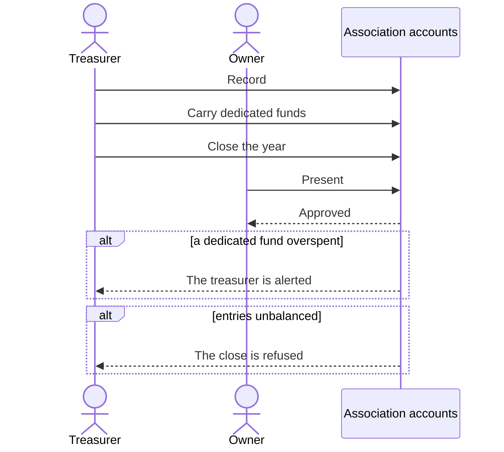

🏠 [Specs](../../../../README.md) › 🏷️ [Sectors](../../../README.md) › 🤲 [SC08 Non-profit association](../../README.md) ›
📝 [Use cases](../README.md) › 📝 [Use cases: FL-SC08-06 Accounts and data](README.md) ›
📝 UC-SC08-14 Keep association accounts

# 📝 UC-SC08-14 Keep association accounts

**Status:** ✅ specified

## Summary

The treasurer keeps the accounts under the non-profit rules with dedicated funds and contributions in kind, closes the
year and presents it to the assembly.

## Personas

- [U31 Treasurer](../../../../01-users/personas/u31-treasurer.md)
- [U13 Owner](../../../../01-users/personas/u13-owner.md)

## Goal

Accounts the assembly approves.

## Trigger

Daily entries and the year end.

## Frequency

Daily; yearly close.

## Preconditions

- The SC08 sector pack is installed for the company,
  [UC-F14-02](../../../../02-functional/f14-plugin-store/use-cases/01-find-and-install/uc-f14-02-install-a-plugin-or-sector-pack.md),
  and its users have their roles,
  [UC-F1-06](../../../../02-functional/f01-administration/use-cases/04-edit-a-role/uc-f01-06-edit-a-role-and-its-record-rules.md).

## Postconditions

- **Success:** the year is closed and presented.
- **Failed:** the year stays open.

## Main flow

1. The treasurer records entries on
   [S-SC08-14 Association accounts](../../screens/06-accounts-and-data/s-sc08-14-association-accounts.md),
   [UC-F8-23](../../../../02-functional/f08-accounting/use-cases/07-client-money-grants-and-non-profits/uc-f08-23-keep-non-profit-accounts.md).
2. Unused dedicated funds are carried over, [BR-SC08-07](../../business-rules/br-sc08-07-dedicated-funds-kept-apart.md),
   [BR-F8-15](../../../../02-functional/f08-accounting/business-rules/br-f08-15-dedicated-funds-keep-their-purpose.md).
3. The treasurer closes the year,
   [UC-F8-10](../../../../02-functional/f08-accounting/use-cases/05-close-report-and-consolidate/uc-f08-10-close-the-period-and-the-year.md).
4. The accounts go to the assembly ([UC-SC08-02](../01-members-and-governance/uc-sc08-02-run-the-general-assembly.md)).

## Alternative flows

- 3a. An external accountant: the accountant closes,
  [UC-F8-14](../../../../02-functional/f08-accounting/use-cases/01-set-up-and-post/uc-f08-14-work-with-the-external-accountant.md).

## Error flows

- 2e. A dedicated fund overspent: the treasurer is alerted.
- 3e. Entries unbalanced: the close is refused.
- Any step: a call to a service or an outside system fails: it is retried first
  ([BR-F3-32](../../../../02-functional/f03-assistant/business-rules/br-f03-32-retry-before-an-error.md)), then the
  error message pattern ([D122](../../../../06-decisions/ux/d122-error-message-standard.md)) says what failed; what was
  typed is kept.

## Business rules

- [BR-SC08-07 Dedicated funds kept apart](../../business-rules/br-sc08-07-dedicated-funds-kept-apart.md)
- [BR-SC08-10 Volunteer time valued if chosen](../../business-rules/br-sc08-10-volunteer-time-valued-if-chosen.md)
- [BR-F8-15 Dedicated funds keep their purpose](../../../../02-functional/f08-accounting/business-rules/br-f08-15-dedicated-funds-keep-their-purpose.md)

## Entities

- [E-SC08-09 Grant report](../../data/e-sc08-09-grant-report.md)
- [E-F8-19 Dedicated fund](../../../../02-functional/f08-accounting/data/e-f08-19-dedicated-fund.md)

## Permissions

The treasurer and owner roles; the record rules of their role and site apply,
[UC-F1-06](../../../../02-functional/f01-administration/use-cases/04-edit-a-role/uc-f01-06-edit-a-role-and-its-record-rules.md).

## Notifications

None beyond the in-app updates of the records concerned.

## Audit events

Every creation, change and state change of grant report, dedicated fund, dedicated fund records, with who, when and the
values before and after (T3).

## AI involvement

The AI assistant answers questions on the grant report, dedicated fund, dedicated fund records of this use case, with
links, and prepares them as drafts the user confirms. It works within the user's rights,
[BR-F3-34](../../../../02-functional/f03-assistant/business-rules/br-f03-34-every-capability-is-reachable-from-the-assistant.md),
and never deletes or does anything irreversible without the user's confirmation,
[BR-F3-07](../../../../02-functional/f03-assistant/business-rules/br-f03-07-no-deletes-no-irreversible-acts.md).

## API, MCP and A2A exposure

Through the API and webhooks (T5) and the MCP and A2A gateway (T6), with the caller's rights,
[BR-F3-34](../../../../02-functional/f03-assistant/business-rules/br-f03-34-every-capability-is-reachable-from-the-assistant.md),
reading, creating and changing the records of this use case; nothing irreversible without a person's confirmation.

## Screens

- [S-SC08-14 Association accounts](../../screens/06-accounts-and-data/s-sc08-14-association-accounts.md)

## Flowchart

See [FL-SC08-06 Accounts and data](../../flows/fl-sc08-06-accounts-and-data.md#flowchart).

## Sequence diagram

## Acceptance criteria

1. **Given** the example association's school fund with 10,000 EUR received and 4,000 EUR used **when** the year closes
   **then** 6,000 EUR is carried over.
2. **Given** the school fund with 10,000 EUR received and 11,000 EUR used **when** spending is posted **then** the
   treasurer is alerted.

## Non-functional notes

[D408](../../../../06-decisions/technical/d408-performance-and-profiles.md)'s targets
([performance](../../../../05-non-functional/performance.md)): 95 % of screens within 1 second; lists paged on the
server, the first page within 1 second; reports within 5 seconds or in the background. WCAG 2.2 AA and RGAA
([D46](../../../../06-decisions/ux/d46-accessibility-standard.md)).

## Regulatory references

Legal values from the France country pack:
[CR-FR-125 Association accounting](../../../../10-country-packs/france/accounting/cr-fr-125-association-accounting.md).

## Related use cases

- [UC-SC08-15 Publish the yearly accounts above the thresholds](uc-sc08-15-publish-the-yearly-accounts-above-the-thresholds.md)

## Open questions

None.

---

⬅️ [UC-SC08-13 Run a temporary bar at events](../05-events/uc-sc08-13-run-a-temporary-bar-at-events.md) ·
⬆️ [Up](README.md) · ➡️ [UC-SC08-15](uc-sc08-15-publish-the-yearly-accounts-above-the-thresholds.md)
