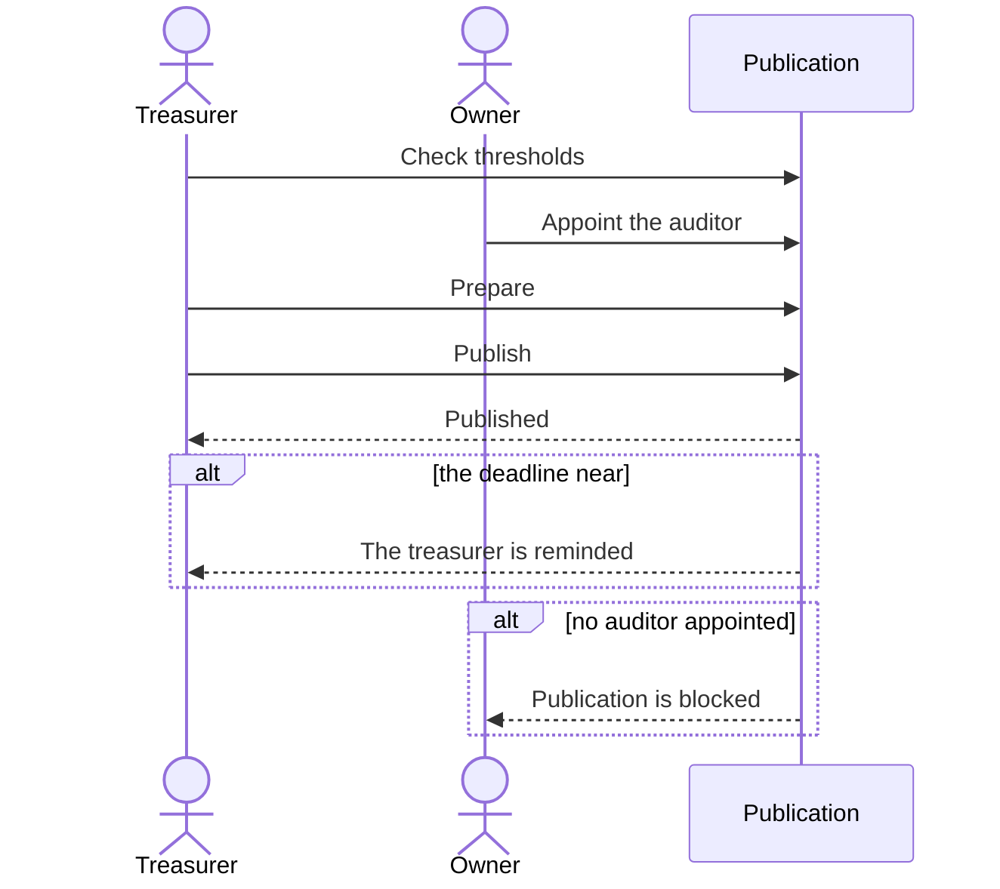

🏠 [Specs](../../../../README.md) › 🏷️ [Sectors](../../../README.md) › 🤲 [SC08 Non-profit association](../../README.md) ›
📝 [Use cases](../README.md) › 📝 [Use cases: FL-SC08-06 Accounts and data](README.md) ›
📝 UC-SC08-15 Publish the yearly accounts above the thresholds

# 📝 UC-SC08-15 Publish the yearly accounts above the thresholds

**Status:** ✅ specified

## Summary

The treasurer checks the grant and gift thresholds, appoints the auditor when crossed, and publishes the accounts.

## Personas

- [U31 Treasurer](../../../../01-users/personas/u31-treasurer.md)
- [U13 Owner](../../../../01-users/personas/u13-owner.md)

## Goal

Accounts published when the law asks.

## Trigger

The year end.

## Frequency

Yearly.

## Preconditions

- The SC08 sector pack is installed for the company,
  [UC-F14-02](../../../../02-functional/f14-plugin-store/use-cases/01-find-and-install/uc-f14-02-install-a-plugin-or-sector-pack.md),
  and its users have their roles,
  [UC-F1-06](../../../../02-functional/f01-administration/use-cases/04-edit-a-role/uc-f01-06-edit-a-role-and-its-record-rules.md).

## Postconditions

- **Success:** the accounts are published.
- **Failed:** the deadline is reminded.

## Main flow

1. SimpleERP checks thresholds on [S-SC08-15 Publication](../../screens/06-accounts-and-data/s-sc08-15-publication.md)
   ([BR-SC08-08](../../business-rules/br-sc08-08-publication-when-over-threshold.md)).
2. The board appoints the auditor.
3. The treasurer prepares the file,
   [UC-F8-25](../../../../02-functional/f08-accounting/use-cases/08-year-end-duties/uc-f08-25-approve-and-file-the-annual-accounts.md).
4. The accounts are published.

## Alternative flows

- 1a. A voluntary publication: the association publishes below the threshold.

## Error flows

- 4e. The deadline near: the treasurer is reminded.
- 2e. No auditor appointed: publication is blocked.
- Any step: a call to a service or an outside system fails: it is retried first
  ([BR-F3-32](../../../../02-functional/f03-assistant/business-rules/br-f03-32-retry-before-an-error.md)), then the
  error message pattern ([D122](../../../../06-decisions/ux/d122-error-message-standard.md)) says what failed; what was
  typed is kept.

## Business rules

- [BR-SC08-08 Publication when over the threshold](../../business-rules/br-sc08-08-publication-when-over-threshold.md)

## Entities

- [E-SC08-09 Grant report](../../data/e-sc08-09-grant-report.md)

## Permissions

The treasurer and owner roles; the record rules of their role and site apply,
[UC-F1-06](../../../../02-functional/f01-administration/use-cases/04-edit-a-role/uc-f01-06-edit-a-role-and-its-record-rules.md).

## Notifications

None beyond the in-app updates of the records concerned.

## Audit events

Every creation, change and state change of grant report records, with who, when and the values before and after (T3).

## AI involvement

The AI assistant answers questions on the grant report records of this use case, with links, and prepares them as drafts
the user confirms. It works within the user's rights,
[BR-F3-34](../../../../02-functional/f03-assistant/business-rules/br-f03-34-every-capability-is-reachable-from-the-assistant.md),
and never deletes or does anything irreversible without the user's confirmation,
[BR-F3-07](../../../../02-functional/f03-assistant/business-rules/br-f03-07-no-deletes-no-irreversible-acts.md).

## API, MCP and A2A exposure

Through the API and webhooks (T5) and the MCP and A2A gateway (T6), with the caller's rights,
[BR-F3-34](../../../../02-functional/f03-assistant/business-rules/br-f03-34-every-capability-is-reachable-from-the-assistant.md),
reading, creating and changing the records of this use case; nothing irreversible without a person's confirmation.

## Screens

- [S-SC08-15 Publication](../../screens/06-accounts-and-data/s-sc08-15-publication.md)

## Flowchart

See [FL-SC08-06 Accounts and data](../../flows/fl-sc08-06-accounts-and-data.md#flowchart).

## Sequence diagram

## Acceptance criteria

1. **Given** the example association's grants over the threshold **when** the year closes **then** an auditor and
   publication are asked.
2. **Given** accounts unpublished in late June **when** the reminder runs **then** the treasurer is reminded.

## Non-functional notes

[D408](../../../../06-decisions/technical/d408-performance-and-profiles.md)'s targets
([performance](../../../../05-non-functional/performance.md)): 95 % of screens within 1 second; lists paged on the
server, the first page within 1 second; reports within 5 seconds or in the background. WCAG 2.2 AA and RGAA
([D46](../../../../06-decisions/ux/d46-accessibility-standard.md)).

## Regulatory references

Legal values from the France country pack:
[CR-FR-126 Publication of accounts above the grant threshold](../../../../10-country-packs/france/non-profit/cr-fr-126-accounts-publication.md).

## Related use cases

- [UC-SC08-14 Keep association accounts](uc-sc08-14-keep-association-accounts.md)

## Open questions

None.

---

⬅️ [UC-SC08-14 Keep association accounts](uc-sc08-14-keep-association-accounts.md) · ⬆️ [Up](README.md) ·
➡️ [UC-SC08-16](../02-donations-and-receipts/uc-sc08-16-manage-bequests-and-gifts-in-kind.md)
