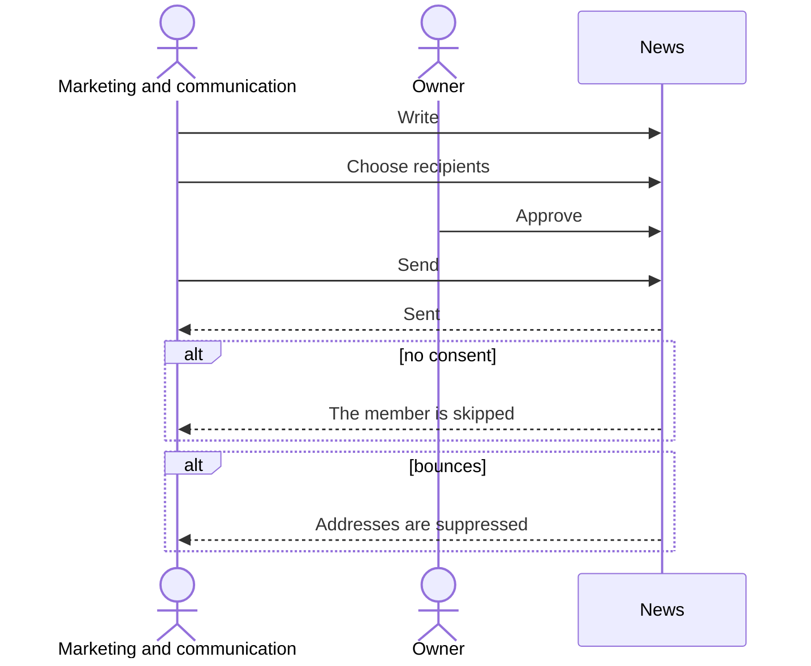

🏠 [Specs](../../../../README.md) › 🏷️ [Sectors](../../../README.md) › 🤲 [SC08 Non-profit association](../../README.md) ›
📝 [Use cases](../README.md) › 📝 [Use cases: FL-SC08-06 Accounts and data](README.md) ›
📝 UC-SC08-17 Communicate with members

# 📝 UC-SC08-17 Communicate with members

**Status:** ✅ specified

## Summary

Marketing writes newsletters and news and sends them to members who agreed.

## Personas

- [U12 Marketing and communication](../../../../01-users/personas/u12-marketing.md)
- [U13 Owner](../../../../01-users/personas/u13-owner.md)

## Goal

Members informed with consent.

## Trigger

News to share.

## Frequency

Monthly.

## Preconditions

- The SC08 sector pack is installed for the company,
  [UC-F14-02](../../../../02-functional/f14-plugin-store/use-cases/01-find-and-install/uc-f14-02-install-a-plugin-or-sector-pack.md),
  and its users have their roles,
  [UC-F1-06](../../../../02-functional/f01-administration/use-cases/04-edit-a-role/uc-f01-06-edit-a-role-and-its-record-rules.md).

## Postconditions

- **Success:** the newsletter is sent.
- **Failed:** the newsletter stays a draft.

## Main flow

1. Marketing writes on [S-SC08-17 News](../../screens/06-accounts-and-data/s-sc08-17-news.md).
2. Members who agreed are chosen ([BR-SC08-13](../../business-rules/br-sc08-13-communication-with-consent.md)).
3. The president approves.
4. It is sent,
   [UC-F5-08](../../../../02-functional/f05-social-media/use-cases/05-benchmark-additions/uc-f05-08-run-email-campaigns.md).

## Alternative flows

- 4a. A member-only area: the news is posted on the portal instead.

## Error flows

- 2e. No consent: the member is skipped.
- 4e. Bounces: addresses are suppressed.
- Any step: a call to a service or an outside system fails: it is retried first
  ([BR-F3-32](../../../../02-functional/f03-assistant/business-rules/br-f03-32-retry-before-an-error.md)), then the
  error message pattern ([D122](../../../../06-decisions/ux/d122-error-message-standard.md)) says what failed; what was
  typed is kept.

## Business rules

- [BR-SC08-13 Communication with consent](../../business-rules/br-sc08-13-communication-with-consent.md)
- [BR-F5-08 Marketing messages need consent](../../../../02-functional/f05-social-media/business-rules/br-f05-08-marketing-needs-consent.md)

## Entities

- [E-SC08-01 Member](../../data/e-sc08-01-member.md)

## Permissions

The marketing and communication and owner roles; the record rules of their role and site apply,
[UC-F1-06](../../../../02-functional/f01-administration/use-cases/04-edit-a-role/uc-f01-06-edit-a-role-and-its-record-rules.md).

## Notifications

None beyond the in-app updates of the records concerned.

## Audit events

Every creation, change and state change of member records, with who, when and the values before and after (T3).

## AI involvement

The AI assistant answers questions on the member records of this use case, with links, and prepares them as drafts the
user confirms. It works within the user's rights,
[BR-F3-34](../../../../02-functional/f03-assistant/business-rules/br-f03-34-every-capability-is-reachable-from-the-assistant.md),
and never deletes or does anything irreversible without the user's confirmation,
[BR-F3-07](../../../../02-functional/f03-assistant/business-rules/br-f03-07-no-deletes-no-irreversible-acts.md).

## API, MCP and A2A exposure

Through the API and webhooks (T5) and the MCP and A2A gateway (T6), with the caller's rights,
[BR-F3-34](../../../../02-functional/f03-assistant/business-rules/br-f03-34-every-capability-is-reachable-from-the-assistant.md),
reading, creating and changing the records of this use case; nothing irreversible without a person's confirmation.

## Screens

- [S-SC08-17 News](../../screens/06-accounts-and-data/s-sc08-17-news.md)

## Flowchart

See [FL-SC08-06 Accounts and data](../../flows/fl-sc08-06-accounts-and-data.md#flowchart).

## Sequence diagram

## Acceptance criteria

1. **Given** the example association's 150 members with 120 consents **when** the newsletter is sent **then** 120
   members receive it.
2. **Given** a member without newsletter consent **when** recipients are chosen **then** the member is skipped.

## Non-functional notes

[D408](../../../../06-decisions/technical/d408-performance-and-profiles.md)'s targets
([performance](../../../../05-non-functional/performance.md)): 95 % of screens within 1 second; lists paged on the
server, the first page within 1 second; reports within 5 seconds or in the background. WCAG 2.2 AA and RGAA
([D46](../../../../06-decisions/ux/d46-accessibility-standard.md)).

## Regulatory references

Legal values from the France country pack:
[CR-FR-063 Consent for email and SMS marketing](../../../../10-country-packs/france/consumer/cr-fr-063-electronic-marketing-consent.md).

## Related use cases

- [UC-SC08-18 Handle members' data-protection rights](uc-sc08-18-handle-members-data-protection-rights.md)

## Open questions

None.

---

⬅️ [UC-SC08-16](../02-donations-and-receipts/uc-sc08-16-manage-bequests-and-gifts-in-kind.md) · ⬆️ [Up](README.md) ·
➡️ [UC-SC08-18 Handle members' data-protection rights](uc-sc08-18-handle-members-data-protection-rights.md)
