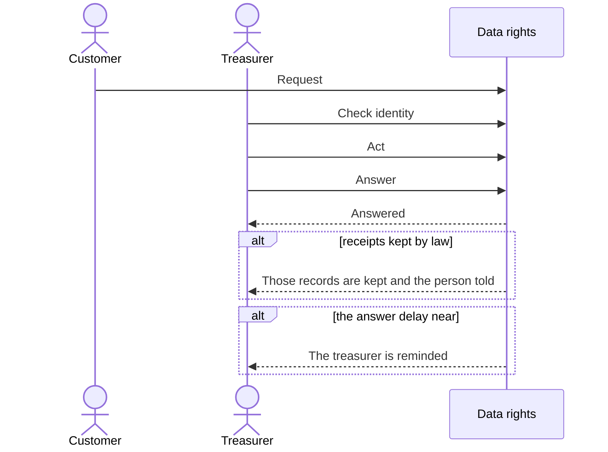

🏠 [Specs](../../../../README.md) › 🏷️ [Sectors](../../../README.md) › 🤲 [SC08 Non-profit association](../../README.md) ›
📝 [Use cases](../README.md) › 📝 [Use cases: FL-SC08-06 Accounts and data](README.md) ›
📝 UC-SC08-18 Handle members' data-protection rights

# 📝 UC-SC08-18 Handle members' data-protection rights

**Status:** ✅ specified

## Summary

The treasurer receives a member's or donor's request to see, correct or erase their data, acts, and answers, keeping
what the law requires.

## Personas

- [U31 Treasurer](../../../../01-users/personas/u31-treasurer.md)
- [U09 Customer](../../../../01-users/personas/u09-customer.md)

## Goal

Rights honoured on time.

## Trigger

A request.

## Frequency

A few a year.

## Preconditions

- The SC08 sector pack is installed for the company,
  [UC-F14-02](../../../../02-functional/f14-plugin-store/use-cases/01-find-and-install/uc-f14-02-install-a-plugin-or-sector-pack.md),
  and its users have their roles,
  [UC-F1-06](../../../../02-functional/f01-administration/use-cases/04-edit-a-role/uc-f01-06-edit-a-role-and-its-record-rules.md).

## Postconditions

- **Success:** the request is answered.
- **Failed:** the request is refused with the reason.

## Main flow

1. The member sends the request on [S-SC08-18 Data rights](../../screens/06-accounts-and-data/s-sc08-18-data-rights.md).
2. The treasurer checks the person's identity.
3. The data is exported, corrected or erased ([BR-SC08-14](../../business-rules/br-sc08-14-members-rights-honoured.md)).
4. The treasurer answers.

## Alternative flows

- 1a. A former member: the same applies.

## Error flows

- 3e. Receipts kept by law: those records are kept and the person told.
- 4e. The answer delay near: the treasurer is reminded.
- Any step: a call to a service or an outside system fails: it is retried first
  ([BR-F3-32](../../../../02-functional/f03-assistant/business-rules/br-f03-32-retry-before-an-error.md)), then the
  error message pattern ([D122](../../../../06-decisions/ux/d122-error-message-standard.md)) says what failed; what was
  typed is kept.

## Business rules

- [BR-SC08-14 Members' rights honoured](../../business-rules/br-sc08-14-members-rights-honoured.md)

## Entities

- [E-SC08-01 Member](../../data/e-sc08-01-member.md)

## Permissions

The treasurer and customer roles; the record rules of their role and site apply,
[UC-F1-06](../../../../02-functional/f01-administration/use-cases/04-edit-a-role/uc-f01-06-edit-a-role-and-its-record-rules.md).

## Notifications

None beyond the in-app updates of the records concerned.

## Audit events

Every creation, change and state change of member records, with who, when and the values before and after (T3).

## AI involvement

The AI assistant answers questions on the member records of this use case, with links, and prepares them as drafts the
user confirms. It works within the user's rights,
[BR-F3-34](../../../../02-functional/f03-assistant/business-rules/br-f03-34-every-capability-is-reachable-from-the-assistant.md),
and never deletes or does anything irreversible without the user's confirmation,
[BR-F3-07](../../../../02-functional/f03-assistant/business-rules/br-f03-07-no-deletes-no-irreversible-acts.md).

## API, MCP and A2A exposure

Through the API and webhooks (T5) and the MCP and A2A gateway (T6), with the caller's rights,
[BR-F3-34](../../../../02-functional/f03-assistant/business-rules/br-f03-34-every-capability-is-reachable-from-the-assistant.md),
reading, creating and changing the records of this use case; nothing irreversible without a person's confirmation.

## Screens

- [S-SC08-18 Data rights](../../screens/06-accounts-and-data/s-sc08-18-data-rights.md)

## Flowchart

See [FL-SC08-06 Accounts and data](../../flows/fl-sc08-06-accounts-and-data.md#flowchart).

## Sequence diagram

## Acceptance criteria

1. **Given** the example association's J. Martin asking for his data **when** it is exported **then** he gets his
   records in a file.
2. **Given** J. Martin asking erasure with receipts in 2026 **when** his data is erased **then** those records are kept
   and the person told.

## Non-functional notes

[D408](../../../../06-decisions/technical/d408-performance-and-profiles.md)'s targets
([performance](../../../../05-non-functional/performance.md)): 95 % of screens within 1 second; lists paged on the
server, the first page within 1 second; reports within 5 seconds or in the background. WCAG 2.2 AA and RGAA
([D46](../../../../06-decisions/ux/d46-accessibility-standard.md)).

## Regulatory references

Legal values from the France country pack:
[CR-FR-051 Access and erasure requests](../../../../10-country-packs/france/data-protection/cr-fr-051-access-and-erasure.md).

## Related use cases

- [UC-SC08-17 Communicate with members](uc-sc08-17-communicate-with-members.md)

## Open questions

None.

---

⬅️ [UC-SC08-17 Communicate with members](uc-sc08-17-communicate-with-members.md) · ⬆️ [Up](README.md) ·
➡️ [UC-SC08-19 Follow the association's dashboard](uc-sc08-19-follow-the-association-s-dashboard.md)
