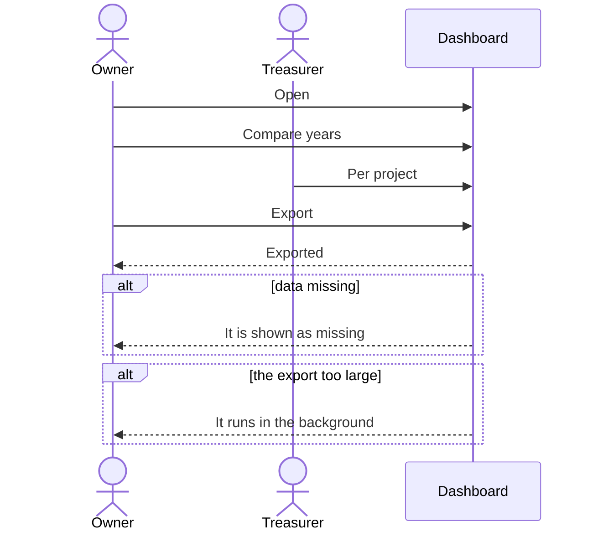

🏠 [Specs](../../../../README.md) › 🏷️ [Sectors](../../../README.md) › 🤲 [SC08 Non-profit association](../../README.md) ›
📝 [Use cases](../README.md) › 📝 [Use cases: FL-SC08-06 Accounts and data](README.md) ›
📝 UC-SC08-19 Follow the association's dashboard

# 📝 UC-SC08-19 Follow the association's dashboard

**Status:** ✅ specified

## Summary

The president and the treasurer follow members, gifts, grants, cash and volunteers, compare years and export for the
assembly.

## Personas

- [U13 Owner](../../../../01-users/personas/u13-owner.md)
- [U31 Treasurer](../../../../01-users/personas/u31-treasurer.md)

## Goal

Steer the association on its figures.

## Trigger

Monthly review.

## Frequency

Monthly.

## Preconditions

- The SC08 sector pack is installed for the company,
  [UC-F14-02](../../../../02-functional/f14-plugin-store/use-cases/01-find-and-install/uc-f14-02-install-a-plugin-or-sector-pack.md),
  and its users have their roles,
  [UC-F1-06](../../../../02-functional/f01-administration/use-cases/04-edit-a-role/uc-f01-06-edit-a-role-and-its-record-rules.md).

## Postconditions

- **Success:** figures are read and exported.
- **Failed:** missing data is shown.

## Main flow

1. The president opens
   [S-SC08-19 Association dashboard](../../screens/06-accounts-and-data/s-sc08-19-association-dashboard.md).
2. The president compares with last year.
3. The treasurer filters per project.
4. The export goes to the assembly file.

## Alternative flows

- 3a. Per project: figures per project and fund.

## Error flows

- 1e. Data missing: it is shown as missing.
- 4e. The export too large: it runs in the background.
- Any step: a call to a service or an outside system fails: it is retried first
  ([BR-F3-32](../../../../02-functional/f03-assistant/business-rules/br-f03-32-retry-before-an-error.md)), then the
  error message pattern ([D122](../../../../06-decisions/ux/d122-error-message-standard.md)) says what failed; what was
  typed is kept.

## Business rules

- [BR-SC08-07 Dedicated funds kept apart](../../business-rules/br-sc08-07-dedicated-funds-kept-apart.md)

## Entities

- [E-SC08-01 Member](../../data/e-sc08-01-member.md)
- [E-SC08-04 Gift](../../data/e-sc08-04-gift.md)
- [E-F8-18 Grant](../../../../02-functional/f08-accounting/data/e-f08-18-grant.md)

## Permissions

The owner and treasurer roles; the record rules of their role and site apply,
[UC-F1-06](../../../../02-functional/f01-administration/use-cases/04-edit-a-role/uc-f01-06-edit-a-role-and-its-record-rules.md).

## Notifications

None beyond the in-app updates of the records concerned.

## Audit events

Every creation, change and state change of member, gift, grant records, with who, when and the values before and after
(T3).

## AI involvement

The AI assistant answers questions on the member, gift, grant records of this use case, with links, and prepares them as
drafts the user confirms. It works within the user's rights,
[BR-F3-34](../../../../02-functional/f03-assistant/business-rules/br-f03-34-every-capability-is-reachable-from-the-assistant.md),
and never deletes or does anything irreversible without the user's confirmation,
[BR-F3-07](../../../../02-functional/f03-assistant/business-rules/br-f03-07-no-deletes-no-irreversible-acts.md).

## API, MCP and A2A exposure

Through the API and webhooks (T5) and the MCP and A2A gateway (T6), with the caller's rights,
[BR-F3-34](../../../../02-functional/f03-assistant/business-rules/br-f03-34-every-capability-is-reachable-from-the-assistant.md),
reading, creating and changing the records of this use case; nothing irreversible without a person's confirmation.

## Screens

- [S-SC08-19 Association dashboard](../../screens/06-accounts-and-data/s-sc08-19-association-dashboard.md)

## Flowchart

See [FL-SC08-06 Accounts and data](../../flows/fl-sc08-06-accounts-and-data.md#flowchart).

## Sequence diagram

## Acceptance criteria

1. **Given** the example association's 150 members and 12,400 EUR of gifts in 2026 **when** the dashboard opens **then**
   it shows both with 2025 beside them.
2. **Given** a month without bank import **when** the dashboard opens **then** it is shown as missing.

## Non-functional notes

[D408](../../../../06-decisions/technical/d408-performance-and-profiles.md)'s targets
([performance](../../../../05-non-functional/performance.md)): 95 % of screens within 1 second; lists paged on the
server, the first page within 1 second; reports within 5 seconds or in the background. WCAG 2.2 AA and RGAA
([D46](../../../../06-decisions/ux/d46-accessibility-standard.md)).

## Regulatory references

None specific to this use case; the sector's legal rules are listed in [SC08 regulatory](../../regulatory.md).

## Related use cases

- [UC-SC08-14 Keep association accounts](uc-sc08-14-keep-association-accounts.md)

## Open questions

None.

---

⬅️ [UC-SC08-18 Handle members' data-protection rights](uc-sc08-18-handle-members-data-protection-rights.md) ·
⬆️ [Up](README.md) ·
➡️ [UC-SC08-20](../02-donations-and-receipts/uc-sc08-20-ask-the-assistant-about-the-association.md)
