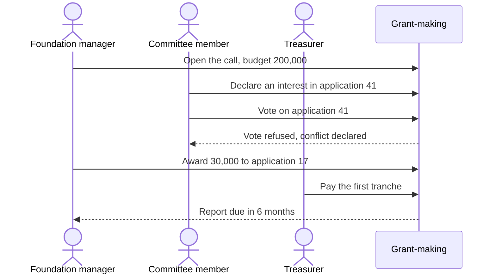

🏠 [Specs](../../../../README.md) › 🏷️ [Sectors](../../../README.md) › 🤲 [SC08 Non-profit association](../../README.md) ›
📝 [Use cases](../README.md) ›
📝 [Use cases: FL-SC08-07 Foundations, integration, federations, peer fundraising](README.md) ›
📝 UC-SC08-21 Give grants as a foundation

# 📝 UC-SC08-21 Give grants as a foundation

**Status:** ✅ specified

## Summary

A foundation gives grants instead of receiving them. It publishes a call, receives applications, checks that they fit
its purpose, lets the selection committee vote, signs an agreement with each winner, pays in tranches and follows the
reports. Members of the committee who have an interest in an application leave the vote on it.

## Personas

- [U31 Treasurer](../../../../01-users/personas/u31-treasurer.md)
- [U13 Owner](../../../../01-users/personas/u13-owner.md)

## Goal

Every grant is chosen by a committee free of conflicts, paid according to an agreement and followed until its report,
and the foundation can show who decided what and why.

## Trigger

A call opens, an application is received, the committee meets, or a tranche or report falls due.

## Frequency

One or two calls a year with 20 to 300 applications each, and a committee meeting per call.

## Preconditions

- The foundation's purpose and the criteria of the call are entered.
- The committee members are members of the association ([E-SC08-01 Member](../../data/e-sc08-01-member.md)) with their
  declared interests.
- The budget of the call is a dedicated fund
  ([E-F8-19](../../../../02-functional/f08-accounting/data/e-f08-19-dedicated-fund.md)).

## Postconditions

- **Succeeded:** each application is saved ([E-SC08-16 Grant application](../../data/e-sc08-16-grant-application.md))
  with its score, the votes without conflicts and its decision, and each grant has its agreement and schedule of
  payments.
- **Failed:** an application is not decided while a vote counted a member with a conflict, and the vote is reopened.

## Main flow

1. The foundation's manager opens the grants screen
   ([S-SC08-21](../../screens/07-foundations-integration-and-federations/s-sc08-21-grant-making.md)) and creates a call
   with its criteria, its budget and its dates.
2. Applicants send their application and documents through a form; each is checked for eligibility and receives an
   acknowledgement.
3. Each member of the committee declares their interests; those with an interest in an application are marked for it
   ([BR-SC08-16](../../business-rules/br-sc08-16-members-with-a-conflict-do-not-vote.md)).
4. The members score the applications and the committee votes at its meeting
   ([UC-SC08-03](../01-members-and-governance/uc-sc08-03-run-the-board-and-its-decisions.md)), the members with a
   conflict not taking part.
5. The manager records the decision, sends the answers and, for each winner, prepares the grant agreement with its
   conditions and tranches.
6. The treasurer pays each tranche on its date and the grantee's report closes the grant
   ([UC-SC08-09](../03-grants/uc-sc08-09-report-to-funders-on-grants.md)).

## Alternative flows

- 2a. An application is incomplete: it is returned with the missing documents and a deadline.
- 4a. The vote is tied: the chair's vote decides if the statutes say so.
- 6a. A grantee asks to change the use of the grant: the committee approves or refuses the change and the agreement is
  amended.

## Error flows

- 3e. A member votes on an application where they declared an interest: the vote is refused for them and recorded.
- 5e. The sum of the awards exceeds the budget of the call: the decisions are held until the awards are reduced.
- 6e. A report is late: the next tranche is not paid and the grantee is reminded.
- Any step: a service does not answer; the call is retried first
  ([BR-F3-32](../../../../02-functional/f03-assistant/business-rules/br-f03-32-retry-before-an-error.md)), then the
  message follows the error pattern ([D122](../../../../06-decisions/ux/d122-error-message-standard.md)) and what the
  user typed stays on the screen.

## Business rules

- [BR-SC08-16](../../business-rules/br-sc08-16-members-with-a-conflict-do-not-vote.md)
- [BR-SC08-06](../../business-rules/br-sc08-06-grants-tracked-to-their-purpose.md)

## Entities

- [E-SC08-16 Grant application](../../data/e-sc08-16-grant-application.md): created, changed, awarded
- [E-SC08-01 Member](../../data/e-sc08-01-member.md): read, the committee members and their interests
- [E-SC08-03 Assembly or board meeting](../../data/e-sc08-03-assembly-or-board-meeting.md): read, the meeting where the
  committee votes
- [E-F8-19](../../../../02-functional/f08-accounting/data/e-f08-19-dedicated-fund.md): changed, the fund the awards come
  from

## Permissions

Foundation manager creates calls and prepares agreements; committee members score and vote; treasurer pays.
The applicant sees only their own application and its decision.

## Notifications

The applicant, by email: the acknowledgement, the decision and the date of each tranche. The committee, in the app: a
meeting is set and applications wait for their score.

## Audit events

Each call, application, declared interest, score, vote with the members counted, decision, agreement and payment, who
and when.

## AI involvement

No AI step of its own. The AI assistant may open the screen and prefill it from the user's words; the user checks and
confirms
[BR-F3-07](../../../../02-functional/f03-assistant/business-rules/br-f03-07-no-deletes-no-irreversible-acts.md).

## API, MCP and A2A exposure

T5 operations of the capability for the personas above: create, read, update and list. The MCP tool of the
capability may read and propose, never confirm alone. No A2A skill.

## Screens

- [S-SC08-21](../../screens/07-foundations-integration-and-federations/s-sc08-21-grant-making.md)

## Flowchart

See
[FL-SC08-07 Foundations, integration, federations, peer fundraising](../../flows/fl-sc08-07-foundations-integration-and-federations.md#flowchart).

## Sequence diagram

## Acceptance criteria

1. **Given** a committee member who declared an interest in application 41 **when** they try to vote on it **then** the
   vote is refused and recorded.
2. **Given** a call budget of 200,000 EUR and awards totalling 215,000 EUR **when** the manager records the decisions
   **then** they are held until the awards are reduced.
3. **Given** an award of 30,000 EUR in two tranches **when** the first date arrives **then** the treasurer is asked to
   pay 15,000 EUR.
4. **Given** a grantee whose report is late **when** the next tranche falls due **then** the payment is held and the
   grantee is reminded.

## Non-functional notes

The screen answers within 2 seconds for 10,000 records; every change is audited.

## Regulatory references

A foundation gives grants for its general-interest purpose in the statutes, and keeps who decided and why.
The members who decide declare their interests and do not vote on applications where they have one. A grant is paid
under an agreement that states its use and its report. Gifts the foundation receives give tax receipts to the donors,
and its accounts are published above the thresholds of the country pack. The France-pack rule is written later. Related:
[CR-FR-127](../../../../10-country-packs/france/non-profit/cr-fr-127-grant-agreement-and-report.md),
[CR-FR-124](../../../../10-country-packs/france/non-profit/cr-fr-124-gift-tax-receipts.md),
[CR-FR-126](../../../../10-country-packs/france/non-profit/cr-fr-126-accounts-publication.md).

## Related use cases

- [UC-SC08-22 Run a work-integration enterprise](uc-sc08-22-run-a-work-integration-enterprise.md)
- [UC-SC08-03](../01-members-and-governance/uc-sc08-03-run-the-board-and-its-decisions.md)
- [UC-SC08-08](../03-grants/uc-sc08-08-apply-for-grants-and-follow-their-conditions.md)
- [UC-F8-22](../../../../02-functional/f08-accounting/use-cases/07-client-money-grants-and-non-profits/uc-f08-22-account-for-a-grant.md)

## Open questions

None.

---

⬅️ [UC-SC08-20](../02-donations-and-receipts/uc-sc08-20-ask-the-assistant-about-the-association.md) ·
⬆️ [Up](README.md) ·
➡️ [UC-SC08-22 Run a work-integration enterprise](uc-sc08-22-run-a-work-integration-enterprise.md)
