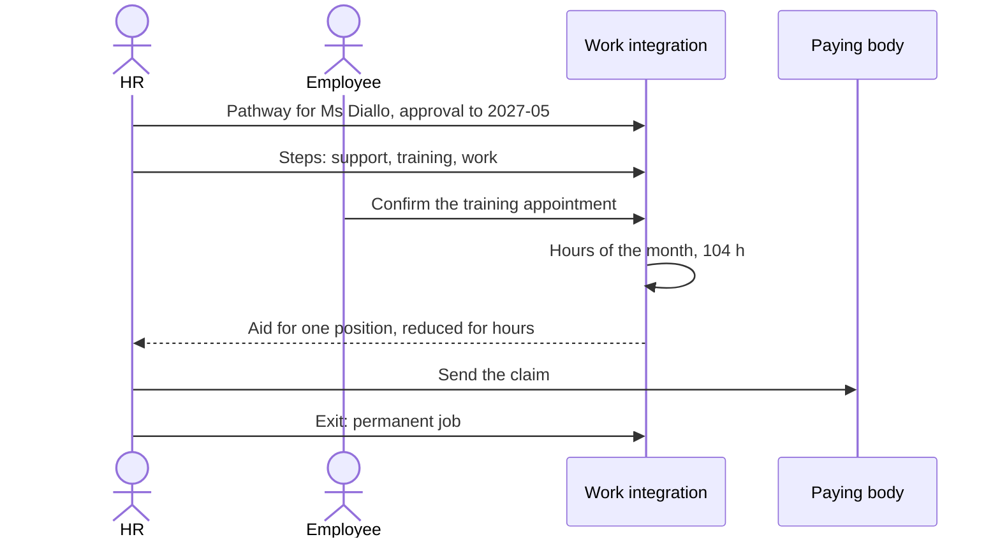

🏠 [Specs](../../../../README.md) › 🏷️ [Sectors](../../../README.md) › 🤲 [SC08 Non-profit association](../../README.md) ›
📝 [Use cases](../README.md) ›
📝 [Use cases: FL-SC08-07 Foundations, integration, federations, peer fundraising](README.md) ›
📝 UC-SC08-22 Run a work-integration enterprise

# 📝 UC-SC08-22 Run a work-integration enterprise

**Status:** 🔄 waiting for the owner

## Summary

A work-integration enterprise (an IAE structure) employs people far from the labour market and supports them to a
lasting job. HR enters each person's approval, their pathway (support, training, work), and the aid the State pays for
each approved position. The employee follows their own steps on the phone.

## Personas

- [U06 Human resources](../../../../01-users/personas/u06-hr.md)
- [U01 Employee](../../../../01-users/personas/u01-employee.md)

## Goal

Every person employed has a valid approval, a pathway with its steps, and the aid claimed is exactly the aid the
approval and the hours worked allow.

## Trigger

A person is approved and hired, a pathway step falls due, or the month's aid is claimed.

## Frequency

Dozens of people at any time, with a few arrivals and exits each month.

## Preconditions

- The structure's type and its number of approved positions are entered in the settings.
- The person is an employee record
  ([E-F9-01](../../../../02-functional/f09-hr-and-projects/data/e-f09-01-employee-record.md)) with a contract
  ([E-F9-02 Contract](../../../../02-functional/f09-hr-and-projects/data/e-f09-02-contract.md)).
- The approval given by the employment service is in the file.

## Postconditions

- **Succeeded:** the pathway is saved ([E-SC08-17 Integration pathway](../../data/e-sc08-17-integration-pathway.md))
  with the approval, the steps and the exit result, and the monthly aid claim matches the approved positions.
- **Failed:** no aid is claimed for a person without a valid approval, and the gap is listed to HR.

## Main flow

1. HR opens the work-integration screen
   ([S-SC08-22](../../screens/07-foundations-integration-and-federations/s-sc08-22-work-integration.md)) and creates the
   pathway of a person with their approval dates and the contract.
2. HR sets the steps of the pathway: social support, training, work experience and the job search.
3. The person sees their steps and appointments on their phone and confirms each one.
4. Each month simple-ERP counts the hours worked and computes the aid per approved position
   ([BR-SC08-17](../../business-rules/br-sc08-17-aid-per-position-follows-the-approval.md)).
5. HR checks the claim and sends it to the paying body
   [UC-F13-10](../../../../02-functional/f13-payroll/use-cases/03-declarations-and-payments/uc-f13-10-file-the-monthly-social-declaration-and-handle-returns.md).
6. At the end of the contract HR records the exit: a job, a training, or another result, with the date.

## Alternative flows

- 4a. A person works part-time: the aid is reduced in proportion to the hours.
- 2a. The approval is renewed: the new dates replace the old ones and the contract is extended.
- 6a. The person leaves before the end: the exit is recorded as early with its reason and the aid stops at the exit
  date.

## Error flows

- 4e. The aid would exceed the number of approved positions: the claim is capped and the extra positions are listed.
- 1e. The approval is missing or expired: the pathway stays Draft and no aid is computed.
- 6e. The pathway ends with no exit result: the file cannot be closed.
- Any step: a service does not answer; the call is retried first
  ([BR-F3-32](../../../../02-functional/f03-assistant/business-rules/br-f03-32-retry-before-an-error.md)), then the
  message follows the error pattern ([D122](../../../../06-decisions/ux/d122-error-message-standard.md)) and what the
  user typed stays on the screen.

## Business rules

- [BR-SC08-17](../../business-rules/br-sc08-17-aid-per-position-follows-the-approval.md)
- [BR-SC08-06](../../business-rules/br-sc08-06-grants-tracked-to-their-purpose.md)

## Entities

- [E-SC08-17 Integration pathway](../../data/e-sc08-17-integration-pathway.md): created, changed, closed
- [E-F9-01](../../../../02-functional/f09-hr-and-projects/data/e-f09-01-employee-record.md): read, the employee record
- [E-F9-02 Contract](../../../../02-functional/f09-hr-and-projects/data/e-f09-02-contract.md): read, the contract and
  its dates
- [E-F9-22](../../../../02-functional/f09-hr-and-projects/data/e-f09-22-training-session.md): read, the training
  sessions of the pathway

## Permissions

HR creates and changes pathways and aid claims; the employee reads and confirms their own steps. The
structure's director reads the aid and the exits, never the social notes.

## Notifications

The employee, on the phone: an appointment or a step is due. HR, in the app: an approval ends within sixty days or a
claim exceeds the approved positions.

## Audit events

Each approval, step, exit and claim, each reading of the social notes, with who and when.

## AI involvement

No AI step of its own. The AI assistant may open the screen and prefill it from the user's words; the user checks and
confirms
[BR-F3-07](../../../../02-functional/f03-assistant/business-rules/br-f03-07-no-deletes-no-irreversible-acts.md).

## API, MCP and A2A exposure

T5 operations of the capability for the personas above: create, read, update and list. The MCP tool of the
capability may read and propose, never confirm alone. No A2A skill.

## Screens

- [S-SC08-22](../../screens/07-foundations-integration-and-federations/s-sc08-22-work-integration.md)

## Flowchart

See
[FL-SC08-07 Foundations, integration, federations, peer fundraising](../../flows/fl-sc08-07-foundations-integration-and-federations.md#flowchart).

## Sequence diagram

## Acceptance criteria

1. **Given** a structure with 20 approved positions and 22 people approved and employed in a month **when** the claim is
   computed **then** it is capped at 20 positions and the 2 extra are listed.
2. **Given** a person whose approval ended last week **when** HR computes the month's aid **then** no aid is computed
   for them and the gap is listed.
3. **Given** a person working 104 hours in a month where a full position is 151.67 hours **when** the aid is computed
   **then** it is reduced in proportion to the hours.
4. **Given** a pathway at its end with no exit result **when** HR tries to close it **then** it is refused and the
   result is asked for.

## Non-functional notes

The screen answers within 2 seconds for 10,000 records; every change is audited.

## Regulatory references

A work-integration enterprise is approved by the State for its type of structure. Each person it employs is
approved by the employment service for a limited time, and the State pays an aid for each approved position, in
proportion to the time worked and by type of structure. The structure reports its exits and results. Personal and social
notes about the person are sensitive data kept apart. The France-pack rule is listed below. Related:
[CR-FR-041](../../../../10-country-packs/france/labour/cr-fr-041-fixed-term-contracts.md),
[CR-FR-102](../../../../10-country-packs/france/home-care/cr-fr-102-personal-services-registration.md),
[CR-FR-052](../../../../10-country-packs/france/data-protection/cr-fr-052-storage-limitation.md).

- France-pack rule, (Proposed) until its law is read:
  [CR-FR-237 Work-integration enterprises (IAE)](../../../../10-country-packs/france/non-profit/cr-fr-237-work-integration-iae.md)

## Related use cases

- [UC-SC08-21 Give grants as a foundation](uc-sc08-21-give-grants-as-a-foundation.md)
- [UC-SC08-23 Run a federation of member clubs](uc-sc08-23-run-a-federation-of-member-clubs.md)
- [UC-SC08-10](../04-volunteers/uc-sc08-10-recruit-and-register-volunteers-for-missions.md)
- [UC-F9-01](../../../../02-functional/f09-hr-and-projects/use-cases/01-people/uc-f09-01-manage-employee-records-and-contracts.md)
- [UC-F9-25](../../../../02-functional/f09-hr-and-projects/use-cases/09-train-and-protect/uc-f09-25-run-the-training-plan-with-opco-funding.md)

## Open questions

None.

---

⬅️ [UC-SC08-21 Give grants as a foundation](uc-sc08-21-give-grants-as-a-foundation.md) · ⬆️ [Up](README.md) ·
➡️ [UC-SC08-23 Run a federation of member clubs](uc-sc08-23-run-a-federation-of-member-clubs.md)
