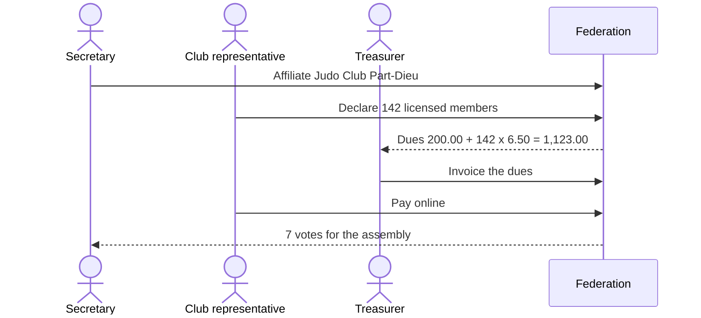

🏠 [Specs](../../../../README.md) › 🏷️ [Sectors](../../../README.md) › 🤲 [SC08 Non-profit association](../../README.md) ›
📝 [Use cases](../README.md) ›
📝 [Use cases: FL-SC08-07 Foundations, integration, federations, peer fundraising](README.md) ›
📝 UC-SC08-23 Run a federation of member clubs

# 📝 UC-SC08-23 Run a federation of member clubs

**Status:** ✅ specified

## Summary

A federation brings together member clubs or associations. It affiliates them, receives each club's yearly list of
licensed members, computes the federation's dues from that headcount, invoices the club, and gives each club its votes
at the general assembly in proportion to its members.

## Personas

- [U31 Treasurer](../../../../01-users/personas/u31-treasurer.md)
- [U13 Owner](../../../../01-users/personas/u13-owner.md)

## Goal

Each club pays dues that follow its real headcount, the federation knows who is affiliated, and the votes at the
assembly match the clubs' members.

## Trigger

A club asks to affiliate, a club declares its members for the season, or the dues fall due.

## Frequency

One season a year with dozens to hundreds of clubs, and affiliations all year.

## Preconditions

- The federation's statutes state the dues scale and the weighting of the votes.
- Each club is an organisation record
  ([E-F6-01](../../../../02-functional/f06-customers-and-sales/data/e-f06-01-customer-record.md)) with its
  representative.
- The season's dates are in the settings.

## Postconditions

- **Succeeded:** each club is saved ([E-SC08-18 Member organisation](../../data/e-sc08-18-member-organisation.md)) with
  its affiliation, headcount, dues and votes, and the dues are invoiced and followed
  ([E-F6-05 Invoice](../../../../02-functional/f06-customers-and-sales/data/e-f06-05-invoice.md)).
- **Failed:** a club with no declared headcount is invoiced the minimum dues and flagged, and no vote is given to an
  unaffiliated club.

## Main flow

1. The federation's secretary opens the federation screen
   ([S-SC08-23](../../screens/07-foundations-integration-and-federations/s-sc08-23-federation.md)) and affiliates a club
   with its representative and its statutes.
2. At the start of the season each club declares its licensed members on its own page
   ([UC-SC08-01](../01-members-and-governance/uc-sc08-01-manage-members-and-dues.md)).
3. SimpleERP computes the dues from the scale: a fixed part and an amount per licensed member
   ([BR-SC08-18](../../business-rules/br-sc08-18-dues-follow-each-clubs-headcount.md)).
4. The treasurer invoices the dues and follows the payments
   [UC-F6-08](../../../../02-functional/f06-customers-and-sales/use-cases/03-invoice-and-get-paid/uc-f06-08-remind-late-payers.md).
5. Before the assembly SimpleERP computes each club's votes from its headcount and the weighting of the statutes
   ([UC-SC08-02](../01-members-and-governance/uc-sc08-02-run-the-general-assembly.md)).
6. The president reads the federation's totals by region and by discipline.

## Alternative flows

- 2a. A club adds members during the season: the dues are recomputed from the date of the addition.
- 1a. A club leaves the federation: its affiliation ends at the date and its dues are settled pro rata.
- 5a. The statutes cap the votes of a large club: the cap applies after the weighting.

## Error flows

- 2e. A club declares more licences than it has members on its list: the declaration is checked and the difference asked
  for.
- 4e. A club does not pay by the due date: it is reminded, then suspended after the delay in the statutes, and loses its
  vote.
- 1e. The statutes of the new club are missing: the affiliation stays Candidate.
- Any step: a service does not answer; the call is retried first
  ([BR-F3-32](../../../../02-functional/f03-assistant/business-rules/br-f03-32-retry-before-an-error.md)), then the
  message follows the error pattern ([D122](../../../../06-decisions/ux/d122-error-message-standard.md)) and what the
  user typed stays on the screen.

## Business rules

- [BR-SC08-18](../../business-rules/br-sc08-18-dues-follow-each-clubs-headcount.md)
- [BR-SC08-04 Dues make members](../../business-rules/br-sc08-04-dues-make-members.md)

## Entities

- [E-SC08-18 Member organisation](../../data/e-sc08-18-member-organisation.md): created, changed, suspended
- [E-SC08-02 Dues payment](../../data/e-sc08-02-dues-payment.md): created, the dues payment of each club
- [E-F6-05 Invoice](../../../../02-functional/f06-customers-and-sales/data/e-f06-05-invoice.md): created, the invoice of
  the dues
- [E-SC08-03 Assembly or board meeting](../../data/e-sc08-03-assembly-or-board-meeting.md): read, the assembly where the
  votes are counted

## Permissions

Secretary affiliates and changes clubs; the club's representative declares their members and reads their own dues;
treasurer invoices. Clubs see only their own file, never the other clubs' lists.

## Notifications

The club representative, by email: the dues invoice, the reminder and the votes it holds. The treasurer, in the app: a
club is late.

## Audit events

Each affiliation, declaration of headcount, dues computation, invoice, suspension, vote weight and leaving, with who and
when.

## AI involvement

No AI step of its own. The AI assistant may open the screen and prefill it from the user's words; the user checks and
confirms
[BR-F3-07](../../../../02-functional/f03-assistant/business-rules/br-f03-07-no-deletes-no-irreversible-acts.md).

## API, MCP and A2A exposure

T5 operations of the capability for the personas above: create, read, update and list. The MCP tool of the
capability may read and propose, never confirm alone. No A2A skill.

## Screens

- [S-SC08-23](../../screens/07-foundations-integration-and-federations/s-sc08-23-federation.md)

## Flowchart

See
[FL-SC08-07 Foundations, integration, federations, peer fundraising](../../flows/fl-sc08-07-foundations-integration-and-federations.md#flowchart).

## Sequence diagram

## Acceptance criteria

1. **Given** a scale of 200.00 EUR plus 6.50 EUR per licensed member and a club with 142 members **when** the dues are
   computed **then** they are 1,123.00 EUR.
2. **Given** a club that adds 10 members in March **when** the dues are recomputed **then** the extra 10 members are
   added from the date.
3. **Given** a club that has not paid after the delay in the statutes **when** the delay ends **then** the club is
   suspended and its votes are removed.
4. **Given** a club with no declaration **when** the dues are computed **then** the minimum dues are invoiced and the
   club is flagged.

## Non-functional notes

The screen answers within 2 seconds for 10,000 records; every change is audited.

## Regulatory references

A federation is an association whose members are associations and follows the same rules for its assembly and
accounts. Membership dues are not a gift and give no tax receipt. A sports federation that issues licences does so under
the State's approval and delegation. The accounts are published above the thresholds of the country pack. The
France-pack rule is written later. Related:
[CR-FR-125](../../../../10-country-packs/france/accounting/cr-fr-125-association-accounting.md),
[CR-FR-126](../../../../10-country-packs/france/non-profit/cr-fr-126-accounts-publication.md),
[CR-FR-124](../../../../10-country-packs/france/non-profit/cr-fr-124-gift-tax-receipts.md).

## Related use cases

- [UC-SC08-22 Run a work-integration enterprise](uc-sc08-22-run-a-work-integration-enterprise.md)
- [UC-SC08-24 Let supporters fundraise for us](uc-sc08-24-let-supporters-fundraise-for-us.md)
- [UC-SC08-01](../01-members-and-governance/uc-sc08-01-manage-members-and-dues.md)
- [UC-SC08-02](../01-members-and-governance/uc-sc08-02-run-the-general-assembly.md)
- [UC-F6-10](../../../../02-functional/f06-customers-and-sales/use-cases/04-subscriptions/uc-f06-10-manage-subscriptions.md)

## Open questions

None.

---

⬅️ [UC-SC08-22 Run a work-integration enterprise](uc-sc08-22-run-a-work-integration-enterprise.md) ·
⬆️ [Up](README.md) · ➡️ [UC-SC08-24 Let supporters fundraise for us](uc-sc08-24-let-supporters-fundraise-for-us.md)
