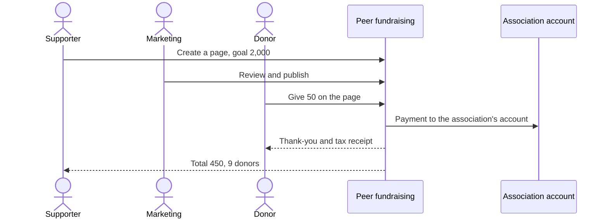

🏠 [Specs](../../../../README.md) › 🏷️ [Sectors](../../../README.md) › 🤲 [SC08 Non-profit association](../../README.md) ›
📝 [Use cases](../README.md) ›
📝 [Use cases: FL-SC08-07 Foundations, integration, federations, peer fundraising](README.md) ›
📝 UC-SC08-24 Let supporters fundraise for us

# 📝 UC-SC08-24 Let supporters fundraise for us

**Status:** ✅ specified

## Summary

Supporters create their own fundraising page for the association, for example for a sporting challenge, a birthday or a
collection at work, and share it. Gifts go to the association, never to the page owner, and the association gives each
donor their tax receipt and thanks the page owner with the total.

## Personas

- [U12 Marketing and communication](../../../../01-users/personas/u12-marketing.md)
- [U09 Customer](../../../../01-users/personas/u09-customer.md)

## Goal

Supporters can raise funds for the association in their own network, every gift reaches the association with a receipt
for its real donor, and no page is used to collect money for anything else.

## Trigger

A supporter asks to fundraise, shares a page, or a donor gives through it.

## Frequency

Dozens of pages during a campaign, each with 5 to 100 gifts.

## Preconditions

- A fundraising campaign exists ([E-SC08-05 Fundraising campaign](../../data/e-sc08-05-fundraising-campaign.md)).
- Online gifts are enabled with the association's payment account
  ([UC-SC08-04](../02-donations-and-receipts/uc-sc08-04-collect-donations-online-and-offline.md)).
- The association's rules for pages (wording, goals, images) are in the settings.

## Postconditions

- **Succeeded:** the page is saved ([E-SC08-19 Fundraising page](../../data/e-sc08-19-fundraising-page.md)) with its
  goal and total, each gift is recorded in the association's gifts ([E-SC08-04 Gift](../../data/e-sc08-04-gift.md)) and
  receipted to the donor ([E-SC08-06 Tax receipt](../../data/e-sc08-06-tax-receipt.md)).
- **Failed:** the page is not published, or is suspended, and no gift is accepted on it.

## Main flow

1. A supporter opens the page creation screen
   ([S-SC08-24](../../screens/07-foundations-integration-and-federations/s-sc08-24-peer-fundraising.md)) from the
   campaign and writes their story, goal and photo.
2. The marketing team reviews the page against the rules and publishes it.
3. The supporter shares the link; each donor gives by card on the page, and the payment goes to the association's
   account ([BR-SC08-19](../../business-rules/br-sc08-19-funds-go-to-the-association-never-the-page-owner.md)).
4. The donor enters their name and address and receives a thank-you and, when eligible, their tax receipt
   ([UC-SC08-06](../02-donations-and-receipts/uc-sc08-06-issue-tax-receipts-for-gifts.md)).
5. The page owner sees the total and the number of donors, and the names of those who agreed to be shown.
6. At the end date the page closes and the association thanks the owner.

## Alternative flows

- 3a. A donor wants to stay anonymous: the page shows "anonymous" and the association keeps the name for the receipt.
- 5a. The owner wants to cover the fees: they give a gift of their own on the page.
- 6a. The goal is reached before the end date: the page stays open if the owner chooses.

## Error flows

- 2e. The page asks for money for another purpose than the campaign: it is refused with the reason.
- 3e. A gift is attempted into a personal account entered by the owner: no such field exists, and the attempt is
  recorded if forced.
- 4e. The donor's address is missing: the gift is recorded and the receipt waits for the address.
- Any step: a service does not answer; the call is retried first
  ([BR-F3-32](../../../../02-functional/f03-assistant/business-rules/br-f03-32-retry-before-an-error.md)), then the
  message follows the error pattern ([D122](../../../../06-decisions/ux/d122-error-message-standard.md)) and what the
  user typed stays on the screen.

## Business rules

- [BR-SC08-19](../../business-rules/br-sc08-19-funds-go-to-the-association-never-the-page-owner.md)
- [BR-SC08-02](../../business-rules/br-sc08-02-receipts-only-when-entitled.md)

## Entities

- [E-SC08-19 Fundraising page](../../data/e-sc08-19-fundraising-page.md): created, changed, closed
- [E-SC08-04 Gift](../../data/e-sc08-04-gift.md): created, each gift made through the page
- [E-SC08-05 Fundraising campaign](../../data/e-sc08-05-fundraising-campaign.md): read, the campaign the page belongs to
- [E-SC08-06 Tax receipt](../../data/e-sc08-06-tax-receipt.md): created, the receipt of each eligible donor

## Permissions

Marketing reviews and publishes pages; the supporter creates and edits their own page; donors give without an account.
The page owner sees totals and consenting donors' names, never the addresses.

## Notifications

The supporter, by email: the page is published or refused, and each new gift. The marketing team, in the app: a page
waits for review.

## Audit events

Each page created, reviewed, published, suspended and closed, each gift with its page and receipt, who and when.

## AI involvement

No AI step of its own. The AI assistant may open the screen and prefill it from the user's words; the user checks and
confirms
[BR-F3-07](../../../../02-functional/f03-assistant/business-rules/br-f03-07-no-deletes-no-irreversible-acts.md).

## API, MCP and A2A exposure

T5 operations of the capability for the personas above: create, read, update and list. The MCP tool of the
capability may read and propose, never confirm alone. No A2A skill.

## Screens

- [S-SC08-24](../../screens/07-foundations-integration-and-federations/s-sc08-24-peer-fundraising.md)

## Flowchart

See
[FL-SC08-07 Foundations, integration, federations, peer fundraising](../../flows/fl-sc08-07-foundations-integration-and-federations.md#flowchart).

## Sequence diagram

## Acceptance criteria

1. **Given** a published page and a donor who gives 50.00 EUR **when** the payment is made **then** the money goes to
   the association's account and the donor receives their receipt.
2. **Given** a page whose owner asks to receive the funds **when** the page is created **then** no field exists for it
   and the funds can only go to the association.
3. **Given** a page that asks for money for a purpose outside the campaign **when** marketing reviews it **then** it is
   refused with the reason.
4. **Given** a donor who wants to stay anonymous **when** they give **then** the page shows anonymous and the receipt is
   still issued in their name.

## Non-functional notes

The screen answers within 2 seconds for 10,000 records; every change is audited.

## Regulatory references

A gift made through a supporter's page is a gift to the association: the association issues the tax receipt
to the donor, who is the one who gave, never to the page owner. Above a yearly threshold of the country pack the
association declares its appeals to public generosity and publishes how it used the funds. The donors' personal data are
shared with the page owner only with consent. The France-pack rules are [CR-FR-286 Appeals to public generosity](../../../../10-country-packs/france/non-profit/cr-fr-286-appeals-to-public-generosity.md) and [CR-FR-124 Tax receipts for gifts and their yearly declaration](../../../../10-country-packs/france/non-profit/cr-fr-124-gift-tax-receipts.md). Related:
[CR-FR-124](../../../../10-country-packs/france/non-profit/cr-fr-124-gift-tax-receipts.md),
[CR-FR-063](../../../../10-country-packs/france/consumer/cr-fr-063-electronic-marketing-consent.md),
[CR-FR-052](../../../../10-country-packs/france/data-protection/cr-fr-052-storage-limitation.md).

## Related use cases

- [UC-SC08-23 Run a federation of member clubs](uc-sc08-23-run-a-federation-of-member-clubs.md)
- [UC-SC08-04](../02-donations-and-receipts/uc-sc08-04-collect-donations-online-and-offline.md)
- [UC-SC08-05](../02-donations-and-receipts/uc-sc08-05-run-fundraising-campaigns.md)
- [UC-SC08-06](../02-donations-and-receipts/uc-sc08-06-issue-tax-receipts-for-gifts.md)

## Open questions

None.

---

⬅️ [UC-SC08-23 Run a federation of member clubs](uc-sc08-23-run-a-federation-of-member-clubs.md) · ⬆️ [Up](README.md)
