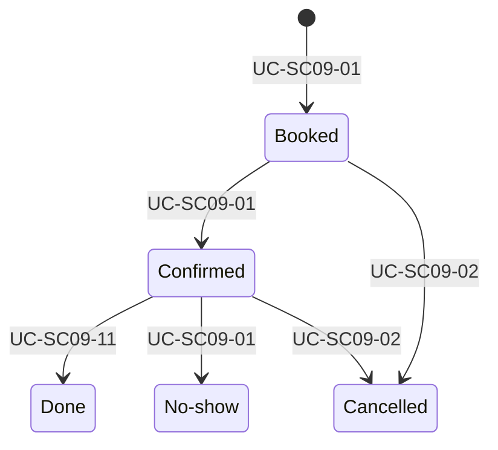

🏠 [Specs](../../../README.md) › 🏷️ [Sectors](../../README.md) › 🩺 [SC09 Health practices](../README.md) ›
🗃️ [Data](README.md) › 🗃️ E-SC09-01 Appointment

# 🗃️ E-SC09-01 Appointment

**Status:** 🔄 waiting for the owner

## Purpose

A patient's appointment: a booking of the shared booking engine
([E-F2-18 Resource booking](../../../02-functional/f02-no-code-configuration/data/e-f02-18-resource-booking.md)) on a
practitioner and a room, with what health practices add: the reason and the patient.

## Fields

| Name | Type | Required | Validation | Default | Example | Personal data | Custom fields |
|---|---|---|---|---|---|---|---|
| patient, practitioner, slot | records | yes | - | - | J. Martin, Dr B., Mon 09:00 | yes | no |
| kind, place | in person or video, room | yes | - | in person | room 2 | no | no |
| state | booked, confirmed, done, no-show, cancelled | yes | - | booked | done | no | no |

## Relations

(Proposed) As its use cases.

## Lifecycle

## Indexes and search

(Proposed) By number, date, partner.

## Retention

Kept for the period of its kind of record in the country pack (D293), or else its kind's default in the
[retention schedule](../../../05-non-functional/data-retention.md).

## Audit

Every change.

## Import and export

(Proposed) CSV, FEC where relevant.

## Used by

- [UC-SC09-01](../use-cases/01-appointments/uc-sc09-01-book-appointments-online-and-at-the-desk.md)
- [UC-SC09-02](../use-cases/01-appointments/uc-sc09-02-remind-patients-and-handle-no-shows.md)
- [UC-SC09-11](../use-cases/04-health-exchanges/uc-sc09-11-teleconsult.md)
- [UC-SC09-12](../use-cases/05-practice-organisation/uc-sc09-12-manage-schedules-rooms-and-equipment.md)
- [UC-SC09-20](../use-cases/01-appointments/uc-sc09-20-ask-the-assistant-about-the-practice.md)

## Open questions

None.

---

⬆️ [Up](README.md) · ➡️ [E-SC09-02 Patient](e-sc09-02-patient.md)
