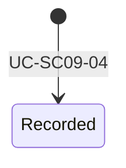

🏠 [Specs](../../../README.md) › 🏷️ [Sectors](../../README.md) › 🩺 [SC09 Health practices](../README.md) ›
🗃️ [Data](README.md) › 🗃️ E-SC09-03 Clinical record entry

# 🗃️ E-SC09-03 Clinical record entry

**Status:** ✅ specified

## Purpose

A consultation or document.

## Fields

| Name | Type | Required | Validation | Default | Example | Personal data | Custom fields |
|---|---|---|---|---|---|---|---|
| patient, date, author | records | yes | BR-SC09-03 | - | J. Martin, 12 Nov, Dr B. | yes | no |
| content | text, files | yes | BR-SC09-02 | - | notes | yes | no |

## Relations

As its use cases.

## Lifecycle

## Indexes and search

By number, date, partner.

## Retention

No legal period for private practice; 20 years after the last visit advised:
[CR-FR-131 Patients' access to their medical record](../../../10-country-packs/france/health-practice/cr-fr-131-medical-record-access.md);
on certified hosting:
[CR-FR-055 Health data hosting](../../../10-country-packs/france/data-protection/cr-fr-055-health-data-hosting.md).

## Audit

Every change.

## Import and export

CSV, FEC where relevant.

## Used by

- [UC-SC09-04](../use-cases/02-patient-file-and-care/uc-sc09-04-keep-the-clinical-record.md)
- [UC-SC09-09](../use-cases/04-health-exchanges/uc-sc09-09-share-with-the-national-health-record-and-secure-messaging.md)
- [UC-SC09-10](../use-cases/04-health-exchanges/uc-sc09-10-receive-lab-and-imaging-results.md)
- [UC-SC09-11](../use-cases/04-health-exchanges/uc-sc09-11-teleconsult.md)
- [UC-SC09-17](../use-cases/06-compliance-and-certification/uc-sc09-17-honour-patients-rights.md)
- [UC-SC09-20](../use-cases/01-appointments/uc-sc09-20-ask-the-assistant-about-the-practice.md)

## Open questions

None.

---

⬅️ [E-SC09-02 Patient](e-sc09-02-patient.md) · ⬆️ [Up](README.md) ·
➡️ [E-SC09-04 Prescription](e-sc09-04-prescription.md)
