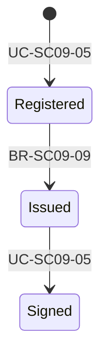

🏠 [Specs](../../../README.md) › 🏷️ [Sectors](../../README.md) › 🩺 [SC09 Health practices](../README.md) ›
🗃️ [Data](README.md) › 🗃️ E-SC09-04 Prescription

# 🗃️ E-SC09-04 Prescription

**Status:** 🔄 waiting for the owner

## Purpose

A prescription.

## Fields

| Name | Type | Required | Validation | Default | Example | Personal data | Custom fields |
|---|---|---|---|---|---|---|---|
| patient, prescriber | records | yes | - | - | J. Martin, Dr B. | yes | no |
| items, national code | list, code | yes | BR-SC09-09 | - | 2 drugs, QR | yes | no |

## Relations

(Proposed) As its use cases.

## Lifecycle

## Indexes and search

(Proposed) By number, date, partner.

## Retention

No legal period for private practice; 20 years after the last visit advised:
[CR-FR-131 Patients' access to their medical record](../../../10-country-packs/france/health-practice/cr-fr-131-medical-record-access.md);
on certified hosting:
[CR-FR-055 Health data hosting](../../../10-country-packs/france/data-protection/cr-fr-055-health-data-hosting.md).

## Audit

Every change.

## Import and export

(Proposed) CSV, FEC where relevant.

## Used by

- [UC-SC09-05](../use-cases/02-patient-file-and-care/uc-sc09-05-write-prescriptions-and-e-prescriptions.md)

## Open questions

None.

---

⬅️ [E-SC09-03 Clinical record entry](e-sc09-03-clinical-record-entry.md) · ⬆️ [Up](README.md) ·
➡️ [E-SC09-05 Care sheet](e-sc09-05-care-sheet.md)
