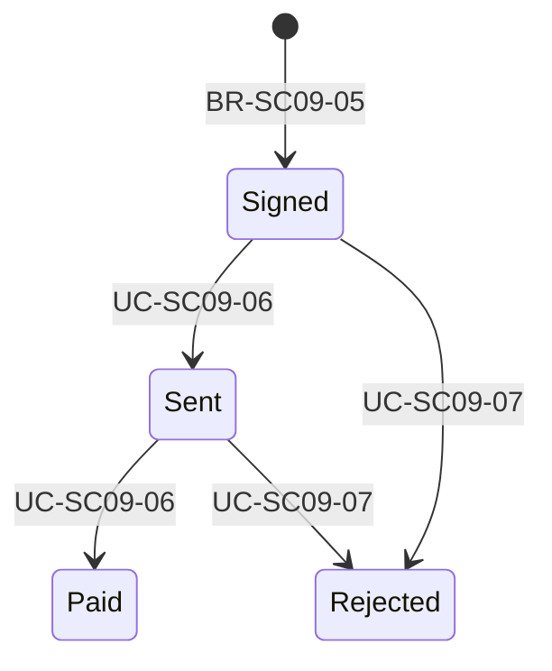

🏠 [Specs](../../../README.md) › 🏷️ [Sectors](../../README.md) › 🩺 [SC09 Health practices](../README.md) ›
🗃️ [Data](README.md) › 🗃️ E-SC09-05 Care sheet

# 🗃️ E-SC09-05 Care sheet

**Status:** 🔄 waiting for the owner

## Purpose

An electronic care sheet.

## Fields

| Name | Type | Required | Validation | Default | Example | Personal data | Custom fields |
|---|---|---|---|---|---|---|---|
| patient, acts | records | yes | BR-SC09-05 | - | J. Martin, consultation | yes | no |
| amount, third-party | amount, yes or no | yes | - | - | 30.00, no | no | no |
| state | signed, sent, paid, rejected | yes | BR-SC09-07 | signed | paid | no | no |

## Relations

(Proposed) As its use cases.

## Lifecycle

## Indexes and search

(Proposed) By number, date, partner.

## Retention

As an accounting record:
[CR-FR-002 Accounting records kept 10 years](../../../10-country-packs/france/accounting/cr-fr-002-accounting-records-kept-ten-years.md).

## Audit

Every change.

## Import and export

(Proposed) CSV, FEC where relevant.

## Used by

- [UC-SC09-06](../use-cases/03-insurance-billing/uc-sc09-06-bill-health-insurance-with-the-carte-vitale.md)
- [UC-SC09-07](../use-cases/03-insurance-billing/uc-sc09-07-handle-third-party-payment-and-insurers-returns.md)
- [UC-SC09-18](../use-cases/06-compliance-and-certification/uc-sc09-18-report-activity-and-quality-indicators.md)

## Open questions

None.

---

⬅️ [E-SC09-04 Prescription](e-sc09-04-prescription.md) · ⬆️ [Up](README.md) ·
➡️ [E-SC09-06 Insurer return](e-sc09-06-insurer-return.md)
