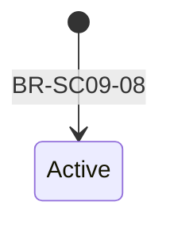

🏠 [Specs](../../../README.md) › 🏷️ [Sectors](../../README.md) › 🩺 [SC09 Health practices](../README.md) ›
🗃️ [Data](README.md) › 🗃️ E-SC09-08 Health exchange

# 🗃️ E-SC09-08 Health exchange

**Status:** 🔄 waiting for the owner

## Purpose

A document sent or received.

## Fields

| Name | Type | Required | Validation | Default | Example | Personal data | Custom fields |
|---|---|---|---|---|---|---|---|
| patient, kind, direction | records | yes | BR-SC09-08 | - | J. Martin, lab report, in | yes | no |
| channel | national record, secure mail, lab | yes | - | - | lab | no | no |

## Relations

(Proposed) As its use cases.

## Lifecycle

## Indexes and search

(Proposed) By number, date, partner.

## Retention

No legal period for private practice; 20 years after the last visit advised:
[CR-FR-131 Patients' access to their medical record](../../../10-country-packs/france/health-practice/cr-fr-131-medical-record-access.md);
on certified hosting:
[CR-FR-055 Health data hosting](../../../10-country-packs/france/data-protection/cr-fr-055-health-data-hosting.md).

## Audit

Every change.

## Import and export

(Proposed) CSV, FEC where relevant.

## Used by

- [UC-SC09-09](../use-cases/04-health-exchanges/uc-sc09-09-share-with-the-national-health-record-and-secure-messaging.md)

## Open questions

None.

---

⬅️ [E-SC09-07 Patient invoice](e-sc09-07-patient-invoice.md) · ⬆️ [Up](README.md) ·
➡️ [E-SC09-09 Consulting room](e-sc09-09-consulting-room.md)
