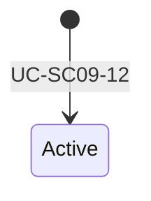

🏠 [Specs](../../../README.md) › 🏷️ [Sectors](../../README.md) › 🩺 [SC09 Health practices](../README.md) ›
🗃️ [Data](README.md) › 🗃️ E-SC09-09 Consulting room

# 🗃️ E-SC09-09 Consulting room

**Status:** ✅ specified

## Purpose

A consulting room and its equipment, bookable through the shared booking engine's resource setting,
[E-F2-17 Bookable resource setting](../../../02-functional/f02-no-code-configuration/data/e-f02-17-bookable-resource-setting.md).

## Fields

| Name | Type | Required | Validation | Default | Example | Personal data | Custom fields |
|---|---|---|---|---|---|---|---|
| name, equipment | text, list | yes | - | - | room 2, chair | no | no |

## Relations

As its use cases.

## Lifecycle

## Indexes and search

By number, date, partner.

## Retention

Kept for the period of its kind of record in the country pack (D293), or else its kind's default in the
[retention schedule](../../../05-non-functional/data-retention.md).

## Audit

Every change.

## Import and export

CSV, FEC where relevant.

## Used by

- [UC-SC09-12](../use-cases/05-practice-organisation/uc-sc09-12-manage-schedules-rooms-and-equipment.md)

## Open questions

None.

---

⬅️ [E-SC09-08 Health exchange](e-sc09-08-health-exchange.md) · ⬆️ [Up](README.md) ·
➡️ [E-SC09-10 Shared cost](e-sc09-10-shared-cost.md)
