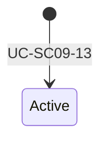

🏠 [Specs](../../../README.md) › 🏷️ [Sectors](../../README.md) › 🩺 [SC09 Health practices](../README.md) ›
🗃️ [Data](README.md) › 🗃️ E-SC09-10 Shared cost

# 🗃️ E-SC09-10 Shared cost

**Status:** ✅ specified

## Purpose

A cost split between partners.

## Fields

| Name | Type | Required | Validation | Default | Example | Personal data | Custom fields |
|---|---|---|---|---|---|---|---|
| cost, period | records | yes | BR-SC09-12 | - | rent, Nov | no | no |
| key, shares | key, amounts | yes | - | - | equal, 1 000 each | no | no |

## Relations

As its use cases.

## Lifecycle

## Indexes and search

By number, date, partner.

## Retention

As an accounting record:
[CR-FR-002 Accounting records kept 10 years](../../../10-country-packs/france/accounting/cr-fr-002-accounting-records-kept-ten-years.md).

## Audit

Every change.

## Import and export

CSV, FEC where relevant.

## Used by

- [UC-SC09-13](../use-cases/05-practice-organisation/uc-sc09-13-share-costs-between-partners.md)
- [UC-SC09-15](../use-cases/05-practice-organisation/uc-sc09-15-keep-practice-accounts.md)

## Open questions

None.

---

⬅️ [E-SC09-09 Consulting room](e-sc09-09-consulting-room.md) · ⬆️ [Up](README.md) ·
➡️ [E-SC09-11 Sterilisation cycle](e-sc09-11-sterilisation-cycle.md)
