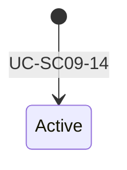

🏠 [Specs](../../../README.md) › 🏷️ [Sectors](../../README.md) › 🩺 [SC09 Health practices](../README.md) ›
🗃️ [Data](README.md) › 🗃️ E-SC09-11 Sterilisation cycle

# 🗃️ E-SC09-11 Sterilisation cycle

**Status:** ✅ specified

## Purpose

A cycle and its instruments.

## Fields

| Name | Type | Required | Validation | Default | Example | Personal data | Custom fields |
|---|---|---|---|---|---|---|---|
| number, date, result | records | yes | BR-SC09-13 | - | C-88, 12 Nov, ok | no | no |
| instruments, patients | lists | no | - | - | kit 4, J. Martin | yes | no |

## Relations

As its use cases.

## Lifecycle

## Indexes and search

By number, date, partner.

## Retention

No legal period for private practice; 20 years after the last visit advised:
[CR-FR-131 Patients' access to their medical record](../../../10-country-packs/france/health-practice/cr-fr-131-medical-record-access.md);
on certified hosting:
[CR-FR-055 Health data hosting](../../../10-country-packs/france/data-protection/cr-fr-055-health-data-hosting.md).

## Audit

Every change.

## Import and export

CSV, FEC where relevant.

## Used by

- [UC-SC09-14](../use-cases/05-practice-organisation/uc-sc09-14-trace-consumables-and-sterilisation.md)

## Open questions

None.

---

⬅️ [E-SC09-10 Shared cost](e-sc09-10-shared-cost.md) · ⬆️ [Up](README.md) ·
➡️ [E-SC09-12 Locum agreement](e-sc09-12-locum-agreement.md)
