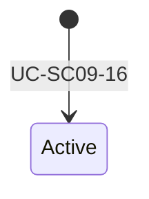

🏠 [Specs](../../../README.md) › 🏷️ [Sectors](../../README.md) › 🩺 [SC09 Health practices](../README.md) ›
🗃️ [Data](README.md) › 🗃️ E-SC09-12 Locum agreement

# 🗃️ E-SC09-12 Locum agreement

**Status:** ✅ specified

## Purpose

A locum and the retrocession rate.

## Fields

| Name | Type | Required | Validation | Default | Example | Personal data | Custom fields |
|---|---|---|---|---|---|---|---|
| locum, period, rate | records | yes | - | - | Dr K., Aug, 70 % | yes | no |

## Relations

As its use cases.

## Lifecycle

## Indexes and search

By number, date, partner.

## Retention

Kept for the period of its kind of record in the country pack (D293), or else its kind's default in the
[retention schedule](../../../05-non-functional/data-retention.md).

## Audit

Every change.

## Import and export

CSV, FEC where relevant.

## Used by

- [UC-SC09-16](../use-cases/05-practice-organisation/uc-sc09-16-manage-locums-and-fee-retrocession.md)

## Open questions

None.

---

⬅️ [E-SC09-11 Sterilisation cycle](e-sc09-11-sterilisation-cycle.md) · ⬆️ [Up](README.md) ·
➡️ [E-SC09-13 Certified module](e-sc09-13-certified-module.md)
