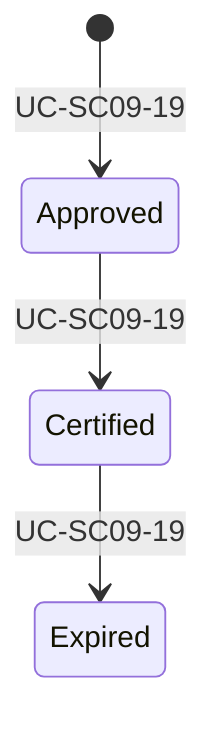

🏠 [Specs](../../../README.md) › 🏷️ [Sectors](../../README.md) › 🩺 [SC09 Health practices](../README.md) ›
🗃️ [Data](README.md) › 🗃️ E-SC09-13 Certified module

# 🗃️ E-SC09-13 Certified module

**Status:** 🔄 waiting for the owner

## Purpose

A module needing an approval.

## Fields

| Name | Type | Required | Validation | Default | Example | Personal data | Custom fields |
|---|---|---|---|---|---|---|---|
| module, approval, version | records | yes | BR-SC09-15 | - | care sheets, CNDA, 1.4 | no | no |
| valid to | date | yes | - | - | 2027-11 | no | no |

## Relations

(Proposed) As its use cases.

## Lifecycle

## Indexes and search

(Proposed) By number, date, partner.

## Retention

Kept for the period of its kind of record in the country pack (D293), or else its kind's default in the
[retention schedule](../../../05-non-functional/data-retention.md).

## Audit

Every change.

## Import and export

(Proposed) CSV, FEC where relevant.

## Used by

- [UC-SC09-19](../use-cases/06-compliance-and-certification/uc-sc09-19-keep-the-software-s-certifications-current.md)

## Open questions

None.

---

⬅️ [E-SC09-12 Locum agreement](e-sc09-12-locum-agreement.md) · ⬆️ [Up](README.md) ·
➡️ [E-SC09-14 Dispensation](e-sc09-14-dispensation.md)
