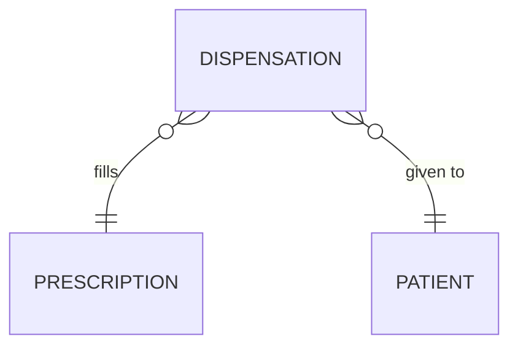
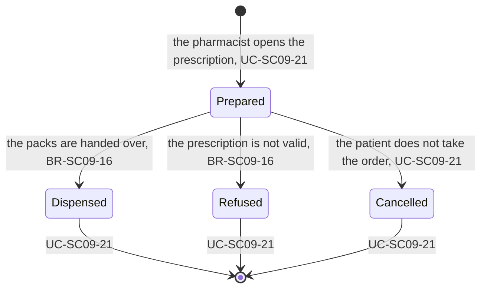

🏠 [Specs](../../../README.md) › 🏷️ [Sectors](../../README.md) › 🩺 [SC09 Health practices](../README.md) ›
🗃️ [Data](README.md) › 🗃️ E-SC09-14 Dispensation

# 🗃️ E-SC09-14 Dispensation

**Status:** ✅ specified

## Purpose

A handing out of medicines to a patient against a prescription: what, how many, which lot and who gave it
([D553](../../../06-decisions/sectors/d553-benchmark-gaps-sc09-health-practices.md)). The prescription is the doctor's
order ([E-SC09-04 Prescription](e-sc09-04-prescription.md)); this record is what the pharmacy did with it.

## Fields

| Name | Type | Required | Validation | Default | Example | Personal data | Custom fields |
|---|---|---|---|---|---|---|---|
| patient | patient (E-SC09-02) | yes | a patient of the practice | - | Mr Aubert | yes | no |
| prescription | prescription (E-SC09-04) | yes | valid and with the quantity left | - | O-2026-0412 | no | no |
| medicine | stock item (E-F7-06) | yes | an item of the prescription | - | Amoxicillin 500 | no | no |
| quantity | number | yes | not above the quantity left | 1 | 2 | no | no |
| lot | text | yes | a lot in stock, not recalled | oldest expiry | L-2204 | no | no |
| expiry | month | yes | not past | from the lot | 2027-06 | no | no |
| substituted for | stock item | no | an equivalent allowed by the prescription | - | - | no | no |
| patient share | amount | no | 0 or more | from the price | 6.40 EUR | no | no |
| dispensed by | employee (E-F9-01) | yes | a pharmacist | the user | Alice M. | no | no |
| dispensed on | date and time | no | set when dispensed | - | 2026-11-14 10:12 | no | no |
| state | Prepared, Dispensed, Refused, Cancelled | yes | the lifecycle below | Prepared | Dispensed | no | no |
| owner | user | yes | a user of the company | the creator | Claire P. | yes | no |

## Relations

- [E-SC09-02 Patient](e-sc09-02-patient.md)
- [E-SC09-04 Prescription](e-sc09-04-prescription.md)
- [E-F7-06 Item](../../../02-functional/f07-purchasing-and-stock/data/e-f07-06-item.md)
- [E-SC09-05 Care sheet](e-sc09-05-care-sheet.md)

## Lifecycle

## Indexes and search

By patient, prescription, medicine, lot, state and date. Names are searched only by users with a care role.

## Retention

Kept for the legal period of the pharmacy's records and for lot recalls
([CR-FR-055](../../../10-country-packs/france/data-protection/cr-fr-055-health-data-hosting.md)).

## Audit

Every dispensation, refusal, substitution and cancellation, with who, when and the lots.

## Import and export

Export of the dispensations of a period for the health insurance; no import.

## Used by

- [UC-SC09-21](../use-cases/07-pharmacy-vets-dental-and-centres/uc-sc09-21-dispense-in-a-pharmacy.md)
- [UC-SC09-05](../use-cases/02-patient-file-and-care/uc-sc09-05-write-prescriptions-and-e-prescriptions.md)

## Open questions

None.

---

⬅️ [E-SC09-13 Certified module](e-sc09-13-certified-module.md) · ⬆️ [Up](README.md) ·
➡️ [E-SC09-15 Eyewear order](e-sc09-15-eyewear-order.md)
