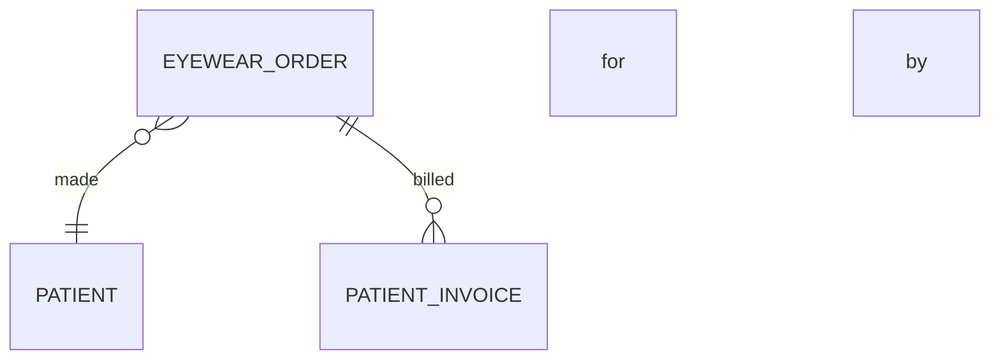
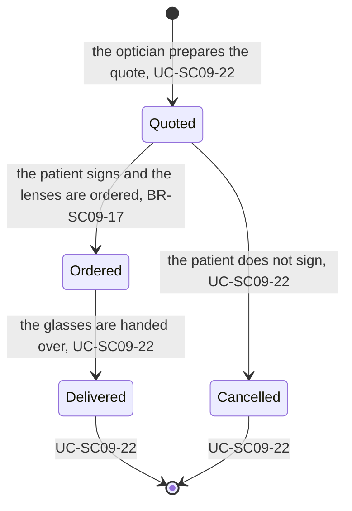

🏠 [Specs](../../../README.md) › 🏷️ [Sectors](../../README.md) › 🩺 [SC09 Health practices](../README.md) ›
🗃️ [Data](README.md) › 🗃️ E-SC09-15 Eyewear order

# 🗃️ E-SC09-15 Eyewear order

**Status:** ✅ specified

## Purpose

An order of glasses or lenses made to a prescription: the correction, the quote, the lab order and the delivery
([D553](../../../06-decisions/sectors/d553-benchmark-gaps-sc09-health-practices.md)). The prescription is the doctor's
([E-SC09-04 Prescription](e-sc09-04-prescription.md)); this record is the optician's order built on it.

## Fields

| Name | Type | Required | Validation | Default | Example | Personal data | Custom fields |
|---|---|---|---|---|---|---|---|
| wearer | patient (E-SC09-02) | yes | a patient of the practice | - | Mrs Lopez | yes | no |
| prescription | prescriber, date | yes | valid for the wearer | - | Dr Hugo B., 2025-09-10 | no | no |
| correction | values per eye | yes | within the lens range | - | R -1.50, L -1.75 | no | no |
| frame | stock item (E-F7-06) | yes | a frame in stock or ordered | - | F-310 | no | no |
| lenses | stock item (E-F7-06) | yes | fits the correction | - | progressive | no | no |
| quote total | amount | yes | above 0 | from the items | 420.00 EUR | no | no |
| patient share | amount | yes | 0 or more | from the quote | 54.00 EUR | no | no |
| quote signed on | date and time | no | needed to order | - | 2026-11-14 11:02 | no | no |
| lab order | reference | no | set when ordered | - | LO-5521 | no | no |
| delivered on | date | no | set at hand-over | - | 2026-11-25 | no | no |
| state | Quoted, Ordered, Delivered, Cancelled | yes | the lifecycle below | Quoted | Ordered | no | no |
| owner | user | yes | a user of the company | the creator | Claire P. | yes | no |

## Relations

- [E-SC09-02 Patient](e-sc09-02-patient.md)
- [E-SC09-04 Prescription](e-sc09-04-prescription.md)
- [E-SC09-07 Patient invoice](e-sc09-07-patient-invoice.md)
- [E-F7-06 Item](../../../02-functional/f07-purchasing-and-stock/data/e-f07-06-item.md)

## Lifecycle

## Indexes and search

By wearer, prescription, state and delivery date.

## Retention

Kept with the sale records and the patient's file for the legal period
([CR-FR-002](../../../10-country-packs/france/accounting/cr-fr-002-accounting-records-kept-ten-years.md)).

## Audit

Every correction, quote, signature, lab order, delivery and remake, with who, when and the values.

## Import and export

Export of the lab orders as a file in the lab's format; no import.

## Used by

- [UC-SC09-22](../use-cases/07-pharmacy-vets-dental-and-centres/uc-sc09-22-sell-eyewear-to-a-prescription.md)
- [UC-SC09-21](../use-cases/07-pharmacy-vets-dental-and-centres/uc-sc09-21-dispense-in-a-pharmacy.md)

## Open questions

None.

---

⬅️ [E-SC09-14 Dispensation](e-sc09-14-dispensation.md) · ⬆️ [Up](README.md) ·
➡️ [E-SC09-16 Animal](e-sc09-16-animal.md)
