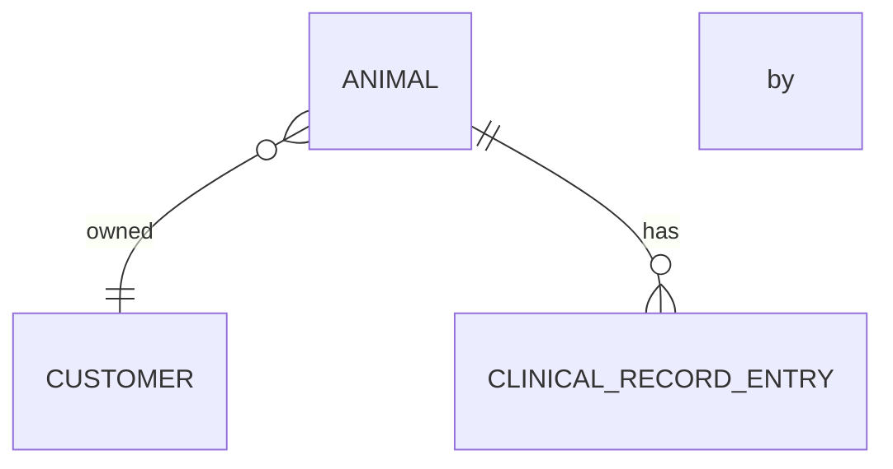
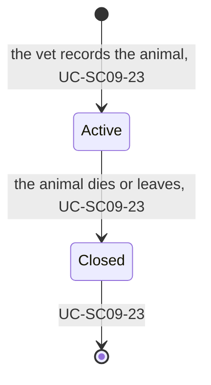

🏠 [Specs](../../../README.md) › 🏷️ [Sectors](../../README.md) › 🩺 [SC09 Health practices](../README.md) ›
🗃️ [Data](README.md) › 🗃️ E-SC09-16 Animal

# 🗃️ E-SC09-16 Animal

**Status:** ✅ specified

## Purpose

An animal cared for by the practice: its owner, identification, vaccines and the medicines given to it, with the
register lines ([D553](../../../06-decisions/sectors/d553-benchmark-gaps-sc09-health-practices.md)). It is the animal's
record, not the human patient's ([E-SC09-02 Patient](e-sc09-02-patient.md)), which holds a person and their insurance.

## Fields

| Name | Type | Required | Validation | Default | Example | Personal data | Custom fields |
|---|---|---|---|---|---|---|---|
| name | text | yes | up to 80 characters | - | Milo | no | no |
| species and breed | text | yes | one of the practice's species | - | dog, Labrador | no | no |
| owner | customer (E-F6-01) | yes | a customer of the company | - | Mrs Pons | yes | no |
| identification | number | no | unique, 15 digits for a chip | - | 250268500123456 | no | no |
| birth date | date | no | not in the future | - | 2019-03-10 | no | no |
| register lines | medicine, lot, quantity, date, vet | no | one line per medicine given | - | antibiotic, A-771, 14 | no | no |
| next vaccine | date | no | from the vaccine schedule | - | 2025-12-02 | no | no |
| closed on | date | no | set when closed | - | - | no | no |
| state | Active, Closed | yes | the lifecycle below | Active | Closed | no | no |
| owner | user | yes | a user of the company | the creator | Claire P. | yes | no |

## Relations

- [E-SC09-03 Clinical record entry](e-sc09-03-clinical-record-entry.md)
- [E-F6-01](../../../02-functional/f06-customers-and-sales/data/e-f06-01-customer-record.md)
- [E-F7-06 Item](../../../02-functional/f07-purchasing-and-stock/data/e-f07-06-item.md)

## Lifecycle

## Indexes and search

By name, owner, identification and species.

## Retention

The register is kept the number of years the pack gives; the animal's record is kept as long
([CR-FR-137](../../../10-country-packs/france/health-practice/cr-fr-137-medical-secrecy.md)).

## Audit

Every animal created, changed or closed and every register line, with who, when and the old and new value.

## Import and export

Export of the register as a file for an inspection; import of a herd as a CSV.

## Used by

- [UC-SC09-23](../use-cases/07-pharmacy-vets-dental-and-centres/uc-sc09-23-run-a-veterinary-practice.md)
- [UC-SC09-14](../use-cases/05-practice-organisation/uc-sc09-14-trace-consumables-and-sterilisation.md)

## Open questions

None.

---

⬅️ [E-SC09-15 Eyewear order](e-sc09-15-eyewear-order.md) · ⬆️ [Up](README.md) ·
➡️ [E-SC09-17 Dental quote](e-sc09-17-dental-quote.md)
