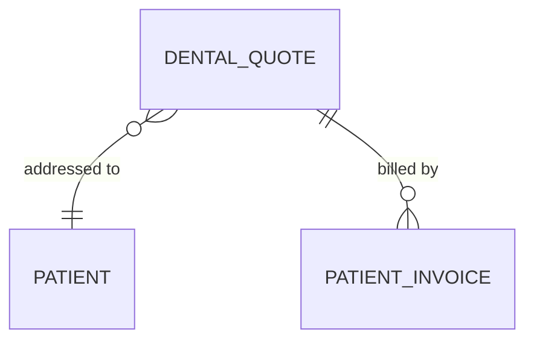
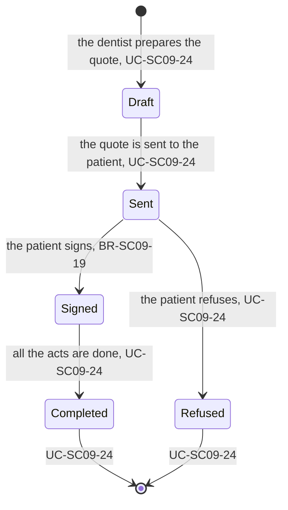

🏠 [Specs](../../../README.md) › 🏷️ [Sectors](../../README.md) › 🩺 [SC09 Health practices](../README.md) ›
🗃️ [Data](README.md) › 🗃️ E-SC09-17 Dental quote

# 🗃️ E-SC09-17 Dental quote

**Status:** ✅ specified

## Purpose

The regulated quote for a patient's dental prosthetics: the acts, prices, shares and signature
([D553](../../../06-decisions/sectors/d553-benchmark-gaps-sc09-health-practices.md)). The patient invoice
([E-SC09-07 Patient invoice](e-sc09-07-patient-invoice.md)) comes from it once the work is done; this record is the
quote before.

## Fields

| Name | Type | Required | Validation | Default | Example | Personal data | Custom fields |
|---|---|---|---|---|---|---|---|
| patient | patient (E-SC09-02) | yes | a patient of the practice | - | Mrs Lopez | yes | no |
| acts | act, code, tooth, fees, device and materials | yes | each act with its code and fees | - | crown, its national code, tooth 26, 120.00, ceramic | no | no |
| place of manufacture | EU, outside the EU | yes | per device | - | EU | no | no |
| basis | amount | yes | from the national scale | - | 120.00 EUR | no | no |
| insurance share | amount | yes | 0 or more | from the basis | 70.00 EUR | no | no |
| cover share | amount | no | 0 or more; information, not on the regulated quote (CR-FR-238) | from the cover | 50.00 EUR | no | no |
| patient remaining cost | amount | no | 0 or more; information, not on the regulated quote | price minus shares | 0.00 EUR | no | no |
| basket | no remaining cost, moderate, free, per act | yes | within the pack's caps | - | no remaining cost | no | no |
| alternatives | acts with no or a moderate remaining cost | no | required for each act concerned | - | crown, metal, no remaining cost | no | no |
| valid until | date | yes | after the quote date | - | 2027-05-14 | no | no |
| sent on | date | no | set when sent | - | 2026-11-14 | no | no |
| signed on | date and time | no | needed before the care | - | 2026-11-15 18:20 | no | no |
| state | Draft, Sent, Signed, Completed, Refused | yes | the lifecycle below | Draft | Sent | no | no |
| owner | user | yes | a user of the company | the creator | Claire P. | yes | no |

## Relations

- [E-SC09-02 Patient](e-sc09-02-patient.md)
- [E-SC09-03 Clinical record entry](e-sc09-03-clinical-record-entry.md)
- [E-SC09-07 Patient invoice](e-sc09-07-patient-invoice.md)

## Lifecycle

## Indexes and search

By patient, state, sent date and signature date.

## Retention

Kept with the patient's file for the legal period
([CR-FR-131](../../../10-country-packs/france/health-practice/cr-fr-131-medical-record-access.md)).

## Audit

Every quote created, sent, signed, versioned or completed, with the acts, prices, who and when.

## Import and export

Export of the signed quote as a PDF for the patient; no import.

## Used by

- [UC-SC09-24](../use-cases/07-pharmacy-vets-dental-and-centres/uc-sc09-24-quote-dental-work-with-the-regulated-quote.md)
- [UC-SC09-08](../use-cases/03-insurance-billing/uc-sc09-08-bill-patients-and-show-fees.md)

## Open questions

None.

---

⬅️ [E-SC09-16 Animal](e-sc09-16-animal.md) · ⬆️ [Up](README.md) ·
➡️ [E-SC09-18 Centre activity](e-sc09-18-centre-activity.md)
