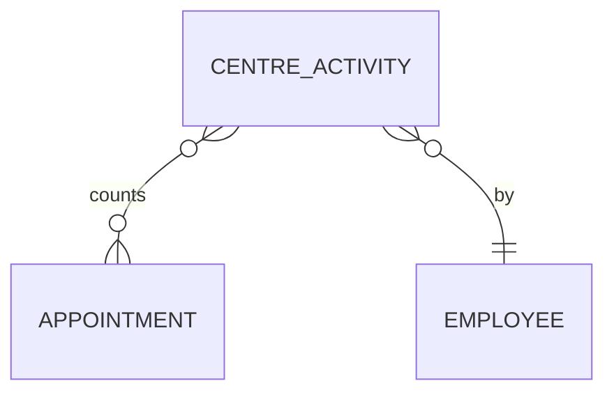
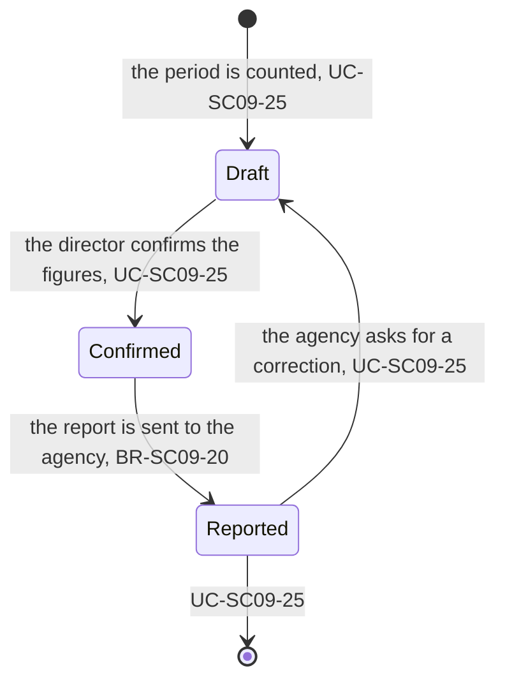

🏠 [Specs](../../../README.md) › 🏷️ [Sectors](../../README.md) › 🩺 [SC09 Health practices](../README.md) ›
🗃️ [Data](README.md) › 🗃️ E-SC09-18 Centre activity

# 🗃️ E-SC09-18 Centre activity

**Status:** ✅ specified

## Purpose

The counted activity of a health centre for one period and profession: visits, patients, hours, targets and the report
to the agency ([D553](../../../06-decisions/sectors/d553-benchmark-gaps-sc09-health-practices.md)). It is built from the
appointments and care sheets; it differs from the practice's quality indicators
[UC-SC09-18](../use-cases/06-compliance-and-certification/uc-sc09-18-report-activity-and-quality-indicators.md), which
follow each practitioner and are not sent to the agency.

## Fields

| Name | Type | Required | Validation | Default | Example | Personal data | Custom fields |
|---|---|---|---|---|---|---|---|
| period | month or year | yes | not in the future | - | 2026-10 | no | no |
| profession | choice | yes | a profession of the centre | - | nurse | no | no |
| visits | number | yes | 0 or more | counted | 310 | no | no |
| patients | number | yes | 0 or more | counted | 180 | no | no |
| hours | number | yes | 0 or more | from the planning | 380 | no | no |
| target | number | no | 0 or more | from the health project | 350 | no | no |
| comment | text | no | up to 500 characters | - | one nurse on leave | no | no |
| sent on | date | no | set when sent | - | 2026-11-05 | no | no |
| acknowledgement | reference | no | from the agency | - | AR-2026-889 | no | no |
| state | Draft, Confirmed, Reported | yes | the lifecycle below | Draft | Confirmed | no | no |
| owner | user | yes | a user of the company | the creator | Claire P. | yes | no |

## Relations

- [E-SC09-01 Appointment](e-sc09-01-appointment.md)
- [E-SC09-05 Care sheet](e-sc09-05-care-sheet.md)
- [E-F9-01](../../../02-functional/f09-hr-and-projects/data/e-f09-01-employee-record.md)

## Lifecycle

## Indexes and search

By period, profession and state.

## Retention

Kept for the years the agency may ask for them
([CR-FR-131](../../../10-country-packs/france/health-practice/cr-fr-131-medical-record-access.md)).

## Audit

Every count, confirmation, sending, reopening and acknowledgement, with who, when and the figures.

## Import and export

Export in the agency's format; no import.

## Used by

- [UC-SC09-25](../use-cases/07-pharmacy-vets-dental-and-centres/uc-sc09-25-run-a-health-centre.md)
- [UC-SC09-18](../use-cases/06-compliance-and-certification/uc-sc09-18-report-activity-and-quality-indicators.md)

## Open questions

None.

---

⬅️ [E-SC09-17 Dental quote](e-sc09-17-dental-quote.md) · ⬆️ [Up](README.md) ·
➡️ [E-SC09-19 ACI indicator](e-sc09-19-aci-indicator.md)
