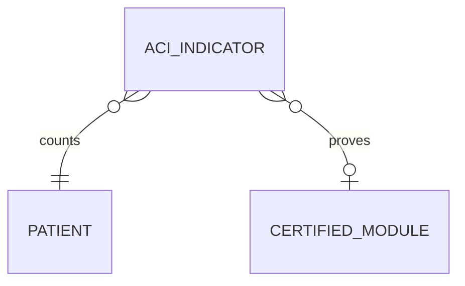
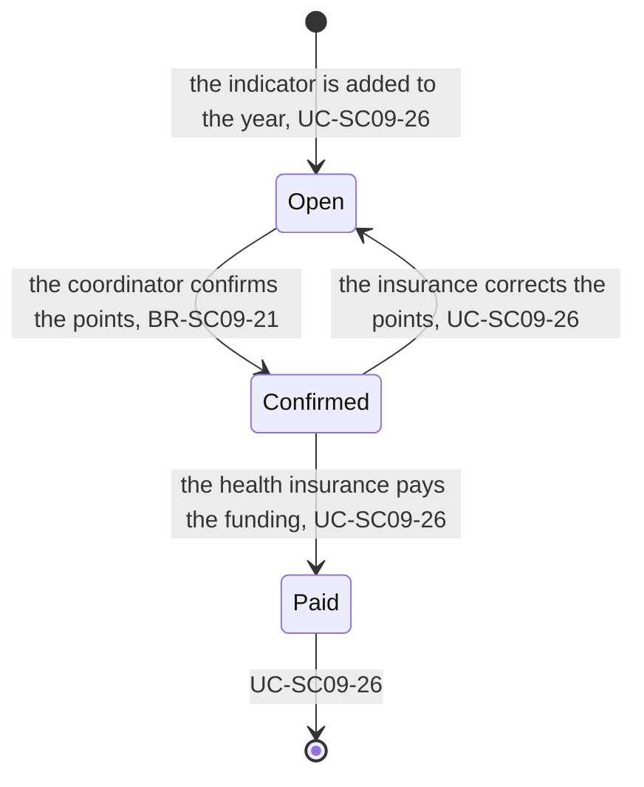

🏠 [Specs](../../../README.md) › 🏷️ [Sectors](../../README.md) › 🩺 [SC09 Health practices](../README.md) ›
🗃️ [Data](README.md) › 🗃️ E-SC09-19 ACI indicator

# 🗃️ E-SC09-19 ACI indicator

**Status:** ✅ specified

## Purpose

One indicator of the practice's funding contract for a year: its target, value, points and evidence
([D553](../../../06-decisions/sectors/d553-benchmark-gaps-sc09-health-practices.md)). It is different from the quality
indicators of each practitioner
[UC-SC09-18](../use-cases/06-compliance-and-certification/uc-sc09-18-report-activity-and-quality-indicators.md): these
follow the contract and decide the funding.

## Fields

| Name | Type | Required | Validation | Default | Example | Personal data | Custom fields |
|---|---|---|---|---|---|---|---|
| year | year | yes | a year of the contract | - | 2026 | no | no |
| indicator | choice | yes | an indicator of the contract | - | named doctor | no | no |
| target | number | yes | from the contract | - | 90 | no | no |
| value | number | no | 0 or more | counted | 93 | no | no |
| points | number | yes | 0 to the indicator's maximum | 0 | 60 | no | no |
| source | records, declared | yes | one of the two | records | records | no | no |
| evidence | files | no | required when declared | - | meeting minutes | no | no |
| funding | amount | no | 0 or more | from the points | 38,400.00 EUR | no | no |
| state | Open, Confirmed, Paid | yes | the lifecycle below | Open | Confirmed | no | no |
| owner | user | yes | a user of the company | the creator | Claire P. | yes | no |

## Relations

- [E-SC09-02 Patient](e-sc09-02-patient.md)
- [E-SC09-10 Shared cost](e-sc09-10-shared-cost.md)
- [E-SC09-13 Certified module](e-sc09-13-certified-module.md)

## Lifecycle

## Indexes and search

By year, indicator and state.

## Retention

Kept for the years the health insurance may reclaim
([CR-FR-131](../../../10-country-packs/france/health-practice/cr-fr-131-medical-record-access.md)).

## Audit

Every value, declaration, evidence, confirmation and correction, with who, when and the points.

## Import and export

Export of the points for the health insurance; no import.

## Used by

- [UC-SC09-26](../use-cases/07-pharmacy-vets-dental-and-centres/uc-sc09-26-run-a-multi-professional-practice.md)
- [UC-SC09-18](../use-cases/06-compliance-and-certification/uc-sc09-18-report-activity-and-quality-indicators.md)

## Open questions

None.

---

⬅️ [E-SC09-18 Centre activity](e-sc09-18-centre-activity.md) · ⬆️ [Up](README.md)
