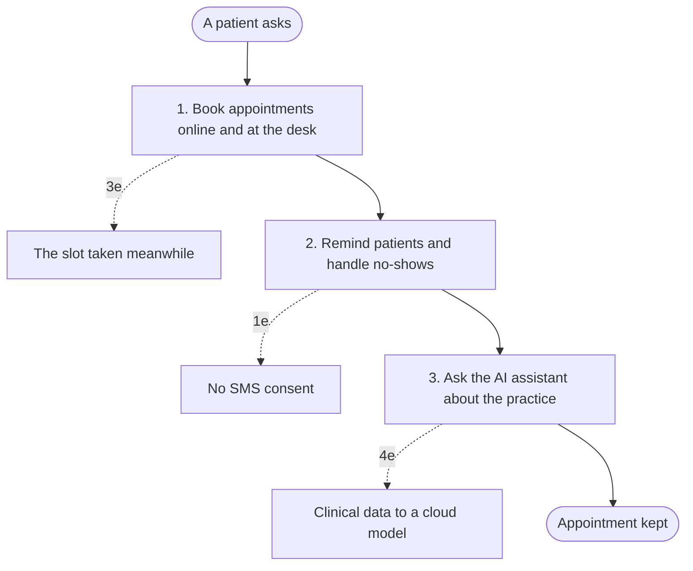

🏠 [Specs](../../../README.md) › 🏷️ [Sectors](../../README.md) › 🩺 [SC09 Health practices](../README.md) ›
🔀 [Flows](README.md) › 🔀 FL-SC09-01 Appointments

# 🔀 FL-SC09-01 Appointments

**Status:** ✅ specified

## Summary

Appointments on the shared booking engine, reminders and the AI assistant. It covers
[UC-SC09-01 Book appointments online and at the desk](../use-cases/01-appointments/uc-sc09-01-book-appointments-online-and-at-the-desk.md),
[UC-SC09-02 Remind patients and handle no-shows](../use-cases/01-appointments/uc-sc09-02-remind-patients-and-handle-no-shows.md),
[UC-SC09-20 Ask the AI assistant about the practice](../use-cases/01-appointments/uc-sc09-20-ask-the-assistant-about-the-practice.md).

## Personas

- [U09 Customer](../../../01-users/personas/u09-customer.md)
- [U13 Owner](../../../01-users/personas/u13-owner.md)
- [U33 Medical secretary](../../../01-users/personas/u33-medical-secretary.md)

## Flowchart

## Sequence diagram

See each use case.

## Steps

| Step | Persona | Screen | Use case | What happens |
|---|---|---|---|---|
| 1 | U33, U09 | [S-SC09-01](../screens/01-appointments/s-sc09-01-agenda.md) | [UC-SC09-01](../use-cases/01-appointments/uc-sc09-01-book-appointments-online-and-at-the-desk.md) | Patients book online and the medical secretary books by phone or at the desk, on the shared booking engine where practitioners and rooms are bookable resources |
| 2 | U33, U09 | [S-SC09-02](../screens/01-appointments/s-sc09-02-reminders.md) | [UC-SC09-02](../use-cases/01-appointments/uc-sc09-02-remind-patients-and-handle-no-shows.md) | The medical secretary has reminders sent before appointments, marks no-shows, follows them up, and fills cancellations from the waiting list |
| 3 | U33, U13 | [S-SC09-20](../screens/01-appointments/s-sc09-20-practice-assistant.md) | [UC-SC09-20](../use-cases/01-appointments/uc-sc09-20-ask-the-assistant-about-the-practice.md) | The medical secretary or a practitioner asks the AI assistant about free slots, rejections or a patient's next appointment, clinical content only with local models |

### Entities and screens

| Entity | States in this flow | Shown at step and screen | Aggregated view |
|---|---|---|---|
| [E-SC09-02 Patient](../data/e-sc09-02-patient.md) | Active | Shown elsewhere: [S-SC09-03 Patient file](../screens/02-patient-file-and-care/s-sc09-03-patient-file.md) | Patients |
| [E-SC09-01 Appointment](../data/e-sc09-01-appointment.md) | Booked, Confirmed, No-show | 1 [S-SC09-01](../screens/01-appointments/s-sc09-01-agenda.md); 2 [S-SC09-02](../screens/01-appointments/s-sc09-02-reminders.md); 3 [S-SC09-20](../screens/01-appointments/s-sc09-20-practice-assistant.md) | Appointments |
| [E-F5-10 Consent and suppression record](../../../02-functional/f05-social-media/data/e-f05-10-consent-and-suppression-record.md) | Given, Withdrawn, Suppressed | Shown elsewhere: [S-F5-15 Consent register](../../../02-functional/f05-social-media/screens/06-audiences-consent-and-journeys/s-f05-15-consent-register.md) | Consent and suppression records |
| [E-F5-20 Waiting list](../../../02-functional/f05-social-media/data/e-f05-20-waiting-list.md) | Active | Shown elsewhere: [S-F5-11 Event](../../../02-functional/f05-social-media/screens/07-events-and-ticketing/s-f05-11-event.md) | Waiting lists |

## Errors

- [UC-SC09-01](../use-cases/01-appointments/uc-sc09-01-book-appointments-online-and-at-the-desk.md) 3e. The slot taken
  meanwhile: another slot is proposed.
- [UC-SC09-01](../use-cases/01-appointments/uc-sc09-01-book-appointments-online-and-at-the-desk.md) 1e. The reason not
  offered online: the patient is asked to call.
- [UC-SC09-02](../use-cases/01-appointments/uc-sc09-02-remind-patients-and-handle-no-shows.md) 1e. No SMS consent: the
  reminder goes by email only.
- [UC-SC09-02](../use-cases/01-appointments/uc-sc09-02-remind-patients-and-handle-no-shows.md) 1f. No contact: no
  reminder is sent and the secretary sees it.
- [UC-SC09-20](../use-cases/01-appointments/uc-sc09-20-ask-the-assistant-about-the-practice.md) 4e. Clinical data to a
  cloud model: it is refused.
- [UC-SC09-20](../use-cases/01-appointments/uc-sc09-20-ask-the-assistant-about-the-practice.md) 1e. A secretary asking
  for clinical notes: the AI assistant refuses ([BR-SC09-03](../business-rules/br-sc09-03-secrecy-by-default.md)).

## Images

Every step and error, for each persona taking part, in light and dark mode (D120). Steps are numbered as in the Steps
table; E rows are the error cases.

| Step | Persona | Device | Light | Dark |
|---|---|---|---|---|
| 1 | U33 | desktop | [light](../images/01-appointments/u33-medical-secretary/1-agenda-desktop-light.png) | [dark](../images/01-appointments/u33-medical-secretary/1-agenda-desktop-dark.png) |
| 1 | U09 | phone | [light](../images/01-appointments/u09-customer/1-agenda-phone-light.png) | [dark](../images/01-appointments/u09-customer/1-agenda-phone-dark.png) |
| 2 | U33 | desktop | [light](../images/01-appointments/u33-medical-secretary/2-reminders-desktop-light.png) | [dark](../images/01-appointments/u33-medical-secretary/2-reminders-desktop-dark.png) |
| 2 | U09 | phone | [light](../images/01-appointments/u09-customer/2-reminders-phone-light.png) | [dark](../images/01-appointments/u09-customer/2-reminders-phone-dark.png) |
| 3 | U33 | desktop | [light](../images/01-appointments/u33-medical-secretary/3-assistant-desktop-light.png) | [dark](../images/01-appointments/u33-medical-secretary/3-assistant-desktop-dark.png) |
| 3 | U13 | desktop | [light](../images/01-appointments/u13-owner/3-assistant-desktop-light.png) | [dark](../images/01-appointments/u13-owner/3-assistant-desktop-dark.png) |
| 3 | U13 | phone | [light](../images/01-appointments/u13-owner/3-assistant-phone-light.png) | [dark](../images/01-appointments/u13-owner/3-assistant-phone-dark.png) |
| E1 | U09 | phone | [light](../images/01-appointments/u09-customer/e1-slot-taken-phone-light.png) | [dark](../images/01-appointments/u09-customer/e1-slot-taken-phone-dark.png) |

## Open questions

None.

---

⬆️ [Up](README.md) · ➡️ [FL-SC09-02 Patient file and care](fl-sc09-02-patient-file-and-care.md)
