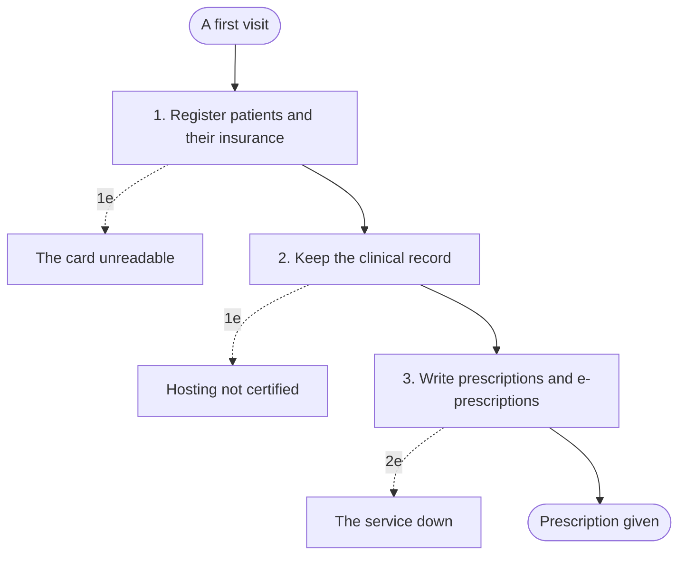

🏠 [Specs](../../../README.md) › 🏷️ [Sectors](../../README.md) › 🩺 [SC09 Health practices](../README.md) ›
🔀 [Flows](README.md) › 🔀 FL-SC09-02 Patient file and care

# 🔀 FL-SC09-02 Patient file and care

**Status:** ✅ specified

## Summary

The patient's file, the clinical record and prescriptions. It covers
[UC-SC09-03 Register patients and their insurance](../use-cases/02-patient-file-and-care/uc-sc09-03-register-patients-and-their-insurance.md),
[UC-SC09-04 Keep the clinical record](../use-cases/02-patient-file-and-care/uc-sc09-04-keep-the-clinical-record.md),
[UC-SC09-05 Write prescriptions and e-prescriptions](../use-cases/02-patient-file-and-care/uc-sc09-05-write-prescriptions-and-e-prescriptions.md).

## Personas

- [U09 Customer](../../../01-users/personas/u09-customer.md)
- [U13 Owner](../../../01-users/personas/u13-owner.md)
- [U33 Medical secretary](../../../01-users/personas/u33-medical-secretary.md)

## Flowchart

## Sequence diagram

See each use case.

## Steps

| Step | Persona | Screen | Use case | What happens |
|---|---|---|---|---|
| 1 | U33, U09 | [S-SC09-03](../screens/02-patient-file-and-care/s-sc09-03-patient-file.md) | [UC-SC09-03](../use-cases/02-patient-file-and-care/uc-sc09-03-register-patients-and-their-insurance.md) | The medical secretary reads the patient's card, completes identity and complementary insurance, and records consents and objections |
| 2 | U13 | [S-SC09-04](../screens/02-patient-file-and-care/s-sc09-04-clinical-record.md) | [UC-SC09-04](../use-cases/02-patient-file-and-care/uc-sc09-04-keep-the-clinical-record.md) | The practitioner opens the patient's record, writes the consultation, and files documents, the record lives only on certified hosting |
| 3 | U13 | [S-SC09-05](../screens/02-patient-file-and-care/s-sc09-05-prescriptions.md) | [UC-SC09-05](../use-cases/02-patient-file-and-care/uc-sc09-05-write-prescriptions-and-e-prescriptions.md) | The practitioner prescribes through the national e-prescription service, signs, and gives the patient the code |

### Entities and screens

| Entity | States in this flow | Shown at step and screen | Aggregated view |
|---|---|---|---|
| [E-SC09-01 Appointment](../data/e-sc09-01-appointment.md) | Booked, Confirmed, Cancelled, Done, No-show | Shown elsewhere: [S-SC09-01 Agenda](../screens/01-appointments/s-sc09-01-agenda.md) | Appointments |
| [E-SC09-02 Patient](../data/e-sc09-02-patient.md) | Active | 1 [S-SC09-03](../screens/02-patient-file-and-care/s-sc09-03-patient-file.md) | Patients |
| [E-SC09-03 Clinical record entry](../data/e-sc09-03-clinical-record-entry.md) | Recorded | 2 [S-SC09-04](../screens/02-patient-file-and-care/s-sc09-04-clinical-record.md) | Clinical record entries |
| [E-SC09-04 Prescription](../data/e-sc09-04-prescription.md) | Registered, Issued, Signed | 3 [S-SC09-05](../screens/02-patient-file-and-care/s-sc09-05-prescriptions.md) | Prescriptions |

## Errors

- [UC-SC09-03](../use-cases/02-patient-file-and-care/uc-sc09-03-register-patients-and-their-insurance.md) 1e. The card
  unreadable: the identity is typed and flagged.
- [UC-SC09-03](../use-cases/02-patient-file-and-care/uc-sc09-03-register-patients-and-their-insurance.md) 2e. A
  duplicate patient: the secretary merges.
- [UC-SC09-04](../use-cases/02-patient-file-and-care/uc-sc09-04-keep-the-clinical-record.md) 1e. Hosting not certified:
  the record is disabled.
- [UC-SC09-04](../use-cases/02-patient-file-and-care/uc-sc09-04-keep-the-clinical-record.md) 1f. A secretary opening it:
  access is refused and logged ([BR-SC09-03](../business-rules/br-sc09-03-secrecy-by-default.md)).
- [UC-SC09-05](../use-cases/02-patient-file-and-care/uc-sc09-05-write-prescriptions-and-e-prescriptions.md) 2e. The
  service down: a paper prescription is printed.
- [UC-SC09-05](../use-cases/02-patient-file-and-care/uc-sc09-05-write-prescriptions-and-e-prescriptions.md) 1e. An
  allergy matching an item: the practitioner is warned.

## Images

Every step and error, for each persona taking part, in light and dark mode (D120). Steps are numbered as in the Steps
table; E rows are the error cases.

| Step | Persona | Device | Light | Dark |
|---|---|---|---|---|
| 1 | U33 | desktop | [light](../images/02-patient-file-and-care/u33-medical-secretary/1-register-desktop-light.png) | [dark](../images/02-patient-file-and-care/u33-medical-secretary/1-register-desktop-dark.png) |
| 1 | U09 | phone | [light](../images/02-patient-file-and-care/u09-customer/1-register-phone-light.png) | [dark](../images/02-patient-file-and-care/u09-customer/1-register-phone-dark.png) |
| 2 | U13 | desktop | [light](../images/02-patient-file-and-care/u13-owner/2-record-desktop-light.png) | [dark](../images/02-patient-file-and-care/u13-owner/2-record-desktop-dark.png) |
| 2 | U13 | phone | [light](../images/02-patient-file-and-care/u13-owner/2-record-phone-light.png) | [dark](../images/02-patient-file-and-care/u13-owner/2-record-phone-dark.png) |
| 3 | U13 | desktop | [light](../images/02-patient-file-and-care/u13-owner/3-prescription-desktop-light.png) | [dark](../images/02-patient-file-and-care/u13-owner/3-prescription-desktop-dark.png) |
| 3 | U13 | phone | [light](../images/02-patient-file-and-care/u13-owner/3-prescription-phone-light.png) | [dark](../images/02-patient-file-and-care/u13-owner/3-prescription-phone-dark.png) |
| E1 | U13 | desktop | [light](../images/02-patient-file-and-care/u13-owner/e1-hosting-desktop-light.png) | [dark](../images/02-patient-file-and-care/u13-owner/e1-hosting-desktop-dark.png) |
| E1 | U13 | phone | [light](../images/02-patient-file-and-care/u13-owner/e1-hosting-phone-light.png) | [dark](../images/02-patient-file-and-care/u13-owner/e1-hosting-phone-dark.png) |

## Open questions

None.

---

⬅️ [FL-SC09-01 Appointments](fl-sc09-01-appointments.md) · ⬆️ [Up](README.md) ·
➡️ [FL-SC09-03 Insurance billing](fl-sc09-03-insurance-billing.md)
