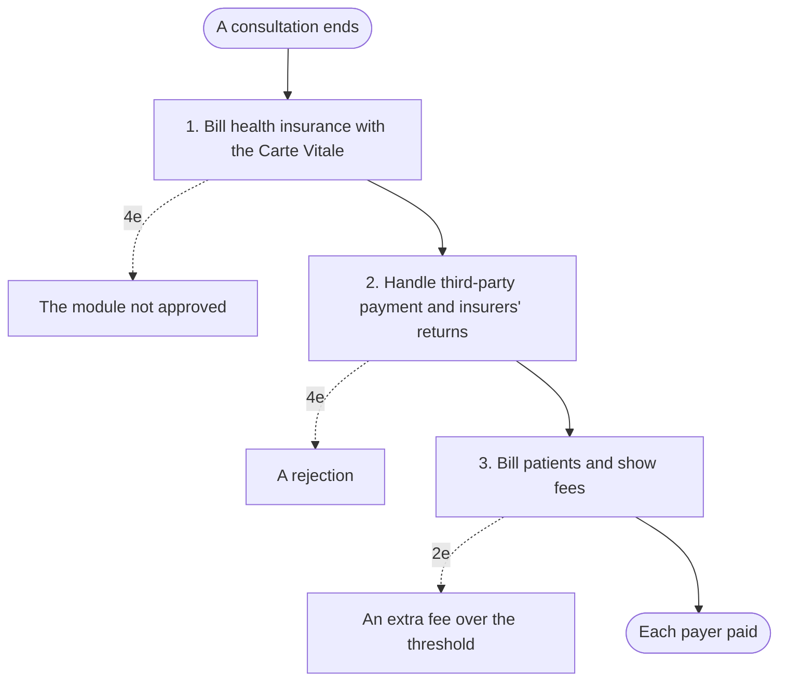

🏠 [Specs](../../../README.md) › 🏷️ [Sectors](../../README.md) › 🩺 [SC09 Health practices](../README.md) ›
🔀 [Flows](README.md) › 🔀 FL-SC09-03 Insurance billing

# 🔀 FL-SC09-03 Insurance billing

**Status:** ✅ specified

## Summary

Billing: care sheets, third-party payment with multi-payer shares, the patient. It covers
[UC-SC09-06 Bill health insurance with the Carte Vitale](../use-cases/03-insurance-billing/uc-sc09-06-bill-health-insurance-with-the-carte-vitale.md),
[UC-SC09-07 Handle third-party payment and insurers' returns](../use-cases/03-insurance-billing/uc-sc09-07-handle-third-party-payment-and-insurers-returns.md),
[UC-SC09-08 Bill patients and show fees](../use-cases/03-insurance-billing/uc-sc09-08-bill-patients-and-show-fees.md).

## Personas

- [U09 Customer](../../../01-users/personas/u09-customer.md)
- [U13 Owner](../../../01-users/personas/u13-owner.md)
- [U33 Medical secretary](../../../01-users/personas/u33-medical-secretary.md)

## Flowchart

## Sequence diagram

See each use case.

## Steps

| Step | Persona | Screen | Use case | What happens |
|---|---|---|---|---|
| 1 | U33, U13 | [S-SC09-06](../screens/03-insurance-billing/s-sc09-06-care-sheets.md) | [UC-SC09-06](../use-cases/03-insurance-billing/uc-sc09-06-bill-health-insurance-with-the-carte-vitale.md) | The medical secretary or practitioner reads the card, codes the acts and sends the electronic care sheet through the approved module |
| 2 | U33 | [S-SC09-07](../screens/03-insurance-billing/s-sc09-07-returns.md) | [UC-SC09-07](../use-cases/03-insurance-billing/uc-sc09-07-handle-third-party-payment-and-insurers-returns.md) | The medical secretary applies third-party payment, so the insurers pay their share through the shared multi-payer invoicing and the patient the rest, then matches the insurers' returns |
| 3 | U33, U09 | [S-SC09-08](../screens/03-insurance-billing/s-sc09-08-patient-billing.md) | [UC-SC09-08](../use-cases/03-insurance-billing/uc-sc09-08-bill-patients-and-show-fees.md) | The centre displays its fees, the medical secretary bills the patient's share, gives an estimate first above the threshold, and issues the receipt |

### Entities and screens

| Entity | States in this flow | Shown at step and screen | Aggregated view |
|---|---|---|---|
| [E-SC09-01 Appointment](../data/e-sc09-01-appointment.md) | Booked, Confirmed, Cancelled, Done, No-show | Shown elsewhere: [S-SC09-01 Agenda](../screens/01-appointments/s-sc09-01-agenda.md) | Appointments |
| [E-SC09-13 Certified module](../data/e-sc09-13-certified-module.md) | Approved | Shown elsewhere: [S-SC09-19 Certifications](../screens/06-compliance-and-certification/s-sc09-19-certifications.md) | Certified modules |
| [E-F6-06 Customer payment](../../../02-functional/f06-customers-and-sales/data/e-f06-06-customer-payment.md) | Matched, Refused | Shown elsewhere: [S-F6-07 Payments and reconciliation](../../../02-functional/f06-customers-and-sales/screens/03-invoice-and-get-paid/s-f06-07-payments-and-reconciliation.md) | Customer payments |
| [E-SC09-06 Insurer return](../data/e-sc09-06-insurer-return.md) | Matched | 2 [S-SC09-07](../screens/03-insurance-billing/s-sc09-07-returns.md) | Insurer returns |
| [E-SC09-02 Patient](../data/e-sc09-02-patient.md) | Active | Shown elsewhere: [S-SC09-03 Patient file](../screens/02-patient-file-and-care/s-sc09-03-patient-file.md) | Patients |
| [E-SC09-07 Patient invoice](../data/e-sc09-07-patient-invoice.md) | Active | 3 [S-SC09-08](../screens/03-insurance-billing/s-sc09-08-patient-billing.md) | Patient invoices |
| [E-SC09-05 Care sheet](../data/e-sc09-05-care-sheet.md) | Signed, Sent, Paid | 1 [S-SC09-06](../screens/03-insurance-billing/s-sc09-06-care-sheets.md); 2 [S-SC09-07](../screens/03-insurance-billing/s-sc09-07-returns.md) | Care sheets |

## Errors

- [UC-SC09-06](../use-cases/03-insurance-billing/uc-sc09-06-bill-health-insurance-with-the-carte-vitale.md) 4e. The
  module not approved: sending is blocked.
- [UC-SC09-06](../use-cases/03-insurance-billing/uc-sc09-06-bill-health-insurance-with-the-carte-vitale.md) 2e. An act
  not in the tariff: it is refused.
- [UC-SC09-07](../use-cases/03-insurance-billing/uc-sc09-07-handle-third-party-payment-and-insurers-returns.md) 4e. A
  rejection: a task is opened for the secretary.
- [UC-SC09-07](../use-cases/03-insurance-billing/uc-sc09-07-handle-third-party-payment-and-insurers-returns.md) 3e. A
  payment not matched: it is listed.
- [UC-SC09-08](../use-cases/03-insurance-billing/uc-sc09-08-bill-patients-and-show-fees.md) 2e. An extra fee over the
  threshold: an estimate is given first.
- [UC-SC09-08](../use-cases/03-insurance-billing/uc-sc09-08-bill-patients-and-show-fees.md) 3e. Payment refused: the
  invoice stays open.

## Images

Every step and error, for each persona taking part, in light and dark mode (D120). Steps are numbered as in the Steps
table; E rows are the error cases.

| Step | Persona | Device | Light | Dark |
|---|---|---|---|---|
| 1 | U33 | desktop | [light](../images/03-insurance-billing/u33-medical-secretary/1-care-sheet-desktop-light.png) | [dark](../images/03-insurance-billing/u33-medical-secretary/1-care-sheet-desktop-dark.png) |
| 1 | U13 | desktop | [light](../images/03-insurance-billing/u13-owner/1-care-sheet-desktop-light.png) | [dark](../images/03-insurance-billing/u13-owner/1-care-sheet-desktop-dark.png) |
| 1 | U13 | phone | [light](../images/03-insurance-billing/u13-owner/1-care-sheet-phone-light.png) | [dark](../images/03-insurance-billing/u13-owner/1-care-sheet-phone-dark.png) |
| 2 | U33 | desktop | [light](../images/03-insurance-billing/u33-medical-secretary/2-returns-desktop-light.png) | [dark](../images/03-insurance-billing/u33-medical-secretary/2-returns-desktop-dark.png) |
| 3 | U33 | desktop | [light](../images/03-insurance-billing/u33-medical-secretary/3-patient-invoice-desktop-light.png) | [dark](../images/03-insurance-billing/u33-medical-secretary/3-patient-invoice-desktop-dark.png) |
| 3 | U09 | phone | [light](../images/03-insurance-billing/u09-customer/3-patient-invoice-phone-light.png) | [dark](../images/03-insurance-billing/u09-customer/3-patient-invoice-phone-dark.png) |
| E1 | U33 | desktop | [light](../images/03-insurance-billing/u33-medical-secretary/e1-estimate-needed-desktop-light.png) | [dark](../images/03-insurance-billing/u33-medical-secretary/e1-estimate-needed-desktop-dark.png) |

## Open questions

None.

---

⬅️ [FL-SC09-02 Patient file and care](fl-sc09-02-patient-file-and-care.md) · ⬆️ [Up](README.md) ·
➡️ [FL-SC09-04 Health exchanges](fl-sc09-04-health-exchanges.md)
