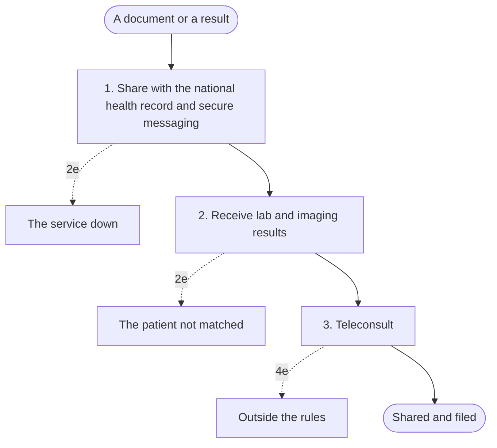

🏠 [Specs](../../../README.md) › 🏷️ [Sectors](../../README.md) › 🩺 [SC09 Health practices](../README.md) ›
🔀 [Flows](README.md) › 🔀 FL-SC09-04 Health exchanges

# 🔀 FL-SC09-04 Health exchanges

**Status:** ✅ specified

## Summary

Exchanges: the national record, results and teleconsultation. It covers
[UC-SC09-09 Share with the national health record and secure messaging](../use-cases/04-health-exchanges/uc-sc09-09-share-with-the-national-health-record-and-secure-messaging.md),
[UC-SC09-10 Receive lab and imaging results](../use-cases/04-health-exchanges/uc-sc09-10-receive-lab-and-imaging-results.md),
[UC-SC09-11 Teleconsult](../use-cases/04-health-exchanges/uc-sc09-11-teleconsult.md).

## Personas

- [U09 Customer](../../../01-users/personas/u09-customer.md)
- [U13 Owner](../../../01-users/personas/u13-owner.md)
- [U33 Medical secretary](../../../01-users/personas/u33-medical-secretary.md)

## Flowchart

## Sequence diagram

See each use case.

## Steps

| Step | Persona | Screen | Use case | What happens |
|---|---|---|---|---|
| 1 | U13 | [S-SC09-09](../screens/04-health-exchanges/s-sc09-09-health-exchanges.md) | [UC-SC09-09](../use-cases/04-health-exchanges/uc-sc09-09-share-with-the-national-health-record-and-secure-messaging.md) | The practitioner files documents to the patient's national record unless they objected, and messages colleagues through secure health messaging |
| 2 | U13, U33 | [S-SC09-10](../screens/04-health-exchanges/s-sc09-10-results.md) | [UC-SC09-10](../use-cases/04-health-exchanges/uc-sc09-10-receive-lab-and-imaging-results.md) | Results arrive from labs, are matched to the patient's record, and the practitioner reads them, abnormal ones are flagged |
| 3 | U13, U09 | [S-SC09-01](../screens/01-appointments/s-sc09-01-agenda.md), [S-SC09-11](../screens/04-health-exchanges/s-sc09-11-teleconsultation.md) | [UC-SC09-11](../use-cases/04-health-exchanges/uc-sc09-11-teleconsult.md) | The patient books a video consultation, the practitioner consults through the shared client video meetings, writes the report and bills within the rules |

### Entities and screens

| Entity | States in this flow | Shown at step and screen | Aggregated view |
|---|---|---|---|
| [E-SC09-08 Health exchange](../data/e-sc09-08-health-exchange.md) | Active | 1 [S-SC09-09](../screens/04-health-exchanges/s-sc09-09-health-exchanges.md); 2 [S-SC09-10](../screens/04-health-exchanges/s-sc09-10-results.md) | Health exchanges |
| [E-SC09-02 Patient](../data/e-sc09-02-patient.md) | Active | Shown elsewhere: [S-SC09-03 Patient file](../screens/02-patient-file-and-care/s-sc09-03-patient-file.md) | Patients |
| [E-F4-16 Client video meeting](../../../02-functional/f04-meetings/data/e-f04-16-client-video-meeting.md) | Planned, Waiting, Live, Ended | Shown elsewhere: [S-F4-21 Client video meeting](../../../02-functional/f04-meetings/screens/12-rooms-and-client-video/s-f04-21-client-video-meeting.md) | Client video meetings |

## Errors

-
  [UC-SC09-09](../use-cases/04-health-exchanges/uc-sc09-09-share-with-the-national-health-record-and-secure-messaging.md)
  2e. The service down: it is retried.
-
  [UC-SC09-09](../use-cases/04-health-exchanges/uc-sc09-09-share-with-the-national-health-record-and-secure-messaging.md)
  3e. A colleague's address unknown: the directory is searched.
- [UC-SC09-10](../use-cases/04-health-exchanges/uc-sc09-10-receive-lab-and-imaging-results.md) 2e. The patient not
  matched: the secretary matches by hand.
- [UC-SC09-10](../use-cases/04-health-exchanges/uc-sc09-10-receive-lab-and-imaging-results.md) 3e. A result unread after
  a day: the practitioner is reminded.
- [UC-SC09-11](../use-cases/04-health-exchanges/uc-sc09-11-teleconsult.md) 4e. Outside the rules: the practitioner is
  warned before billing.
- [UC-SC09-11](../use-cases/04-health-exchanges/uc-sc09-11-teleconsult.md) 2e. The video fails: a phone call follows.

## Images

Every step and error, for each persona taking part, in light and dark mode (D120). Steps are numbered as in the Steps
table; E rows are the error cases.

| Step | Persona | Device | Light | Dark |
|---|---|---|---|---|
| 1 | U13 | desktop | [light](../images/04-health-exchanges/u13-owner/1-national-record-desktop-light.png) | [dark](../images/04-health-exchanges/u13-owner/1-national-record-desktop-dark.png) |
| 1 | U13 | phone | [light](../images/04-health-exchanges/u13-owner/1-national-record-phone-light.png) | [dark](../images/04-health-exchanges/u13-owner/1-national-record-phone-dark.png) |
| 2 | U13 | desktop | [light](../images/04-health-exchanges/u13-owner/2-results-desktop-light.png) | [dark](../images/04-health-exchanges/u13-owner/2-results-desktop-dark.png) |
| 2 | U13 | phone | [light](../images/04-health-exchanges/u13-owner/2-results-phone-light.png) | [dark](../images/04-health-exchanges/u13-owner/2-results-phone-dark.png) |
| 2 | U33 | desktop | [light](../images/04-health-exchanges/u33-medical-secretary/2-results-desktop-light.png) | [dark](../images/04-health-exchanges/u33-medical-secretary/2-results-desktop-dark.png) |
| 3 | U09 | phone | [light](../images/04-health-exchanges/u09-customer/3-teleconsultation-phone-light.png) | [dark](../images/04-health-exchanges/u09-customer/3-teleconsultation-phone-dark.png) |
| 3 | U13 | desktop | [light](../images/04-health-exchanges/u13-owner/3-teleconsultation-desktop-light.png) | [dark](../images/04-health-exchanges/u13-owner/3-teleconsultation-desktop-dark.png) |
| 3 | U13 | phone | [light](../images/04-health-exchanges/u13-owner/3-teleconsultation-phone-light.png) | [dark](../images/04-health-exchanges/u13-owner/3-teleconsultation-phone-dark.png) |
| E1 | U13 | desktop | [light](../images/04-health-exchanges/u13-owner/e1-objection-desktop-light.png) | [dark](../images/04-health-exchanges/u13-owner/e1-objection-desktop-dark.png) |
| E1 | U13 | phone | [light](../images/04-health-exchanges/u13-owner/e1-objection-phone-light.png) | [dark](../images/04-health-exchanges/u13-owner/e1-objection-phone-dark.png) |

## Open questions

None.

---

⬅️ [FL-SC09-03 Insurance billing](fl-sc09-03-insurance-billing.md) · ⬆️ [Up](README.md) ·
➡️ [FL-SC09-05 Practice organisation](fl-sc09-05-practice-organisation.md)
