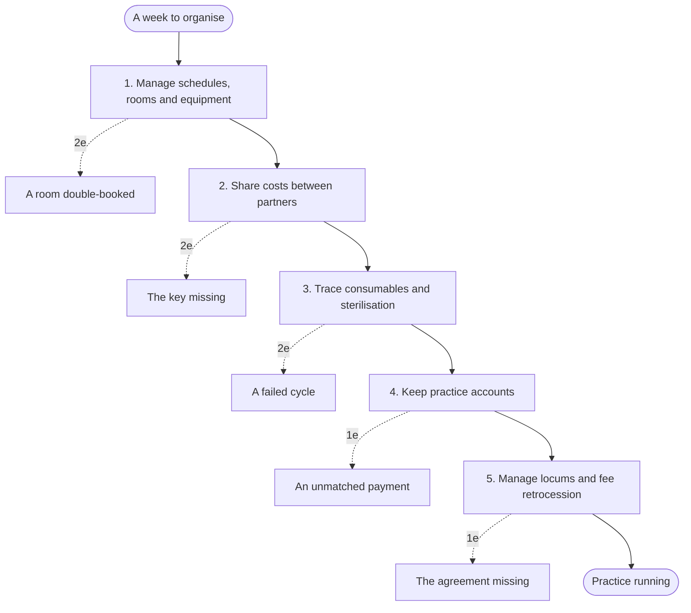

🏠 [Specs](../../../README.md) › 🏷️ [Sectors](../../README.md) › 🩺 [SC09 Health practices](../README.md) ›
🔀 [Flows](README.md) › 🔀 FL-SC09-05 Practice organisation

# 🔀 FL-SC09-05 Practice organisation

**Status:** ✅ specified

## Summary

The practice: schedules and rooms, shared costs, sterilisation, accounts, locums. It covers
[UC-SC09-12 Manage schedules, rooms and equipment](../use-cases/05-practice-organisation/uc-sc09-12-manage-schedules-rooms-and-equipment.md),
[UC-SC09-13 Share costs between partners](../use-cases/05-practice-organisation/uc-sc09-13-share-costs-between-partners.md),
[UC-SC09-14 Trace consumables and sterilisation](../use-cases/05-practice-organisation/uc-sc09-14-trace-consumables-and-sterilisation.md),
[UC-SC09-15 Keep practice accounts](../use-cases/05-practice-organisation/uc-sc09-15-keep-practice-accounts.md),
[UC-SC09-16 Manage locums and fee retrocession](../use-cases/05-practice-organisation/uc-sc09-16-manage-locums-and-fee-retrocession.md).

## Personas

- [U05 Accounting](../../../01-users/personas/u05-accounting.md)
- [U13 Owner](../../../01-users/personas/u13-owner.md)
- [U33 Medical secretary](../../../01-users/personas/u33-medical-secretary.md)

## Flowchart

## Sequence diagram

See each use case.

## Steps

| Step | Persona | Screen | Use case | What happens |
|---|---|---|---|---|
| 1 | U33, U13 | [S-SC09-12](../screens/05-practice-organisation/s-sc09-12-schedules.md) | [UC-SC09-12](../use-cases/05-practice-organisation/uc-sc09-12-manage-schedules-rooms-and-equipment.md) | The medical secretary sets practitioners' schedules and books rooms and equipment on the shared booking engine, then publishes |
| 2 | U13, U05 | [S-SC09-13](../screens/05-practice-organisation/s-sc09-13-cost-sharing.md) | [UC-SC09-13](../use-cases/05-practice-organisation/uc-sc09-13-share-costs-between-partners.md) | Accounting records shared costs, applies the partners' key and calls each partner's share |
| 3 | U33, U13 | [S-SC09-14](../screens/05-practice-organisation/s-sc09-14-sterilisation.md) | [UC-SC09-14](../use-cases/05-practice-organisation/uc-sc09-14-trace-consumables-and-sterilisation.md) | The medical secretary runs and records sterilisation cycles and links instruments to the patients they served |
| 4 | U05, U13 | [S-SC09-15](../screens/05-practice-organisation/s-sc09-15-practice-accounts.md) | [UC-SC09-15](../use-cases/05-practice-organisation/uc-sc09-15-keep-practice-accounts.md) | Accounting imports receipts from insurers and patients, records expenses and closes the year of the liberal practice |
| 5 | U13, U05 | [S-SC09-16](../screens/05-practice-organisation/s-sc09-16-locums.md) | [UC-SC09-16](../use-cases/05-practice-organisation/uc-sc09-16-manage-locums-and-fee-retrocession.md) | A practitioner records a locum's agreement, bills under it and retrocedes the agreed share of fees |

### Entities and screens

| Entity | States in this flow | Shown at step and screen | Aggregated view |
|---|---|---|---|
| [E-SC09-09 Consulting room](../data/e-sc09-09-consulting-room.md) | Active | 1 [S-SC09-12](../screens/05-practice-organisation/s-sc09-12-schedules.md) | Consulting rooms |
| [E-F2-17 Bookable resource setting](../../../02-functional/f02-no-code-configuration/data/e-f02-17-bookable-resource-setting.md) | Draft, Published, Archived | 1 [S-SC09-12](../screens/05-practice-organisation/s-sc09-12-schedules.md) | Bookable resource settings |
| [E-SC09-10 Shared cost](../data/e-sc09-10-shared-cost.md) | Active | 2 [S-SC09-13](../screens/05-practice-organisation/s-sc09-13-cost-sharing.md); 4 [S-SC09-15](../screens/05-practice-organisation/s-sc09-15-practice-accounts.md) | Shared costs |
| [E-F7-06 Item](../../../02-functional/f07-purchasing-and-stock/data/e-f07-06-item.md) | Active | Shown elsewhere: [S-F7-21 Stock levels](../../../02-functional/f07-purchasing-and-stock/screens/03-replenish/s-f07-21-stock-levels.md) | Items |
| [E-SC09-11 Sterilisation cycle](../data/e-sc09-11-sterilisation-cycle.md) | Active | 3 [S-SC09-14](../screens/05-practice-organisation/s-sc09-14-sterilisation.md) | Sterilisation cycles |
| [E-F8-13 Book](../../../02-functional/f08-accounting/data/e-f08-13-book.md) | Refused | Shown elsewhere: [S-F8-15 Books](../../../02-functional/f08-accounting/screens/06-benchmark-additions/s-f08-15-books.md) | Books |
| [E-F6-06 Customer payment](../../../02-functional/f06-customers-and-sales/data/e-f06-06-customer-payment.md) | Refused | Shown elsewhere: [S-F6-07 Payments and reconciliation](../../../02-functional/f06-customers-and-sales/screens/03-invoice-and-get-paid/s-f06-07-payments-and-reconciliation.md) | Customer payments |
| [E-SC09-12 Locum agreement](../data/e-sc09-12-locum-agreement.md) | Active | 5 [S-SC09-16](../screens/05-practice-organisation/s-sc09-16-locums.md) | Locum agreements |

## Errors

- [UC-SC09-12](../use-cases/05-practice-organisation/uc-sc09-12-manage-schedules-rooms-and-equipment.md) 2e. A room
  double-booked: the second booking is refused,
  [BR-F2-18](../../../02-functional/f02-no-code-configuration/business-rules/br-f02-18-one-booking-per-resource-and-slot.md).
- [UC-SC09-12](../use-cases/05-practice-organisation/uc-sc09-12-manage-schedules-rooms-and-equipment.md) 1e. Hours
  outside opening: they are refused.
- [UC-SC09-13](../use-cases/05-practice-organisation/uc-sc09-13-share-costs-between-partners.md) 2e. The key missing:
  costs are held.
- [UC-SC09-13](../use-cases/05-practice-organisation/uc-sc09-13-share-costs-between-partners.md) 4e. A partner not
  paying: a reminder is sent.
- [UC-SC09-14](../use-cases/05-practice-organisation/uc-sc09-14-trace-consumables-and-sterilisation.md) 2e. A failed
  cycle: the instruments are blocked.
- [UC-SC09-14](../use-cases/05-practice-organisation/uc-sc09-14-trace-consumables-and-sterilisation.md) 3e. An
  instrument without cycle: its use is refused.
- [UC-SC09-15](../use-cases/05-practice-organisation/uc-sc09-15-keep-practice-accounts.md) 1e. An unmatched payment: it
  is listed.
- [UC-SC09-15](../use-cases/05-practice-organisation/uc-sc09-15-keep-practice-accounts.md) 3e. A period locked: entries
  go to the next one.
- [UC-SC09-16](../use-cases/05-practice-organisation/uc-sc09-16-manage-locums-and-fee-retrocession.md) 1e. The agreement
  missing: billing is blocked.
- [UC-SC09-16](../use-cases/05-practice-organisation/uc-sc09-16-manage-locums-and-fee-retrocession.md) 3e. A rate
  missing: the computation is held.

## Images

Every step and error, for each persona taking part, in light and dark mode (D120). Steps are numbered as in the Steps
table; E rows are the error cases.

| Step | Persona | Device | Light | Dark |
|---|---|---|---|---|
| 1 | U33 | desktop | [light](../images/05-practice-organisation/u33-medical-secretary/1-schedules-desktop-light.png) | [dark](../images/05-practice-organisation/u33-medical-secretary/1-schedules-desktop-dark.png) |
| 1 | U13 | desktop | [light](../images/05-practice-organisation/u13-owner/1-schedules-desktop-light.png) | [dark](../images/05-practice-organisation/u13-owner/1-schedules-desktop-dark.png) |
| 1 | U13 | phone | [light](../images/05-practice-organisation/u13-owner/1-schedules-phone-light.png) | [dark](../images/05-practice-organisation/u13-owner/1-schedules-phone-dark.png) |
| 2 | U13 | desktop | [light](../images/05-practice-organisation/u13-owner/2-cost-sharing-desktop-light.png) | [dark](../images/05-practice-organisation/u13-owner/2-cost-sharing-desktop-dark.png) |
| 2 | U13 | phone | [light](../images/05-practice-organisation/u13-owner/2-cost-sharing-phone-light.png) | [dark](../images/05-practice-organisation/u13-owner/2-cost-sharing-phone-dark.png) |
| 2 | U05 | desktop | [light](../images/05-practice-organisation/u05-accounting/2-cost-sharing-desktop-light.png) | [dark](../images/05-practice-organisation/u05-accounting/2-cost-sharing-desktop-dark.png) |
| 3 | U33 | desktop | [light](../images/05-practice-organisation/u33-medical-secretary/3-sterilisation-desktop-light.png) | [dark](../images/05-practice-organisation/u33-medical-secretary/3-sterilisation-desktop-dark.png) |
| 3 | U13 | desktop | [light](../images/05-practice-organisation/u13-owner/3-sterilisation-desktop-light.png) | [dark](../images/05-practice-organisation/u13-owner/3-sterilisation-desktop-dark.png) |
| 3 | U13 | phone | [light](../images/05-practice-organisation/u13-owner/3-sterilisation-phone-light.png) | [dark](../images/05-practice-organisation/u13-owner/3-sterilisation-phone-dark.png) |
| 4 | U05 | desktop | [light](../images/05-practice-organisation/u05-accounting/4-accounts-desktop-light.png) | [dark](../images/05-practice-organisation/u05-accounting/4-accounts-desktop-dark.png) |
| 4 | U13 | desktop | [light](../images/05-practice-organisation/u13-owner/4-accounts-desktop-light.png) | [dark](../images/05-practice-organisation/u13-owner/4-accounts-desktop-dark.png) |
| 4 | U13 | phone | [light](../images/05-practice-organisation/u13-owner/4-accounts-phone-light.png) | [dark](../images/05-practice-organisation/u13-owner/4-accounts-phone-dark.png) |
| 5 | U13 | desktop | [light](../images/05-practice-organisation/u13-owner/5-locum-desktop-light.png) | [dark](../images/05-practice-organisation/u13-owner/5-locum-desktop-dark.png) |
| 5 | U13 | phone | [light](../images/05-practice-organisation/u13-owner/5-locum-phone-light.png) | [dark](../images/05-practice-organisation/u13-owner/5-locum-phone-dark.png) |
| 5 | U05 | desktop | [light](../images/05-practice-organisation/u05-accounting/5-locum-desktop-light.png) | [dark](../images/05-practice-organisation/u05-accounting/5-locum-desktop-dark.png) |
| E1 | U13 | desktop | [light](../images/05-practice-organisation/u13-owner/e1-key-missing-desktop-light.png) | [dark](../images/05-practice-organisation/u13-owner/e1-key-missing-desktop-dark.png) |
| E1 | U13 | phone | [light](../images/05-practice-organisation/u13-owner/e1-key-missing-phone-light.png) | [dark](../images/05-practice-organisation/u13-owner/e1-key-missing-phone-dark.png) |

## Open questions

None.

---

⬅️ [FL-SC09-04 Health exchanges](fl-sc09-04-health-exchanges.md) · ⬆️ [Up](README.md) ·
➡️ [FL-SC09-06 Compliance and certification](fl-sc09-06-compliance-and-certification.md)
