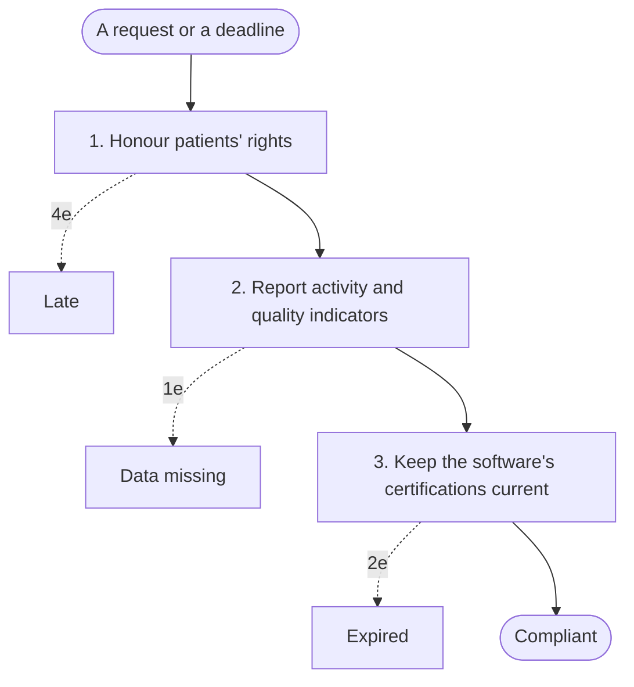

🏠 [Specs](../../../README.md) › 🏷️ [Sectors](../../README.md) › 🩺 [SC09 Health practices](../README.md) ›
🔀 [Flows](README.md) › 🔀 FL-SC09-06 Compliance and certification

# 🔀 FL-SC09-06 Compliance and certification

**Status:** ✅ specified

## Summary

Compliance: patients' rights, indicators and certifications. It covers
[UC-SC09-17 Honour patients' rights](../use-cases/06-compliance-and-certification/uc-sc09-17-honour-patients-rights.md),
[UC-SC09-18 Report activity and quality indicators](../use-cases/06-compliance-and-certification/uc-sc09-18-report-activity-and-quality-indicators.md),
[UC-SC09-19 Keep the software's certifications current](../use-cases/06-compliance-and-certification/uc-sc09-19-keep-the-software-s-certifications-current.md).

## Personas

- [U05 Accounting](../../../01-users/personas/u05-accounting.md)
- [U07 Administrator](../../../01-users/personas/u07-administrator.md)
- [U09 Customer](../../../01-users/personas/u09-customer.md)
- [U11 IT provider administrator](../../../01-users/personas/u11-provider-admin.md)
- [U13 Owner](../../../01-users/personas/u13-owner.md)

## Flowchart

## Sequence diagram

See each use case.

## Steps

| Step | Persona | Screen | Use case | What happens |
|---|---|---|---|---|
| 1 | U13, U09 | [S-SC09-17](../screens/06-compliance-and-certification/s-sc09-17-patients-rights.md) | [UC-SC09-17](../use-cases/06-compliance-and-certification/uc-sc09-17-honour-patients-rights.md) | A practitioner receives a patient's request for their record, prepares it and answers within the legal deadline, keeping consents, secrecy and objections |
| 2 | U13, U05 | [S-SC09-18](../screens/06-compliance-and-certification/s-sc09-18-quality-indicator.md) | [UC-SC09-18](../use-cases/06-compliance-and-certification/uc-sc09-18-report-activity-and-quality-indicators.md) | The practitioner computes activity and quality indicators, reviews and declares them |
| 3 | U11, U07 | [S-SC09-19](../screens/06-compliance-and-certification/s-sc09-19-certifications.md) | [UC-SC09-19](../use-cases/06-compliance-and-certification/uc-sc09-19-keep-the-software-s-certifications-current.md) | The IT provider administrator tracks the certified modules' versions and approvals, renews them, and updates practices, an expired module is disabled |

### Entities and screens

| Entity | States in this flow | Shown at step and screen | Aggregated view |
|---|---|---|---|
| [E-F15-08 Data-subject request](../../../02-functional/f15-legal-assistant/data/e-f15-08-data-subject-request.md) | Received, Verified, Overdue, Answered | Shown elsewhere: [S-F15-10 Privacy and AI register](../../../02-functional/f15-legal-assistant/screens/06-privacy-and-ai-duties/s-f15-10-privacy-and-ai-register.md) | Data-subject requests |
| [E-SC09-02 Patient](../data/e-sc09-02-patient.md) | Active | 1 [S-SC09-17](../screens/06-compliance-and-certification/s-sc09-17-patients-rights.md) | Patients |
| [E-SC09-13 Certified module](../data/e-sc09-13-certified-module.md) | Approved, Certified, Expired | 3 [S-SC09-19](../screens/06-compliance-and-certification/s-sc09-19-certifications.md) | Certified modules |

## Errors

- [UC-SC09-17](../use-cases/06-compliance-and-certification/uc-sc09-17-honour-patients-rights.md) 4e. Late: the
  practitioner is alerted.
- [UC-SC09-17](../use-cases/06-compliance-and-certification/uc-sc09-17-honour-patients-rights.md) 2e. Identity not
  proved: the request waits.
- [UC-SC09-18](../use-cases/06-compliance-and-certification/uc-sc09-18-report-activity-and-quality-indicators.md) 1e.
  Data missing: it is listed.
- [UC-SC09-18](../use-cases/06-compliance-and-certification/uc-sc09-18-report-activity-and-quality-indicators.md) 3e.
  The deadline near: a reminder is sent.
- [UC-SC09-19](../use-cases/06-compliance-and-certification/uc-sc09-19-keep-the-software-s-certifications-current.md)
  2e. Expired: the module is disabled ([BR-SC09-15](../business-rules/br-sc09-15-certifications-kept-current.md)).
- [UC-SC09-19](../use-cases/06-compliance-and-certification/uc-sc09-19-keep-the-software-s-certifications-current.md)
  3e. An update fails: it is rolled back,
  [UC-F14-28](../../../02-functional/f14-plugin-store/use-cases/06-release-channels-and-rollback/uc-f14-28-roll-back-to-the-previous-version.md).

## Images

Every step and error, for each persona taking part, in light and dark mode (D120). Steps are numbered as in the Steps
table; E rows are the error cases.

| Step | Persona | Device | Light | Dark |
|---|---|---|---|---|
| 1 | U13 | desktop | [light](../images/06-compliance-and-certification/u13-owner/1-rights-desktop-light.png) | [dark](../images/06-compliance-and-certification/u13-owner/1-rights-desktop-dark.png) |
| 1 | U13 | phone | [light](../images/06-compliance-and-certification/u13-owner/1-rights-phone-light.png) | [dark](../images/06-compliance-and-certification/u13-owner/1-rights-phone-dark.png) |
| 1 | U09 | phone | [light](../images/06-compliance-and-certification/u09-customer/1-rights-phone-light.png) | [dark](../images/06-compliance-and-certification/u09-customer/1-rights-phone-dark.png) |
| 2 | U13 | desktop | [light](../images/06-compliance-and-certification/u13-owner/2-indicators-desktop-light.png) | [dark](../images/06-compliance-and-certification/u13-owner/2-indicators-desktop-dark.png) |
| 2 | U13 | phone | [light](../images/06-compliance-and-certification/u13-owner/2-indicators-phone-light.png) | [dark](../images/06-compliance-and-certification/u13-owner/2-indicators-phone-dark.png) |
| 2 | U05 | desktop | [light](../images/06-compliance-and-certification/u05-accounting/2-indicators-desktop-light.png) | [dark](../images/06-compliance-and-certification/u05-accounting/2-indicators-desktop-dark.png) |
| 3 | U11 | desktop | [light](../images/06-compliance-and-certification/u11-provider-admin/3-certifications-desktop-light.png) | [dark](../images/06-compliance-and-certification/u11-provider-admin/3-certifications-desktop-dark.png) |
| 3 | U07 | desktop | [light](../images/06-compliance-and-certification/u07-administrator/3-certifications-desktop-light.png) | [dark](../images/06-compliance-and-certification/u07-administrator/3-certifications-desktop-dark.png) |
| E1 | U13 | desktop | [light](../images/06-compliance-and-certification/u13-owner/e1-access-late-desktop-light.png) | [dark](../images/06-compliance-and-certification/u13-owner/e1-access-late-desktop-dark.png) |
| E1 | U13 | phone | [light](../images/06-compliance-and-certification/u13-owner/e1-access-late-phone-light.png) | [dark](../images/06-compliance-and-certification/u13-owner/e1-access-late-phone-dark.png) |

## Open questions

None.

---

⬅️ [FL-SC09-05 Practice organisation](fl-sc09-05-practice-organisation.md) · ⬆️ [Up](README.md) ·
➡️ [FL-SC09-07 Pharmacy, eyewear, vets, dental and health centres](fl-sc09-07-pharmacy-vets-dental-and-centres.md)
