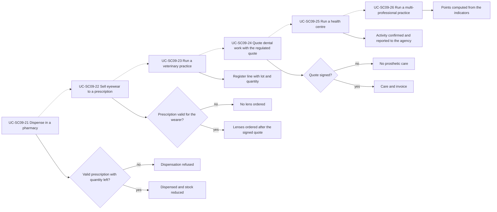
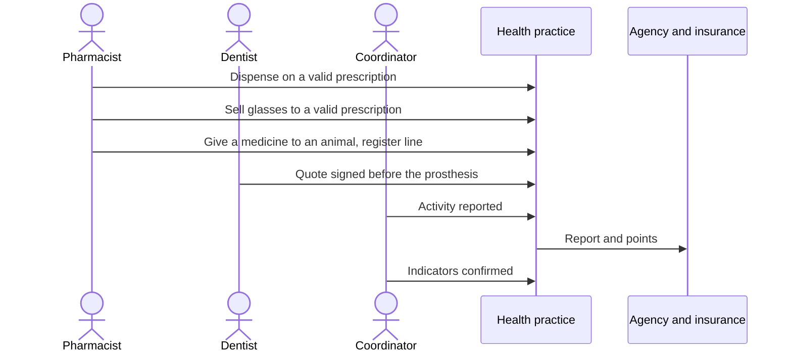

🏠 [Specs](../../../README.md) › 🏷️ [Sectors](../../README.md) › 🩺 [SC09 Health practices](../README.md) ›
🔀 [Flows](README.md) › 🔀 FL-SC09-07 Pharmacy, eyewear, vets, dental and health centres

# 🔀 FL-SC09-07 Pharmacy, eyewear, vets, dental and health centres

**Status:** ✅ specified

## Summary

Six situations of pharmacies, opticians, vets, dentists and health centres that practice suites handle: dispensing
medicines on a prescription, selling glasses to a prescription, running a veterinary practice with its register, quoting
dental work with the regulated quote, reporting a health centre's activity, and following the funding indicators of a
multi-professional practice ([D553](../../../06-decisions/sectors/d553-benchmark-gaps-sc09-health-practices.md)).

## Personas

- [U36 Professional](../../../01-users/personas/u36-professional.md), who dispenses, sells, treats and quotes
- [U17 Cashier](../../../01-users/personas/u17-cashier.md), who takes the patient's share at the counter
- [U33 Medical secretary](../../../01-users/personas/u33-medical-secretary.md), who books, counts and follows the
  indicators
- [U09 Customer](../../../01-users/personas/u09-customer.md), who reads and signs the quote on the phone
- [U13 Owner](../../../01-users/personas/u13-owner.md), who confirms the activity

## Flowchart

## Sequence diagram

## Steps

| Step | Persona | Screen | Use case | What happens |
|---|---|---|---|---|
| 1 | [U36](../../../01-users/personas/u36-professional.md) | [S-SC09-21](../screens/07-pharmacy-vets-dental-and-centres/s-sc09-21-pharmacy.md) | [UC-SC09-21](../use-cases/07-pharmacy-vets-dental-and-centres/uc-sc09-21-dispense-in-a-pharmacy.md) | The pharmacist checks the prescription and dispenses by lot, and the cashier takes the patient's share at the counter |
| 2 | [U36](../../../01-users/personas/u36-professional.md) | [S-SC09-22](../screens/07-pharmacy-vets-dental-and-centres/s-sc09-22-eyewear.md) | [UC-SC09-22](../use-cases/07-pharmacy-vets-dental-and-centres/uc-sc09-22-sell-eyewear-to-a-prescription.md) | The optician checks the prescription's validity, the patient signs the quote and the lenses are ordered |
| 3 | [U36](../../../01-users/personas/u36-professional.md) | [S-SC09-23](../screens/07-pharmacy-vets-dental-and-centres/s-sc09-23-veterinary.md) | [UC-SC09-23](../use-cases/07-pharmacy-vets-dental-and-centres/uc-sc09-23-run-a-veterinary-practice.md) | The vet records the animal and writes each medicine in the register with its lot |
| 4 | [U36](../../../01-users/personas/u36-professional.md) | [S-SC09-24](../screens/07-pharmacy-vets-dental-and-centres/s-sc09-24-dental-quotes.md) | [UC-SC09-24](../use-cases/07-pharmacy-vets-dental-and-centres/uc-sc09-24-quote-dental-work-with-the-regulated-quote.md) | The dentist sends the regulated quote and the patient reads and signs it on the phone before the care |
| 5 | [U33](../../../01-users/personas/u33-medical-secretary.md) | [S-SC09-25](../screens/07-pharmacy-vets-dental-and-centres/s-sc09-25-health-centre.md) | [UC-SC09-25](../use-cases/07-pharmacy-vets-dental-and-centres/uc-sc09-25-run-a-health-centre.md) | The director counts the centre's activity and sends the report to the regional health agency |
| 6 | [U33](../../../01-users/personas/u33-medical-secretary.md) | [S-SC09-26](../screens/07-pharmacy-vets-dental-and-centres/s-sc09-26-msp.md) | [UC-SC09-26](../use-cases/07-pharmacy-vets-dental-and-centres/uc-sc09-26-run-a-multi-professional-practice.md) | The coordinator follows the funding indicators and the points of the year |

### Entities and screens

| Entity | States in this flow | Shown at step and screen | Aggregated view |
|---|---|---|---|
| [E-SC09-14 Dispensation](../data/e-sc09-14-dispensation.md) | Prepared, Dispensed, Refused, Cancelled | 1 [S-SC09-21](../screens/07-pharmacy-vets-dental-and-centres/s-sc09-21-pharmacy.md) | Dispensations |
| [E-SC09-15 Eyewear order](../data/e-sc09-15-eyewear-order.md) | Quoted, Ordered, Delivered, Cancelled | 2 [S-SC09-22](../screens/07-pharmacy-vets-dental-and-centres/s-sc09-22-eyewear.md) | Eyewear orders |
| [E-SC09-16 Animal](../data/e-sc09-16-animal.md) | Active, Closed | 3 [S-SC09-23](../screens/07-pharmacy-vets-dental-and-centres/s-sc09-23-veterinary.md) | Animals |
| [E-SC09-17 Dental quote](../data/e-sc09-17-dental-quote.md) | Draft, Sent, Signed, Completed, Refused | 4 [S-SC09-24](../screens/07-pharmacy-vets-dental-and-centres/s-sc09-24-dental-quotes.md) | Dental quotes |
| [E-SC09-18 Centre activity](../data/e-sc09-18-centre-activity.md) | Draft, Confirmed, Reported | 5 [S-SC09-25](../screens/07-pharmacy-vets-dental-and-centres/s-sc09-25-health-centre.md) | Centre activities |
| [E-SC09-19 ACI indicator](../data/e-sc09-19-aci-indicator.md) | Open, Confirmed, Paid | 6 [S-SC09-26](../screens/07-pharmacy-vets-dental-and-centres/s-sc09-26-msp.md) | Funding indicators |

## Errors

- **E1 There is no valid prescription.** The prescription is missing, ended or has nothing left; the dispensation is
  refused with the reason and nothing leaves the pharmacy
  ([BR-SC09-16](../business-rules/br-sc09-16-prescription-medicines-need-a-valid-prescription.md), step 1).

## Images

Every step and error, for each persona taking part, in light and dark mode (D120). Steps are numbered as in the Steps
table; E rows are the error cases.

| Step | Persona | Device | Light | Dark |
|---|---|---|---|---|
| 1 | U36 | desktop | [light](../images/07-pharmacy-vets-dental-and-centres/u36-professional/1-pharmacy-desktop-light.png) | [dark](../images/07-pharmacy-vets-dental-and-centres/u36-professional/1-pharmacy-desktop-dark.png) |
| 1 | U17 | tablet | [light](../images/07-pharmacy-vets-dental-and-centres/u17-cashier/1-pharmacy-tablet-light.png) | [dark](../images/07-pharmacy-vets-dental-and-centres/u17-cashier/1-pharmacy-tablet-dark.png) |
| 1 | U36 | phone | [light](../images/07-pharmacy-vets-dental-and-centres/u36-professional/1-pharmacy-phone-light.png) | [dark](../images/07-pharmacy-vets-dental-and-centres/u36-professional/1-pharmacy-phone-dark.png) |
| 2 | U36 | desktop | [light](../images/07-pharmacy-vets-dental-and-centres/u36-professional/2-eyewear-desktop-light.png) | [dark](../images/07-pharmacy-vets-dental-and-centres/u36-professional/2-eyewear-desktop-dark.png) |
| 2 | U17 | tablet | [light](../images/07-pharmacy-vets-dental-and-centres/u17-cashier/2-eyewear-tablet-light.png) | [dark](../images/07-pharmacy-vets-dental-and-centres/u17-cashier/2-eyewear-tablet-dark.png) |
| 2 | U36 | phone | [light](../images/07-pharmacy-vets-dental-and-centres/u36-professional/2-eyewear-phone-light.png) | [dark](../images/07-pharmacy-vets-dental-and-centres/u36-professional/2-eyewear-phone-dark.png) |
| 3 | U36 | desktop | [light](../images/07-pharmacy-vets-dental-and-centres/u36-professional/3-veterinary-desktop-light.png) | [dark](../images/07-pharmacy-vets-dental-and-centres/u36-professional/3-veterinary-desktop-dark.png) |
| 3 | U33 | desktop | [light](../images/07-pharmacy-vets-dental-and-centres/u33-medical-secretary/3-veterinary-desktop-light.png) | [dark](../images/07-pharmacy-vets-dental-and-centres/u33-medical-secretary/3-veterinary-desktop-dark.png) |
| 3 | U36 | phone | [light](../images/07-pharmacy-vets-dental-and-centres/u36-professional/3-veterinary-phone-light.png) | [dark](../images/07-pharmacy-vets-dental-and-centres/u36-professional/3-veterinary-phone-dark.png) |
| 4 | U36 | desktop | [light](../images/07-pharmacy-vets-dental-and-centres/u36-professional/4-dental-quotes-desktop-light.png) | [dark](../images/07-pharmacy-vets-dental-and-centres/u36-professional/4-dental-quotes-desktop-dark.png) |
| 4 | U09 | phone | [light](../images/07-pharmacy-vets-dental-and-centres/u09-customer/4-dental-quotes-phone-light.png) | [dark](../images/07-pharmacy-vets-dental-and-centres/u09-customer/4-dental-quotes-phone-dark.png) |
| 4 | U36 | phone | [light](../images/07-pharmacy-vets-dental-and-centres/u36-professional/4-dental-quotes-phone-light.png) | [dark](../images/07-pharmacy-vets-dental-and-centres/u36-professional/4-dental-quotes-phone-dark.png) |
| 5 | U33 | desktop | [light](../images/07-pharmacy-vets-dental-and-centres/u33-medical-secretary/5-health-centre-desktop-light.png) | [dark](../images/07-pharmacy-vets-dental-and-centres/u33-medical-secretary/5-health-centre-desktop-dark.png) |
| 5 | U13 | desktop | [light](../images/07-pharmacy-vets-dental-and-centres/u13-owner/5-health-centre-desktop-light.png) | [dark](../images/07-pharmacy-vets-dental-and-centres/u13-owner/5-health-centre-desktop-dark.png) |
| 6 | U33 | desktop | [light](../images/07-pharmacy-vets-dental-and-centres/u33-medical-secretary/6-msp-desktop-light.png) | [dark](../images/07-pharmacy-vets-dental-and-centres/u33-medical-secretary/6-msp-desktop-dark.png) |
| 6 | U36 | desktop | [light](../images/07-pharmacy-vets-dental-and-centres/u36-professional/6-msp-desktop-light.png) | [dark](../images/07-pharmacy-vets-dental-and-centres/u36-professional/6-msp-desktop-dark.png) |
| E1 | U36 | desktop | [light](../images/07-pharmacy-vets-dental-and-centres/u36-professional/e1-there-is-no-valid-prescription-desktop-light.png) | [dark](../images/07-pharmacy-vets-dental-and-centres/u36-professional/e1-there-is-no-valid-prescription-desktop-dark.png) |
| E1 | U36 | phone | [light](../images/07-pharmacy-vets-dental-and-centres/u36-professional/e1-there-is-no-valid-prescription-phone-light.png) | [dark](../images/07-pharmacy-vets-dental-and-centres/u36-professional/e1-there-is-no-valid-prescription-phone-dark.png) |

## Open questions

None.

---

⬅️ [FL-SC09-06 Compliance and certification](fl-sc09-06-compliance-and-certification.md) · ⬆️ [Up](README.md)
