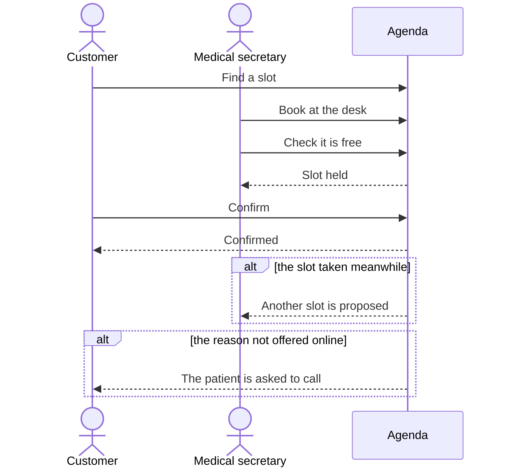

🏠 [Specs](../../../../README.md) › 🏷️ [Sectors](../../../README.md) › 🩺 [SC09 Health practices](../../README.md) ›
📝 [Use cases](../README.md) › 📝 [Use cases: FL-SC09-01 Appointments](README.md) ›
📝 UC-SC09-01 Book appointments online and at the desk

# 📝 UC-SC09-01 Book appointments online and at the desk

**Status:** ✅ specified

## Summary

Patients book online and the medical secretary books by phone or at the desk, on the shared booking engine where
practitioners and rooms are bookable resources.

## Personas

- [U33 Medical secretary](../../../../01-users/personas/u33-medical-secretary.md)
- [U09 Customer](../../../../01-users/personas/u09-customer.md)

## Goal

Appointments booked without double booking, from any channel.

## Trigger

A patient asks for an appointment.

## Frequency

About 120 a day in the example centre.

## Preconditions

- The SC09 sector pack is installed for the company,
  [UC-F14-02](../../../../02-functional/f14-plugin-store/use-cases/01-find-and-install/uc-f14-02-install-a-plugin-or-sector-pack.md),
  and its users have their roles,
  [UC-F1-06](../../../../02-functional/f01-administration/use-cases/04-edit-a-role/uc-f01-06-edit-a-role-and-its-record-rules.md).
- Practitioners and rooms are bookable resources with their hours,
  [UC-F2-18](../../../../02-functional/f02-no-code-configuration/use-cases/08-views-and-bookings/uc-f02-18-make-a-record-type-bookable.md).

## Postconditions

- **Success:** the appointment is booked and confirmed to the patient.
- **Failed:** no slot is booked; the patient is offered the waiting list.

## Main flow

1. The patient searches the booking page on [S-SC09-01 Agenda](../../screens/01-appointments/s-sc09-01-agenda.md) by
   practitioner and reason,
   [UC-F2-19](../../../../02-functional/f02-no-code-configuration/use-cases/08-views-and-bookings/uc-f02-19-book-a-resource.md).
2. Or the medical secretary books by phone or at the desk.
3. The booking engine checks the practitioner and the room are free,
   [BR-F2-18](../../../../02-functional/f02-no-code-configuration/business-rules/br-f02-18-one-booking-per-resource-and-slot.md).
4. The patient gets the confirmation.

## Alternative flows

- 1a. An urgent slot: the secretary uses a slot kept for urgent care.

## Error flows

- 3e. The slot taken meanwhile: another slot is proposed.
- 1e. The reason not offered online: the patient is asked to call.
- Any step: a call to a service or an outside system fails: it is retried first
  ([BR-F3-32](../../../../02-functional/f03-assistant/business-rules/br-f03-32-retry-before-an-error.md)), then the
  error message pattern ([D122](../../../../06-decisions/ux/d122-error-message-standard.md)) says what failed; what was
  typed is kept.

## Business rules

- [BR-SC09-03 Secrecy by default](../../business-rules/br-sc09-03-secrecy-by-default.md)
- [BR-F2-18 One booking per resource and slot](../../../../02-functional/f02-no-code-configuration/business-rules/br-f02-18-one-booking-per-resource-and-slot.md)
- [BR-F2-19 Booking rules decide who books what and when](../../../../02-functional/f02-no-code-configuration/business-rules/br-f02-19-booking-rules-decide-who-books-what-and-when.md)

## Entities

- [E-SC09-01 Appointment](../../data/e-sc09-01-appointment.md)
- [E-F2-18 Resource booking](../../../../02-functional/f02-no-code-configuration/data/e-f02-18-resource-booking.md)

## Permissions

The medical secretary and customer roles; the record rules of their role and site apply,
[UC-F1-06](../../../../02-functional/f01-administration/use-cases/04-edit-a-role/uc-f01-06-edit-a-role-and-its-record-rules.md).

## Notifications

- The patient gets the confirmation by SMS or email, with consent.

## Audit events

Every creation, change and state change of appointment, booking records, with who, when and the values before and after
(T3).

## AI involvement

The AI assistant answers questions on the appointment, booking records of this use case, with links, and prepares them
as drafts the user confirms. It works within the user's rights,
[BR-F3-34](../../../../02-functional/f03-assistant/business-rules/br-f03-34-every-capability-is-reachable-from-the-assistant.md),
and never deletes or does anything irreversible without the user's confirmation,
[BR-F3-07](../../../../02-functional/f03-assistant/business-rules/br-f03-07-no-deletes-no-irreversible-acts.md).

## API, MCP and A2A exposure

Through the API and webhooks (T5) and the MCP and A2A gateway (T6), with the caller's rights,
[BR-F3-34](../../../../02-functional/f03-assistant/business-rules/br-f03-34-every-capability-is-reachable-from-the-assistant.md),
reading, creating and changing the records of this use case; nothing irreversible without a person's confirmation.

## Screens

- [S-SC09-01 Agenda](../../screens/01-appointments/s-sc09-01-agenda.md)

## Flowchart

See [FL-SC09-01 Appointments](../../flows/fl-sc09-01-appointments.md#flowchart).

## Sequence diagram

## Acceptance criteria

1. **Given** the example health centre's Dr B. free on Monday at 09:00 in room 2 **when** J. Martin books online
   **then** the appointment is confirmed and the slot closed on every channel.
2. **Given** Dr B. on Monday at 09:00 taken a second earlier **when** J. Martin books it **then** another slot is
   proposed.

## Non-functional notes

[D408](../../../../06-decisions/technical/d408-performance-and-profiles.md)'s targets
([performance](../../../../05-non-functional/performance.md)): 95 % of screens within 1 second; lists paged on the
server, the first page within 1 second; reports within 5 seconds or in the background. WCAG 2.2 AA and RGAA
([D46](../../../../06-decisions/ux/d46-accessibility-standard.md)).

## Regulatory references

None specific to this use case; the sector's legal rules are listed in [SC09 regulatory](../../regulatory.md).

## Related use cases

- [UC-SC09-02 Remind patients and handle no-shows](uc-sc09-02-remind-patients-and-handle-no-shows.md)

## Open questions

None.

---

⬆️ [Up](README.md) ·
➡️ [UC-SC09-02 Remind patients and handle no-shows](uc-sc09-02-remind-patients-and-handle-no-shows.md)
