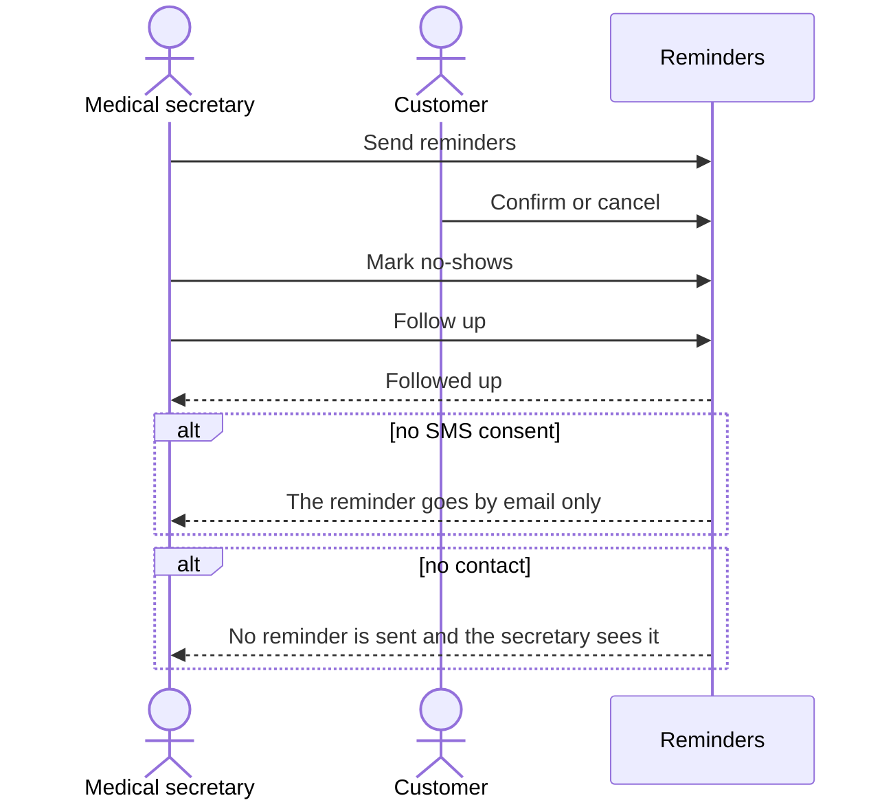

🏠 [Specs](../../../../README.md) › 🏷️ [Sectors](../../../README.md) › 🩺 [SC09 Health practices](../../README.md) ›
📝 [Use cases](../README.md) › 📝 [Use cases: FL-SC09-01 Appointments](README.md) ›
📝 UC-SC09-02 Remind patients and handle no-shows

# 📝 UC-SC09-02 Remind patients and handle no-shows

**Status:** 🔄 waiting for the owner

## Summary

The medical secretary has reminders sent before appointments, marks no-shows, follows them up, and fills cancellations
from the waiting list.

## Personas

- [U33 Medical secretary](../../../../01-users/personas/u33-medical-secretary.md)
- [U09 Customer](../../../../01-users/personas/u09-customer.md)

## Goal

Fewer no-shows, freed slots reused.

## Trigger

An appointment approaches, or a patient does not come.

## Frequency

Daily.

## Preconditions

- The SC09 sector pack is installed for the company,
  [UC-F14-02](../../../../02-functional/f14-plugin-store/use-cases/01-find-and-install/uc-f14-02-install-a-plugin-or-sector-pack.md),
  and its users have their roles,
  [UC-F1-06](../../../../02-functional/f01-administration/use-cases/04-edit-a-role/uc-f01-06-edit-a-role-and-its-record-rules.md).

## Postconditions

- **Success:** reminders are sent and no-shows recorded.
- **Failed:** the slot stays empty.

## Main flow

1. Reminders go to patients with consent on [S-SC09-02 Reminders](../../screens/01-appointments/s-sc09-02-reminders.md).
2. The patient confirms or cancels from the message.
3. The secretary marks no-shows.
4. The secretary follows up repeated no-shows.

## Alternative flows

- 2a. A cancellation: the waiting list is offered the slot.

## Error flows

- 1e. No SMS consent: the reminder goes by email only.
- 1f. No contact: no reminder is sent and the secretary sees it.
- Any step: a call to a service or an outside system fails: it is retried first
  ([BR-F3-32](../../../../02-functional/f03-assistant/business-rules/br-f03-32-retry-before-an-error.md)), then the
  error message pattern ([D122](../../../../06-decisions/ux/d122-error-message-standard.md)) says what failed; what was
  typed is kept.

## Business rules

- [BR-SC09-03 Secrecy by default](../../business-rules/br-sc09-03-secrecy-by-default.md)

## Entities

- [E-SC09-01 Appointment](../../data/e-sc09-01-appointment.md)

## Permissions

The medical secretary and customer roles; the record rules of their role and site apply,
[UC-F1-06](../../../../02-functional/f01-administration/use-cases/04-edit-a-role/uc-f01-06-edit-a-role-and-its-record-rules.md).

## Notifications

None beyond the in-app updates of the records concerned.

## Audit events

Every creation, change and state change of appointment records, with who, when and the values before and after (T3).

## AI involvement

The AI assistant answers questions on the appointment records of this use case, with links, and prepares them as drafts
the user confirms. It works within the user's rights,
[BR-F3-34](../../../../02-functional/f03-assistant/business-rules/br-f03-34-every-capability-is-reachable-from-the-assistant.md),
and never deletes or does anything irreversible without the user's confirmation,
[BR-F3-07](../../../../02-functional/f03-assistant/business-rules/br-f03-07-no-deletes-no-irreversible-acts.md).

## API, MCP and A2A exposure

Through the API and webhooks (T5) and the MCP and A2A gateway (T6), with the caller's rights,
[BR-F3-34](../../../../02-functional/f03-assistant/business-rules/br-f03-34-every-capability-is-reachable-from-the-assistant.md),
reading, creating and changing the records of this use case; nothing irreversible without a person's confirmation.

## Screens

- [S-SC09-02 Reminders](../../screens/01-appointments/s-sc09-02-reminders.md)

## Flowchart

See [FL-SC09-01 Appointments](../../flows/fl-sc09-01-appointments.md#flowchart).

## Sequence diagram

## Acceptance criteria

1. **Given** the example health centre's J. Martin with an appointment on Monday at 09:00 **when** reminders run
   **then** he gets a reminder ((Proposed) 24 hours before).
2. **Given** J. Martin without SMS consent **when** reminders run **then** the reminder goes by email only.

## Non-functional notes

[D408](../../../../06-decisions/technical/d408-performance-and-profiles.md)'s targets
([performance](../../../../05-non-functional/performance.md)): 95 % of screens within 1 second; lists paged on the
server, the first page within 1 second; reports within 5 seconds or in the background. WCAG 2.2 AA and RGAA
([D46](../../../../06-decisions/ux/d46-accessibility-standard.md)).

## Regulatory references

None specific to this use case; the sector's legal rules are listed in [SC09 regulatory](../../regulatory.md).

## Related use cases

- [UC-SC09-01 Book appointments online and at the desk](uc-sc09-01-book-appointments-online-and-at-the-desk.md)

## Open questions

None open; the items marked (Proposed) wait for the owner in the [waiting list](../../../../09-waiting/README.md).

---

⬅️ [UC-SC09-01 Book appointments online and at the desk](uc-sc09-01-book-appointments-online-and-at-the-desk.md) ·
⬆️ [Up](README.md) · ➡️ [UC-SC09-03](../02-patient-file-and-care/uc-sc09-03-register-patients-and-their-insurance.md)
