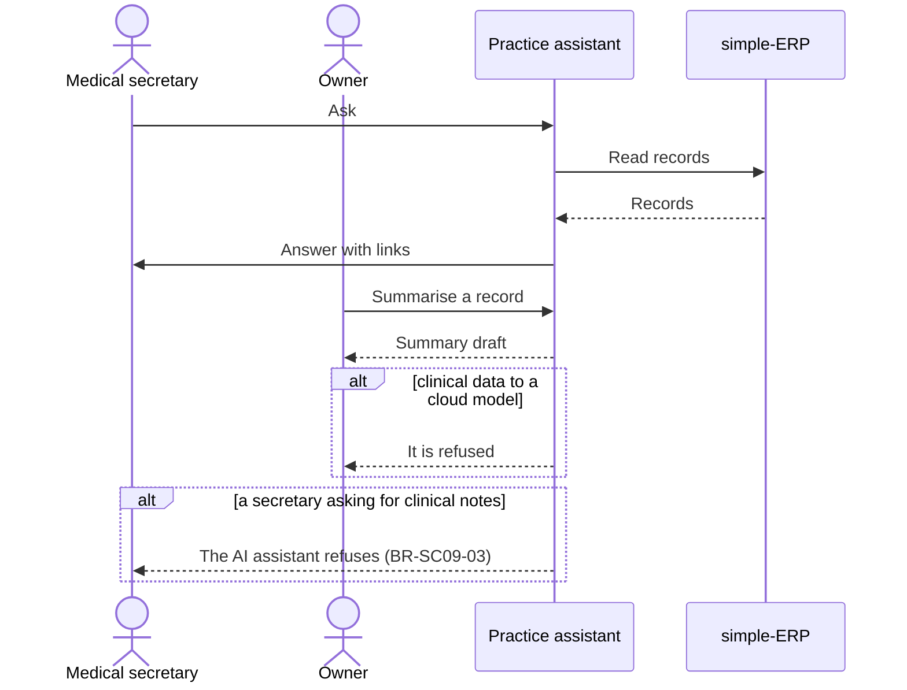

🏠 [Specs](../../../../README.md) › 🏷️ [Sectors](../../../README.md) › 🩺 [SC09 Health practices](../../README.md) ›
📝 [Use cases](../README.md) › 📝 [Use cases: FL-SC09-01 Appointments](README.md) ›
📝 UC-SC09-20 Ask the AI assistant about the practice

# 📝 UC-SC09-20 Ask the AI assistant about the practice

**Status:** ✅ specified

## Summary

The medical secretary or a practitioner asks the AI assistant about free slots, rejections or a patient's next
appointment; clinical content only with local models.

## Personas

- [U33 Medical secretary](../../../../01-users/personas/u33-medical-secretary.md)
- [U13 Owner](../../../../01-users/personas/u13-owner.md)

## Goal

Answers without hunting through screens, secrecy kept.

## Trigger

A question to the AI assistant.

## Frequency

Daily.

## Preconditions

- The SC09 sector pack is installed for the company,
  [UC-F14-02](../../../../02-functional/f14-plugin-store/use-cases/01-find-and-install/uc-f14-02-install-a-plugin-or-sector-pack.md),
  and its users have their roles,
  [UC-F1-06](../../../../02-functional/f01-administration/use-cases/04-edit-a-role/uc-f01-06-edit-a-role-and-its-record-rules.md).

## Postconditions

- **Success:** the answer cites the records, or the draft is confirmed.
- **Failed:** the AI assistant says it cannot answer or act, and why.

## Main flow

1. The secretary asks on [S-SC09-20 Practice assistant](../../screens/01-appointments/s-sc09-20-practice-assistant.md):
   "Which care sheets were rejected this week?".
2. The AI assistant reads billing records within the user's rights.
3. The AI assistant lists them with reasons.
4. A practitioner asks for a record's summary; a local model drafts it
   ([BR-SC09-14](../../business-rules/br-sc09-14-ai-on-health-data-local-and-assisting.md)).

## Alternative flows

- 4a. The practitioner checks the summary: the summary is a draft until the practitioner checks it.

## Error flows

- 4e. Clinical data to a cloud model: it is refused.
- 1e. A secretary asking for clinical notes: the AI assistant refuses
  ([BR-SC09-03](../../business-rules/br-sc09-03-secrecy-by-default.md)).
- Any step: a call to a service or an outside system fails: it is retried first
  ([BR-F3-32](../../../../02-functional/f03-assistant/business-rules/br-f03-32-retry-before-an-error.md)), then the
  error message pattern ([D122](../../../../06-decisions/ux/d122-error-message-standard.md)) says what failed; what was
  typed is kept.

## Business rules

- [BR-SC09-14 AI on health data local and assisting](../../business-rules/br-sc09-14-ai-on-health-data-local-and-assisting.md)
- [BR-SC09-03 Secrecy by default](../../business-rules/br-sc09-03-secrecy-by-default.md)
- [BR-F3-34 All capabilities via the AI assistant](../../../../02-functional/f03-assistant/business-rules/br-f03-34-every-capability-is-reachable-from-the-assistant.md)
- [BR-F3-07 No deletes, no irreversible acts](../../../../02-functional/f03-assistant/business-rules/br-f03-07-no-deletes-no-irreversible-acts.md)

## Entities

- [E-SC09-01 Appointment](../../data/e-sc09-01-appointment.md)
- [E-SC09-03 Clinical record entry](../../data/e-sc09-03-clinical-record-entry.md)

## Permissions

The medical secretary and owner roles; the record rules of their role and site apply,
[UC-F1-06](../../../../02-functional/f01-administration/use-cases/04-edit-a-role/uc-f01-06-edit-a-role-and-its-record-rules.md).

## Notifications

None beyond the in-app updates of the records concerned.

## Audit events

Every creation, change and state change of appointment, clinical record entry records, with who, when and the values
before and after (T3).

## AI involvement

The AI assistant answers questions on the appointment, clinical record entry records of this use case, with links, and
prepares them as drafts the user confirms. It works within the user's rights,
[BR-F3-34](../../../../02-functional/f03-assistant/business-rules/br-f03-34-every-capability-is-reachable-from-the-assistant.md),
and never deletes or does anything irreversible without the user's confirmation,
[BR-F3-07](../../../../02-functional/f03-assistant/business-rules/br-f03-07-no-deletes-no-irreversible-acts.md).

## API, MCP and A2A exposure

Through the API and webhooks (T5) and the MCP and A2A gateway (T6), with the caller's rights,
[BR-F3-34](../../../../02-functional/f03-assistant/business-rules/br-f03-34-every-capability-is-reachable-from-the-assistant.md),
reading, creating and changing the records of this use case; nothing irreversible without a person's confirmation.

## Screens

- [S-SC09-20 Practice assistant](../../screens/01-appointments/s-sc09-20-practice-assistant.md)

## Flowchart

See [FL-SC09-01 Appointments](../../flows/fl-sc09-01-appointments.md#flowchart).

## Sequence diagram

## Acceptance criteria

1. **Given** the example health centre's 2 rejected care sheets this week **when** the secretary asks **then** the
   AI assistant lists the 2.
2. **Given** a centre with only a cloud model **when** a record summary is asked **then** it is refused.

## Non-functional notes

[D408](../../../../06-decisions/technical/d408-performance-and-profiles.md)'s targets
([performance](../../../../05-non-functional/performance.md)): 95 % of screens within 1 second; lists paged on the
server, the first page within 1 second; reports within 5 seconds or in the background. WCAG 2.2 AA and RGAA
([D46](../../../../06-decisions/ux/d46-accessibility-standard.md)).

## Regulatory references

Legal values from the France country pack:
[CR-FR-056 People know they deal with an AI](../../../../10-country-packs/france/ai-and-recording/cr-fr-056-people-know-they-deal-with-an-ai.md).

## Related use cases

- [UC-SC09-07 Handle third-party payment and insurers' returns](../03-insurance-billing/uc-sc09-07-handle-third-party-payment-and-insurers-returns.md)

## Open questions

None.

---

⬅️ [UC-SC09-19](../06-compliance-and-certification/uc-sc09-19-keep-the-software-s-certifications-current.md) ·
⬆️ [Up](README.md) ·
➡️ [UC-SC09-21 Dispense in a pharmacy](../07-pharmacy-vets-dental-and-centres/uc-sc09-21-dispense-in-a-pharmacy.md)
