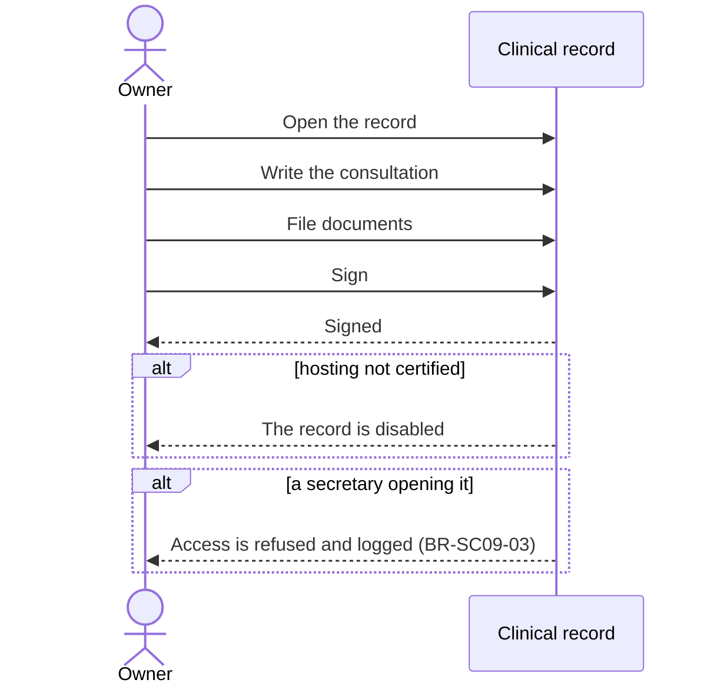

🏠 [Specs](../../../../README.md) › 🏷️ [Sectors](../../../README.md) › 🩺 [SC09 Health practices](../../README.md) ›
📝 [Use cases](../README.md) › 📝 [Use cases: FL-SC09-02 Patient file and care](README.md) ›
📝 UC-SC09-04 Keep the clinical record

# 📝 UC-SC09-04 Keep the clinical record

**Status:** ✅ specified

## Summary

The practitioner opens the patient's record, writes the consultation, and files documents; the record lives only on
certified hosting.

## Personas

- [U13 Owner](../../../../01-users/personas/u13-owner.md)

## Goal

A complete clinical record seen only by the care team.

## Trigger

A consultation.

## Frequency

Per consultation.

## Preconditions

- The SC09 sector pack is installed for the company,
  [UC-F14-02](../../../../02-functional/f14-plugin-store/use-cases/01-find-and-install/uc-f14-02-install-a-plugin-or-sector-pack.md),
  and its users have their roles,
  [UC-F1-06](../../../../02-functional/f01-administration/use-cases/04-edit-a-role/uc-f01-06-edit-a-role-and-its-record-rules.md).
- The company has certified health-data hosting
  ([BR-SC09-02](../../business-rules/br-sc09-02-health-data-only-on-certified-hosting.md)).

## Postconditions

- **Success:** the consultation is in the record.
- **Failed:** the record is disabled.

## Main flow

1. The practitioner opens the record on
   [S-SC09-04 Clinical record](../../screens/02-patient-file-and-care/s-sc09-04-clinical-record.md).
2. The practitioner writes notes, allergies and history.
3. Documents are filed.
4. The entry is signed and locked.

## Alternative flows

- 2a. Templates by specialty: the practitioner starts from a template.

## Error flows

- 1e. Hosting not certified: the record is disabled.
- 1f. A secretary opening it: access is refused and logged
  ([BR-SC09-03](../../business-rules/br-sc09-03-secrecy-by-default.md)).
- Any step: a call to a service or an outside system fails: it is retried first
  ([BR-F3-32](../../../../02-functional/f03-assistant/business-rules/br-f03-32-retry-before-an-error.md)), then the
  error message pattern ([D122](../../../../06-decisions/ux/d122-error-message-standard.md)) says what failed; what was
  typed is kept.

## Business rules

- [BR-SC09-02 Health data only on certified hosting](../../business-rules/br-sc09-02-health-data-only-on-certified-hosting.md)
- [BR-SC09-03 Secrecy by default](../../business-rules/br-sc09-03-secrecy-by-default.md)

## Entities

- [E-SC09-03 Clinical record entry](../../data/e-sc09-03-clinical-record-entry.md)

## Permissions

The owner roles; the record rules of their role and site apply,
[UC-F1-06](../../../../02-functional/f01-administration/use-cases/04-edit-a-role/uc-f01-06-edit-a-role-and-its-record-rules.md).

## Notifications

None beyond the in-app updates of the records concerned.

## Audit events

Every creation, change and state change of clinical record entry records, with who, when and the values before and after
(T3).

## AI involvement

The AI assistant answers questions on the clinical record entry records of this use case, with links, and prepares them
as drafts the user confirms. It works within the user's rights,
[BR-F3-34](../../../../02-functional/f03-assistant/business-rules/br-f03-34-every-capability-is-reachable-from-the-assistant.md),
and never deletes or does anything irreversible without the user's confirmation,
[BR-F3-07](../../../../02-functional/f03-assistant/business-rules/br-f03-07-no-deletes-no-irreversible-acts.md).

## API, MCP and A2A exposure

Through the API and webhooks (T5) and the MCP and A2A gateway (T6), with the caller's rights,
[BR-F3-34](../../../../02-functional/f03-assistant/business-rules/br-f03-34-every-capability-is-reachable-from-the-assistant.md),
reading, creating and changing the records of this use case; nothing irreversible without a person's confirmation.

## Screens

- [S-SC09-04 Clinical record](../../screens/02-patient-file-and-care/s-sc09-04-clinical-record.md)

## Flowchart

See [FL-SC09-02 Patient file and care](../../flows/fl-sc09-02-patient-file-and-care.md#flowchart).

## Sequence diagram

## Acceptance criteria

1. **Given** the example health centre's Dr B. with J. Martin on 12 November **when** the entry is signed **then** it
   shows in J. Martin's record with author and date.
2. **Given** a centre without certified hosting **when** a record is opened **then** the record is disabled.

## Non-functional notes

[D408](../../../../06-decisions/technical/d408-performance-and-profiles.md)'s targets
([performance](../../../../05-non-functional/performance.md)): 95 % of screens within 1 second; lists paged on the
server, the first page within 1 second; reports within 5 seconds or in the background. WCAG 2.2 AA and RGAA
([D46](../../../../06-decisions/ux/d46-accessibility-standard.md)).

## Regulatory references

Legal values from the France country pack:
[CR-FR-055 Health data hosting](../../../../10-country-packs/france/data-protection/cr-fr-055-health-data-hosting.md),
[CR-FR-137 Professional secrecy](../../../../10-country-packs/france/health-practice/cr-fr-137-medical-secrecy.md).

## Related use cases

- [UC-SC09-05 Write prescriptions and e-prescriptions](uc-sc09-05-write-prescriptions-and-e-prescriptions.md)

## Open questions

None.

---

⬅️ [UC-SC09-03 Register patients and their insurance](uc-sc09-03-register-patients-and-their-insurance.md) ·
⬆️ [Up](README.md) ·
➡️ [UC-SC09-05 Write prescriptions and e-prescriptions](uc-sc09-05-write-prescriptions-and-e-prescriptions.md)
