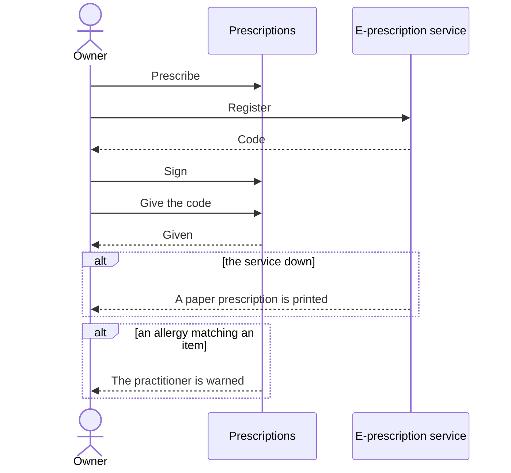

🏠 [Specs](../../../../README.md) › 🏷️ [Sectors](../../../README.md) › 🩺 [SC09 Health practices](../../README.md) ›
📝 [Use cases](../README.md) › 📝 [Use cases: FL-SC09-02 Patient file and care](README.md) ›
📝 UC-SC09-05 Write prescriptions and e-prescriptions

# 📝 UC-SC09-05 Write prescriptions and e-prescriptions

**Status:** ✅ specified

## Summary

The practitioner prescribes through the national e-prescription service, signs, and gives the patient the code.

## Personas

- [U13 Owner](../../../../01-users/personas/u13-owner.md)

## Goal

Prescriptions the pharmacy can read at once.

## Trigger

A consultation needing a prescription.

## Frequency

Many a day.

## Preconditions

- The SC09 sector pack is installed for the company,
  [UC-F14-02](../../../../02-functional/f14-plugin-store/use-cases/01-find-and-install/uc-f14-02-install-a-plugin-or-sector-pack.md),
  and its users have their roles,
  [UC-F1-06](../../../../02-functional/f01-administration/use-cases/04-edit-a-role/uc-f01-06-edit-a-role-and-its-record-rules.md).

## Postconditions

- **Success:** the prescription is registered and given.
- **Failed:** a paper prescription is given.

## Main flow

1. The practitioner writes the items on
   [S-SC09-05 Prescriptions](../../screens/02-patient-file-and-care/s-sc09-05-prescriptions.md).
2. The prescription is registered with the national service
   ([BR-SC09-09](../../business-rules/br-sc09-09-prescriptions-electronic.md)).
3. The practitioner signs.
4. The patient gets the code.

## Alternative flows

- 1a. A renewal: the previous prescription is copied.

## Error flows

- 2e. The service down: a paper prescription is printed.
- 1e. An allergy matching an item: the practitioner is warned.
- Any step: a call to a service or an outside system fails: it is retried first
  ([BR-F3-32](../../../../02-functional/f03-assistant/business-rules/br-f03-32-retry-before-an-error.md)), then the
  error message pattern ([D122](../../../../06-decisions/ux/d122-error-message-standard.md)) says what failed; what was
  typed is kept.

## Business rules

- [BR-SC09-09 Prescriptions electronic](../../business-rules/br-sc09-09-prescriptions-electronic.md)

## Entities

- [E-SC09-04 Prescription](../../data/e-sc09-04-prescription.md)

## Permissions

The owner roles; the record rules of their role and site apply,
[UC-F1-06](../../../../02-functional/f01-administration/use-cases/04-edit-a-role/uc-f01-06-edit-a-role-and-its-record-rules.md).

## Notifications

None beyond the in-app updates of the records concerned.

## Audit events

Every creation, change and state change of prescription records, with who, when and the values before and after (T3).

## AI involvement

The AI assistant answers questions on the prescription records of this use case, with links, and prepares them as drafts
the user confirms. It works within the user's rights,
[BR-F3-34](../../../../02-functional/f03-assistant/business-rules/br-f03-34-every-capability-is-reachable-from-the-assistant.md),
and never deletes or does anything irreversible without the user's confirmation,
[BR-F3-07](../../../../02-functional/f03-assistant/business-rules/br-f03-07-no-deletes-no-irreversible-acts.md).

## API, MCP and A2A exposure

Through the API and webhooks (T5) and the MCP and A2A gateway (T6), with the caller's rights,
[BR-F3-34](../../../../02-functional/f03-assistant/business-rules/br-f03-34-every-capability-is-reachable-from-the-assistant.md),
reading, creating and changing the records of this use case; nothing irreversible without a person's confirmation.

## Screens

- [S-SC09-05 Prescriptions](../../screens/02-patient-file-and-care/s-sc09-05-prescriptions.md)

## Flowchart

See [FL-SC09-02 Patient file and care](../../flows/fl-sc09-02-patient-file-and-care.md#flowchart).

## Sequence diagram

## Acceptance criteria

1. **Given** the example health centre's Dr B. prescribing 2 drugs to J. Martin **when** it is registered **then** the
   prescription shows a QR.
2. **Given** the national service unavailable **when** Dr B. prescribes **then** a paper prescription is printed.

## Non-functional notes

[D408](../../../../06-decisions/technical/d408-performance-and-profiles.md)'s targets
([performance](../../../../05-non-functional/performance.md)): 95 % of screens within 1 second; lists paged on the
server, the first page within 1 second; reports within 5 seconds or in the background. WCAG 2.2 AA and RGAA
([D46](../../../../06-decisions/ux/d46-accessibility-standard.md)).

## Regulatory references

Legal values from the France country pack:
[CR-FR-134 E-prescription](../../../../10-country-packs/france/health-practice/cr-fr-134-e-prescription.md).

## Related use cases

- [UC-SC09-04 Keep the clinical record](uc-sc09-04-keep-the-clinical-record.md)

## Open questions

None.

---

⬅️ [UC-SC09-04 Keep the clinical record](uc-sc09-04-keep-the-clinical-record.md) · ⬆️ [Up](README.md) ·
➡️ [UC-SC09-06](../03-insurance-billing/uc-sc09-06-bill-health-insurance-with-the-carte-vitale.md)
