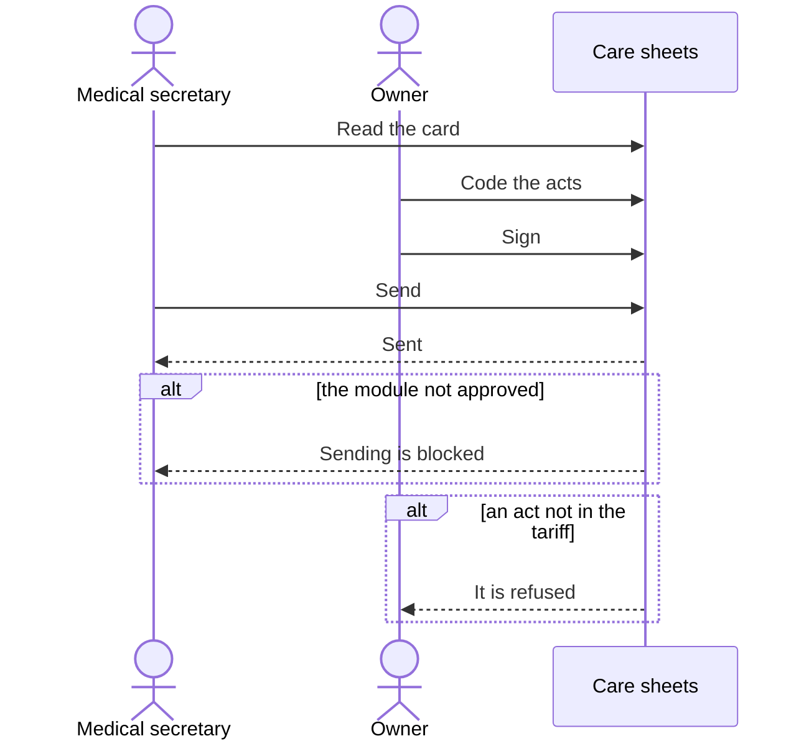

🏠 [Specs](../../../../README.md) › 🏷️ [Sectors](../../../README.md) › 🩺 [SC09 Health practices](../../README.md) ›
📝 [Use cases](../README.md) › 📝 [Use cases: FL-SC09-03 Insurance billing](README.md) ›
📝 UC-SC09-06 Bill health insurance with the Carte Vitale

# 📝 UC-SC09-06 Bill health insurance with the Carte Vitale

**Status:** ✅ specified

## Summary

The medical secretary or practitioner reads the card, codes the acts and sends the electronic care sheet through the
approved module.

## Personas

- [U33 Medical secretary](../../../../01-users/personas/u33-medical-secretary.md)
- [U13 Owner](../../../../01-users/personas/u13-owner.md)

## Goal

Care sheets sent and paid.

## Trigger

A consultation ends.

## Frequency

Per consultation.

## Preconditions

- The SC09 sector pack is installed for the company,
  [UC-F14-02](../../../../02-functional/f14-plugin-store/use-cases/01-find-and-install/uc-f14-02-install-a-plugin-or-sector-pack.md),
  and its users have their roles,
  [UC-F1-06](../../../../02-functional/f01-administration/use-cases/04-edit-a-role/uc-f01-06-edit-a-role-and-its-record-rules.md).

## Postconditions

- **Success:** the care sheet is sent.
- **Failed:** the care sheet is held.

## Main flow

1. The secretary reads the card on [S-SC09-06 Care sheets](../../screens/03-insurance-billing/s-sc09-06-care-sheets.md).
2. The practitioner codes the acts.
3. The practitioner signs.
4. The care sheet goes through the approved module
   ([BR-SC09-05](../../business-rules/br-sc09-05-care-sheets-through-the-approved-module.md)).

## Alternative flows

- 1a. Degraded mode without card: the sheet is sent with the paper proof later.

## Error flows

- 4e. The module not approved: sending is blocked.
- 2e. An act not in the tariff: it is refused.
- Any step: a call to a service or an outside system fails: it is retried first
  ([BR-F3-32](../../../../02-functional/f03-assistant/business-rules/br-f03-32-retry-before-an-error.md)), then the
  error message pattern ([D122](../../../../06-decisions/ux/d122-error-message-standard.md)) says what failed; what was
  typed is kept.

## Business rules

- [BR-SC09-05 Care sheets through the approved module](../../business-rules/br-sc09-05-care-sheets-through-the-approved-module.md)

## Entities

- [E-SC09-05 Care sheet](../../data/e-sc09-05-care-sheet.md)

## Permissions

The medical secretary and owner roles; the record rules of their role and site apply,
[UC-F1-06](../../../../02-functional/f01-administration/use-cases/04-edit-a-role/uc-f01-06-edit-a-role-and-its-record-rules.md).

## Notifications

None beyond the in-app updates of the records concerned.

## Audit events

Every creation, change and state change of care sheet records, with who, when and the values before and after (T3).

## AI involvement

The AI assistant answers questions on the care sheet records of this use case, with links, and prepares them as drafts
the user confirms. It works within the user's rights,
[BR-F3-34](../../../../02-functional/f03-assistant/business-rules/br-f03-34-every-capability-is-reachable-from-the-assistant.md),
and never deletes or does anything irreversible without the user's confirmation,
[BR-F3-07](../../../../02-functional/f03-assistant/business-rules/br-f03-07-no-deletes-no-irreversible-acts.md).

## API, MCP and A2A exposure

Through the API and webhooks (T5) and the MCP and A2A gateway (T6), with the caller's rights,
[BR-F3-34](../../../../02-functional/f03-assistant/business-rules/br-f03-34-every-capability-is-reachable-from-the-assistant.md),
reading, creating and changing the records of this use case; nothing irreversible without a person's confirmation.

## Screens

- [S-SC09-06 Care sheets](../../screens/03-insurance-billing/s-sc09-06-care-sheets.md)

## Flowchart

See [FL-SC09-03 Insurance billing](../../flows/fl-sc09-03-insurance-billing.md#flowchart).

## Sequence diagram

## Acceptance criteria

1. **Given** the example health centre's consultation for J. Martin at 30 EUR **when** the sheet is sent **then**
   CS-4471 shows sent.
2. **Given** a module whose approval expired **when** a sheet is sent **then** sending is blocked.

## Non-functional notes

[D408](../../../../06-decisions/technical/d408-performance-and-profiles.md)'s targets
([performance](../../../../05-non-functional/performance.md)): 95 % of screens within 1 second; lists paged on the
server, the first page within 1 second; reports within 5 seconds or in the background. WCAG 2.2 AA and RGAA
([D46](../../../../06-decisions/ux/d46-accessibility-standard.md)).

## Regulatory references

Legal values from the France country pack:
[CR-FR-132 SESAM-Vitale approval of billing software](../../../../10-country-packs/france/health-practice/cr-fr-132-sesam-vitale-approval.md).

## Related use cases

- [UC-SC09-07 Handle third-party payment and insurers' returns](uc-sc09-07-handle-third-party-payment-and-insurers-returns.md)

## Open questions

None.

---

⬅️ [UC-SC09-05](../02-patient-file-and-care/uc-sc09-05-write-prescriptions-and-e-prescriptions.md) ·
⬆️ [Up](README.md) · ➡️ [UC-SC09-07](uc-sc09-07-handle-third-party-payment-and-insurers-returns.md)
