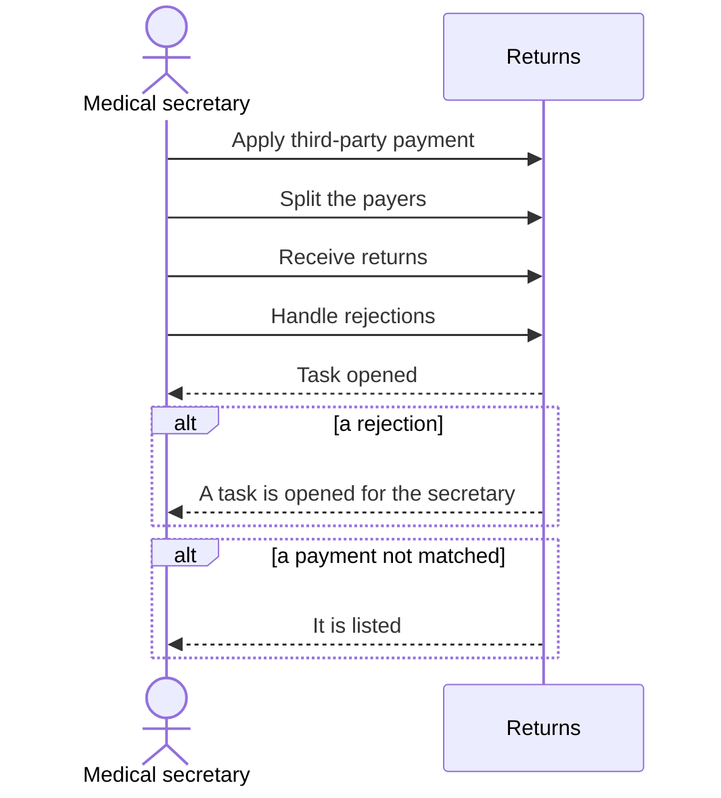

🏠 [Specs](../../../../README.md) › 🏷️ [Sectors](../../../README.md) › 🩺 [SC09 Health practices](../../README.md) ›
📝 [Use cases](../README.md) › 📝 [Use cases: FL-SC09-03 Insurance billing](README.md) ›
📝 UC-SC09-07 Handle third-party payment and insurers' returns

# 📝 UC-SC09-07 Handle third-party payment and insurers' returns

**Status:** ✅ specified

## Summary

The medical secretary applies third-party payment, so the insurers pay their share through the shared multi-payer
invoicing and the patient the rest, then matches the insurers' returns.

## Personas

- [U33 Medical secretary](../../../../01-users/personas/u33-medical-secretary.md)

## Goal

Each payer pays its share; rejections followed.

## Trigger

A care sheet with third-party payment, and insurers' returns.

## Frequency

Daily.

## Preconditions

- The SC09 sector pack is installed for the company,
  [UC-F14-02](../../../../02-functional/f14-plugin-store/use-cases/01-find-and-install/uc-f14-02-install-a-plugin-or-sector-pack.md),
  and its users have their roles,
  [UC-F1-06](../../../../02-functional/f01-administration/use-cases/04-edit-a-role/uc-f01-06-edit-a-role-and-its-record-rules.md).

## Postconditions

- **Success:** returns are matched; rejections become tasks.
- **Failed:** the gap is listed.

## Main flow

1. SimpleERP applies it where due on [S-SC09-07 Returns](../../screens/03-insurance-billing/s-sc09-07-returns.md)
   ([BR-SC09-06](../../business-rules/br-sc09-06-third-party-payment-when-due.md)).
2. The insurer and the complementary insurer each owe their share, the patient the rest,
   [UC-F6-20](../../../../02-functional/f06-customers-and-sales/use-cases/07-special-invoicing/uc-f06-20-invoice-several-payers-with-funders-and-caps.md),
   [BR-F6-13](../../../../02-functional/f06-customers-and-sales/business-rules/br-f06-13-each-payer-pays-its-share-up-to-its-cap.md).
3. Returns are imported and matched ([BR-SC09-07](../../business-rules/br-sc09-07-returns-reconciled.md)).
4. A rejection opens a task.

## Alternative flows

- 2a. A complementary insurer: its share is sent to it as well.

## Error flows

- 4e. A rejection: a task is opened for the secretary.
- 3e. A payment not matched: it is listed.
- Any step: a call to a service or an outside system fails: it is retried first
  ([BR-F3-32](../../../../02-functional/f03-assistant/business-rules/br-f03-32-retry-before-an-error.md)), then the
  error message pattern ([D122](../../../../06-decisions/ux/d122-error-message-standard.md)) says what failed; what was
  typed is kept.

## Business rules

- [BR-SC09-06 Third-party payment when due](../../business-rules/br-sc09-06-third-party-payment-when-due.md)
- [BR-SC09-07 Insurers' returns reconciled](../../business-rules/br-sc09-07-returns-reconciled.md)
- [BR-F6-13 Each payer pays its share up to its cap](../../../../02-functional/f06-customers-and-sales/business-rules/br-f06-13-each-payer-pays-its-share-up-to-its-cap.md)

## Entities

- [E-SC09-05 Care sheet](../../data/e-sc09-05-care-sheet.md)
- [E-SC09-06 Insurer return](../../data/e-sc09-06-insurer-return.md)
- [E-F6-14 Funder agreement](../../../../02-functional/f06-customers-and-sales/data/e-f06-14-funder-agreement.md)

## Permissions

The medical secretary roles; the record rules of their role and site apply,
[UC-F1-06](../../../../02-functional/f01-administration/use-cases/04-edit-a-role/uc-f01-06-edit-a-role-and-its-record-rules.md).

## Notifications

None beyond the in-app updates of the records concerned.

## Audit events

Every creation, change and state change of care sheet, insurer return, funder agreement records, with who, when and the
values before and after (T3).

## AI involvement

The AI assistant answers questions on the care sheet, insurer return, funder agreement records of this use case, with
links, and prepares them as drafts the user confirms. It works within the user's rights,
[BR-F3-34](../../../../02-functional/f03-assistant/business-rules/br-f03-34-every-capability-is-reachable-from-the-assistant.md),
and never deletes or does anything irreversible without the user's confirmation,
[BR-F3-07](../../../../02-functional/f03-assistant/business-rules/br-f03-07-no-deletes-no-irreversible-acts.md).

## API, MCP and A2A exposure

Through the API and webhooks (T5) and the MCP and A2A gateway (T6), with the caller's rights,
[BR-F3-34](../../../../02-functional/f03-assistant/business-rules/br-f03-34-every-capability-is-reachable-from-the-assistant.md),
reading, creating and changing the records of this use case; nothing irreversible without a person's confirmation.

## Screens

- [S-SC09-07 Returns](../../screens/03-insurance-billing/s-sc09-07-returns.md)

## Flowchart

See [FL-SC09-03 Insurance billing](../../flows/fl-sc09-03-insurance-billing.md#flowchart).

## Sequence diagram

## Acceptance criteria

1. **Given** the example health centre's CS-4471 at 30 EUR with third-party payment **when** the CPAM pays 21 EUR
   **then** the return is matched and 9 EUR remain for the complementary insurer or the patient.
2. **Given** CS-4471 rejected by the CPAM **when** the return arrives **then** a task is opened for the secretary.

## Non-functional notes

[D408](../../../../06-decisions/technical/d408-performance-and-profiles.md)'s targets
([performance](../../../../05-non-functional/performance.md)): 95 % of screens within 1 second; lists paged on the
server, the first page within 1 second; reports within 5 seconds or in the background. WCAG 2.2 AA and RGAA
([D46](../../../../06-decisions/ux/d46-accessibility-standard.md)).

## Regulatory references

Legal values from the France country pack:
[CR-FR-133 Third-party payment (tiers payant)](../../../../10-country-packs/france/health-practice/cr-fr-133-third-party-payment.md).

## Related use cases

- [UC-SC09-08 Bill patients and show fees](uc-sc09-08-bill-patients-and-show-fees.md)

## Open questions

None.

---

⬅️ [UC-SC09-06 Bill health insurance with the Carte Vitale](uc-sc09-06-bill-health-insurance-with-the-carte-vitale.md) ·
⬆️ [Up](README.md) · ➡️ [UC-SC09-08 Bill patients and show fees](uc-sc09-08-bill-patients-and-show-fees.md)
