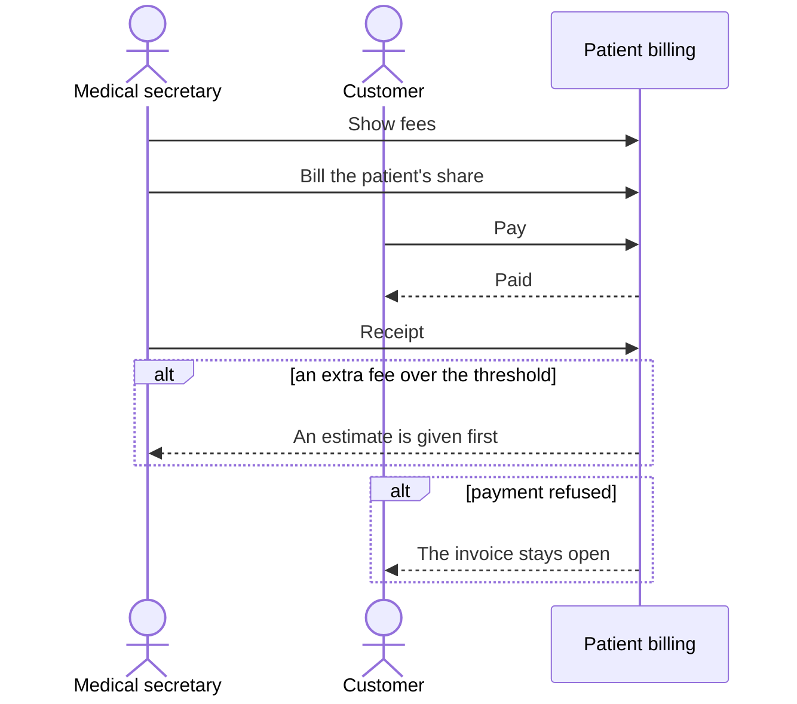

🏠 [Specs](../../../../README.md) › 🏷️ [Sectors](../../../README.md) › 🩺 [SC09 Health practices](../../README.md) ›
📝 [Use cases](../README.md) › 📝 [Use cases: FL-SC09-03 Insurance billing](README.md) ›
📝 UC-SC09-08 Bill patients and show fees

# 📝 UC-SC09-08 Bill patients and show fees

**Status:** ✅ specified

## Summary

The centre displays its fees; the medical secretary bills the patient's share, gives an estimate first above the
threshold, and issues the receipt.

## Personas

- [U33 Medical secretary](../../../../01-users/personas/u33-medical-secretary.md)
- [U09 Customer](../../../../01-users/personas/u09-customer.md)

## Goal

Patients know and pay their share.

## Trigger

A consultation.

## Frequency

Daily.

## Preconditions

- The SC09 sector pack is installed for the company,
  [UC-F14-02](../../../../02-functional/f14-plugin-store/use-cases/01-find-and-install/uc-f14-02-install-a-plugin-or-sector-pack.md),
  and its users have their roles,
  [UC-F1-06](../../../../02-functional/f01-administration/use-cases/04-edit-a-role/uc-f01-06-edit-a-role-and-its-record-rules.md).

## Postconditions

- **Success:** the patient pays and gets a receipt.
- **Failed:** the invoice stays open.

## Main flow

1. Fees are displayed on [S-SC09-08 Patient billing](../../screens/03-insurance-billing/s-sc09-08-patient-billing.md)
   and online ([BR-SC09-04](../../business-rules/br-sc09-04-fees-shown-before-the-act.md)).
2. The secretary bills the patient's share.
3. The patient pays,
   [UC-F6-07](../../../../02-functional/f06-customers-and-sales/use-cases/03-invoice-and-get-paid/uc-f06-07-get-paid-online-and-reconcile.md).
4. The receipt is given.

## Alternative flows

- 3a. Payment by card: the card terminal is used.

## Error flows

- 2e. An extra fee over the threshold: an estimate is given first.
- 3e. Payment refused: the invoice stays open.
- Any step: a call to a service or an outside system fails: it is retried first
  ([BR-F3-32](../../../../02-functional/f03-assistant/business-rules/br-f03-32-retry-before-an-error.md)), then the
  error message pattern ([D122](../../../../06-decisions/ux/d122-error-message-standard.md)) says what failed; what was
  typed is kept.

## Business rules

- [BR-SC09-04 Fees shown before the act](../../business-rules/br-sc09-04-fees-shown-before-the-act.md)

## Entities

- [E-SC09-07 Patient invoice](../../data/e-sc09-07-patient-invoice.md)

## Permissions

The medical secretary and customer roles; the record rules of their role and site apply,
[UC-F1-06](../../../../02-functional/f01-administration/use-cases/04-edit-a-role/uc-f01-06-edit-a-role-and-its-record-rules.md).

## Notifications

None beyond the in-app updates of the records concerned.

## Audit events

Every creation, change and state change of patient invoice records, with who, when and the values before and after (T3).

## AI involvement

The AI assistant answers questions on the patient invoice records of this use case, with links, and prepares them as
drafts the user confirms. It works within the user's rights,
[BR-F3-34](../../../../02-functional/f03-assistant/business-rules/br-f03-34-every-capability-is-reachable-from-the-assistant.md),
and never deletes or does anything irreversible without the user's confirmation,
[BR-F3-07](../../../../02-functional/f03-assistant/business-rules/br-f03-07-no-deletes-no-irreversible-acts.md).

## API, MCP and A2A exposure

Through the API and webhooks (T5) and the MCP and A2A gateway (T6), with the caller's rights,
[BR-F3-34](../../../../02-functional/f03-assistant/business-rules/br-f03-34-every-capability-is-reachable-from-the-assistant.md),
reading, creating and changing the records of this use case; nothing irreversible without a person's confirmation.

## Screens

- [S-SC09-08 Patient billing](../../screens/03-insurance-billing/s-sc09-08-patient-billing.md)

## Flowchart

See [FL-SC09-03 Insurance billing](../../flows/fl-sc09-03-insurance-billing.md#flowchart).

## Sequence diagram

## Acceptance criteria

1. **Given** the example health centre's J. Martin with 30 EUR and no extra fee **when** he pays **then** the receipt
   shows 30 EUR.
2. **Given** an extra fee above the threshold for J. Martin **when** the act is billed **then** an estimate is given
   first.

## Non-functional notes

[D408](../../../../06-decisions/technical/d408-performance-and-profiles.md)'s targets
([performance](../../../../05-non-functional/performance.md)): 95 % of screens within 1 second; lists paged on the
server, the first page within 1 second; reports within 5 seconds or in the background. WCAG 2.2 AA and RGAA
([D46](../../../../06-decisions/ux/d46-accessibility-standard.md)).

## Regulatory references

Legal values from the France country pack:
[CR-FR-130 Display of fees in a practice](../../../../10-country-packs/france/health-practice/cr-fr-130-fee-display.md).

## Related use cases

- [UC-SC09-07 Handle third-party payment and insurers' returns](uc-sc09-07-handle-third-party-payment-and-insurers-returns.md)

## Open questions

None.

---

⬅️ [UC-SC09-07](uc-sc09-07-handle-third-party-payment-and-insurers-returns.md) · ⬆️ [Up](README.md) ·
➡️ [UC-SC09-09](../04-health-exchanges/uc-sc09-09-share-with-the-national-health-record-and-secure-messaging.md)
