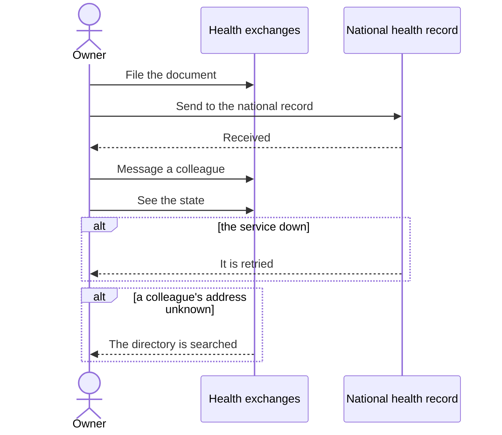

🏠 [Specs](../../../../README.md) › 🏷️ [Sectors](../../../README.md) › 🩺 [SC09 Health practices](../../README.md) ›
📝 [Use cases](../README.md) › 📝 [Use cases: FL-SC09-04 Health exchanges](README.md) ›
📝 UC-SC09-09 Share with the national health record and secure messaging

# 📝 UC-SC09-09 Share with the national health record and secure messaging

**Status:** ✅ specified

## Summary

The practitioner files documents to the patient's national record unless they objected, and messages colleagues through
secure health messaging.

## Personas

- [U13 Owner](../../../../01-users/personas/u13-owner.md)

## Goal

Documents shared as the law asks.

## Trigger

A document to share.

## Frequency

Daily.

## Preconditions

- The SC09 sector pack is installed for the company,
  [UC-F14-02](../../../../02-functional/f14-plugin-store/use-cases/01-find-and-install/uc-f14-02-install-a-plugin-or-sector-pack.md),
  and its users have their roles,
  [UC-F1-06](../../../../02-functional/f01-administration/use-cases/04-edit-a-role/uc-f01-06-edit-a-role-and-its-record-rules.md).

## Postconditions

- **Success:** the document is in the national record or sent.
- **Failed:** the document is not sent and the reason shown.

## Main flow

1. The practitioner files the document on
   [S-SC09-09 Health exchanges](../../screens/04-health-exchanges/s-sc09-09-health-exchanges.md).
2. It is sent unless the patient objected
   ([BR-SC09-08](../../business-rules/br-sc09-08-record-shared-with-the-national-record.md)).
3. The practitioner sends a secure message.
4. The sending state shows on the document.

## Alternative flows

- 2a. The patient objected: nothing is sent.

## Error flows

- 2e. The service down: it is retried.
- 3e. A colleague's address unknown: the directory is searched.
- Any step: a call to a service or an outside system fails: it is retried first
  ([BR-F3-32](../../../../02-functional/f03-assistant/business-rules/br-f03-32-retry-before-an-error.md)), then the
  error message pattern ([D122](../../../../06-decisions/ux/d122-error-message-standard.md)) says what failed; what was
  typed is kept.

## Business rules

- [BR-SC09-08 Record shared with the national record](../../business-rules/br-sc09-08-record-shared-with-the-national-record.md)

## Entities

- [E-SC09-03 Clinical record entry](../../data/e-sc09-03-clinical-record-entry.md)
- [E-SC09-08 Health exchange](../../data/e-sc09-08-health-exchange.md)

## Permissions

The owner roles; the record rules of their role and site apply,
[UC-F1-06](../../../../02-functional/f01-administration/use-cases/04-edit-a-role/uc-f01-06-edit-a-role-and-its-record-rules.md).

## Notifications

None beyond the in-app updates of the records concerned.

## Audit events

Every creation, change and state change of clinical record entry, health exchange records, with who, when and the values
before and after (T3).

## AI involvement

The AI assistant answers questions on the clinical record entry, health exchange records of this use case, with links,
and prepares them as drafts the user confirms. It works within the user's rights,
[BR-F3-34](../../../../02-functional/f03-assistant/business-rules/br-f03-34-every-capability-is-reachable-from-the-assistant.md),
and never deletes or does anything irreversible without the user's confirmation,
[BR-F3-07](../../../../02-functional/f03-assistant/business-rules/br-f03-07-no-deletes-no-irreversible-acts.md).

## API, MCP and A2A exposure

Through the API and webhooks (T5) and the MCP and A2A gateway (T6), with the caller's rights,
[BR-F3-34](../../../../02-functional/f03-assistant/business-rules/br-f03-34-every-capability-is-reachable-from-the-assistant.md),
reading, creating and changing the records of this use case; nothing irreversible without a person's confirmation.

## Screens

- [S-SC09-09 Health exchanges](../../screens/04-health-exchanges/s-sc09-09-health-exchanges.md)

## Flowchart

See [FL-SC09-04 Health exchanges](../../flows/fl-sc09-04-health-exchanges.md#flowchart).

## Sequence diagram

## Acceptance criteria

1. **Given** the example health centre's J. Martin who objected **when** a report is filed **then** nothing goes to his
   national record.
2. **Given** the national record unavailable **when** a document is sent **then** it is retried.

## Non-functional notes

[D408](../../../../06-decisions/technical/d408-performance-and-profiles.md)'s targets
([performance](../../../../05-non-functional/performance.md)): 95 % of screens within 1 second; lists paged on the
server, the first page within 1 second; reports within 5 seconds or in the background. WCAG 2.2 AA and RGAA
([D46](../../../../06-decisions/ux/d46-accessibility-standard.md)).

## Regulatory references

Legal values from the France country pack:
[CR-FR-135 The national health record (Mon espace santé)](../../../../10-country-packs/france/health-practice/cr-fr-135-national-health-record.md),
[CR-FR-136 Ségur software labels and secure health messaging](../../../../10-country-packs/france/health-practice/cr-fr-136-segur-labels.md).

## Related use cases

- [UC-SC09-10 Receive lab and imaging results](uc-sc09-10-receive-lab-and-imaging-results.md)

## Open questions

None.

---

⬅️ [UC-SC09-08 Bill patients and show fees](../03-insurance-billing/uc-sc09-08-bill-patients-and-show-fees.md) ·
⬆️ [Up](README.md) · ➡️ [UC-SC09-10 Receive lab and imaging results](uc-sc09-10-receive-lab-and-imaging-results.md)
